<p align="center">
  
</p>

<p align="center">
  <strong>Dein Samsung Smart TV von 2014 spielt deine Plex-Bibliothek wieder ab – schnell und modern.</strong>
</p>

<p align="center">
  <a href="https://github.com/itsab1989/neolume/releases/latest"></a>
  
  
  <a href="LICENSE"></a>
</p>

<p align="center">
  <strong><a href="https://itsab1989.github.io/neolume/">🌐 Website</a></strong> ·
  <strong><a href="https://github.com/itsab1989/neolume/releases/latest">⬇️ Download</a></strong> ·
  <strong><a href="docs/INSTALL.de.md">📖 Installation</a></strong> ·
  <strong><a href="docs/FAQ.de.md">❓ Fragen</a></strong> ·
  <a href="README.md">English</a>
</p>

**Neolume** ist ein kostenloser, quelloffener und **inoffizieller Client für Plex Media Server** für Samsung-Fernseher von
**2014** (Smart Hub „Orsay“, z. B. H- und HU-Serie). Die offizielle Plex-App dieser Geräte wird nicht mehr gepflegt und kann
sich nicht mehr anmelden, weil der Fernseher nur alte Verschlüsselung beherrscht. Neolume löst das: Ein kleines
Einrichtungsprogramm auf deinem Computer meldet sich **einmal** an, danach spricht der Fernseher **nur noch mit deinem
eigenen Plex Media Server im Heimnetz**.

> [!NOTE]
> **Neolume ist kein Produkt von Plex.** Es ist ein unabhängiges Hobbyprojekt und steht in keiner Verbindung zu Plex, Inc.
> oder Samsung. „Plex“ ist eine Marke von Plex, Inc. Bei Fragen hilft nicht der Plex-Support, sondern ein
> [Issue](https://github.com/itsab1989/neolume/issues) hier im Projekt.

<p align="center">
  <a href="https://ko-fi.com/itsab1989"></a>
  <br>
  <sub>Neolume ist kostenlos und bleibt es. Wenn es deinem alten Fernseher ein zweites Leben schenkt, ist ein Kaffee ein schönes Dankeschön – ganz freiwillig, die App bleibt so oder so vollständig.</sub>
</p>

## Funktionen

- Startet in Sekundenbruchteilen aus dem eigenen Zwischenspeicher; Bedienung mit Fernbedienung **und** Smart-Control-Zeiger.
- Startseite mit Weiterschauen, Nächste Folgen, Neu je Bibliothek, Hintergrundbild und Staffelstreifen; je Profil anpassbar.
  Auf der Serienseite zusätzlich ein Balken für die ganze Serie (beides abschaltbar).
- Bibliotheken mit Raster, Sortieren, Filtern, A–Z; Detailseiten für Filme, Serien, Staffeln, Folgen; Suche.
- Player: Direktwiedergabe oder Umwandlung durch deinen Server (z. B. HEVC), Ton- und Untertitelwahl je Serie,
  Intro/Abspann überspringen, nächste Folge, Kapitel, Sleep-Timer, Vorschaubilder beim Spulen; ⏮ / ⏭ für vorige/nächste
  Folge, Kapitel oder Video; Sprungknöpfe zeigen ihre echte Weite (z. B. -10 / +30). Mit der Smart Control zeigt der
  Fortschrittsbalken die Zeit (und ein Vorschaubild) schon vor dem Klick, und die optionale Feinauswahl macht Sprünge
  in langen Filmen viel genauer.
- Musik und Hörbücher; Plex-Home-Profile, Kinderprofile, eigene App-PIN je Profil.
- Entdecken, Plex-Merkliste und Infos zu Titeln, die nicht auf deinem Server sind, über einen optionalen Helfer im Heimnetz;
  die plex.tv-Reihen schlagen nur Titel vor, die du noch nicht hast (abschaltbar). Der Helfer kann mit dem Computer starten,
  zeigt ein kleines Symbol in der Menüleiste bzw. neben der Uhr und ist mit einem Klick wieder entfernt.
- Bildschirmschoner mit Bildern aus deinen ganzen Bibliotheken, neun Übergängen (oder Zufall) und sechs Einblendungen zur Wahl.
- Optional: Bibliotheken von **Servern, die jemand für dich freigegeben hat** (z. B. ein Freund), mit Herkunft in der Seitenleiste.
- Oberfläche Deutsch und Englisch, Akzentfarbe je Profil wählbar (sieben Farben). Keine Werbung, kein Tracking.
- Gern auch ruhiger: vier Stile für die Uhr auf der Startseite, und Tastenhinweise, die immer zu sehen sind, nach ein paar
  Sekunden ausblenden oder ganz verborgen bleiben (jede Taste erklärt trotzdem Einstellungen › Hilfe & Info › Tastenbelegung).
- Hintergrund in Bibliotheken wählbar: Farbstimmung des gewählten Titels (Standard), sein Bild, ein neues Zufallsbild bei jedem Öffnen oder schlicht.

<p align="center">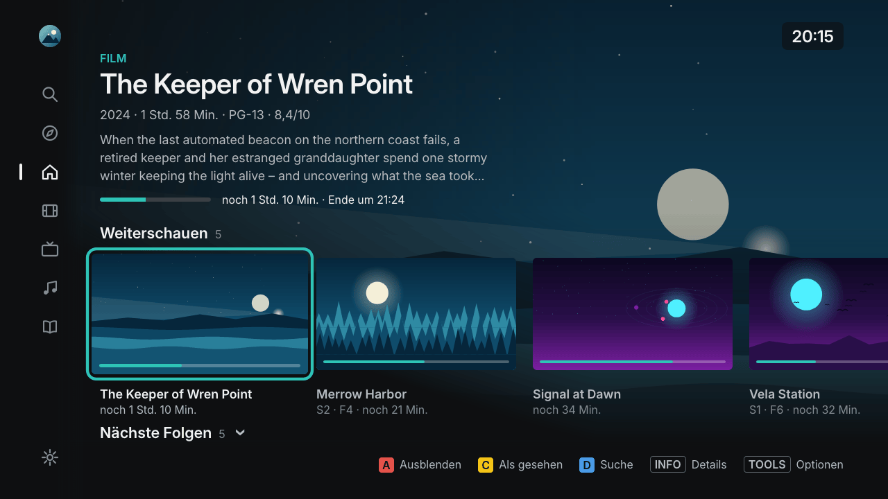</p>

| | |
|---|---|
| 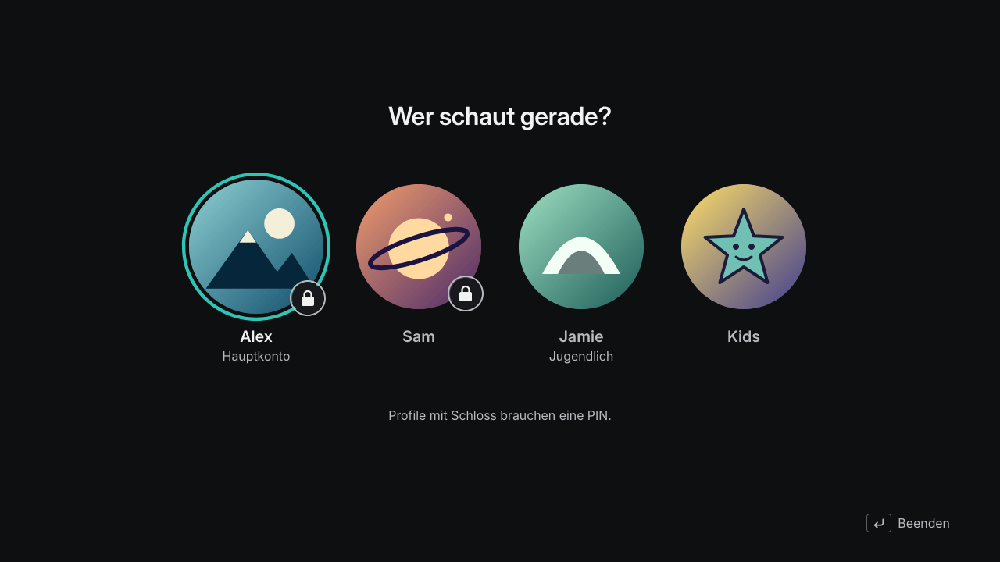 | 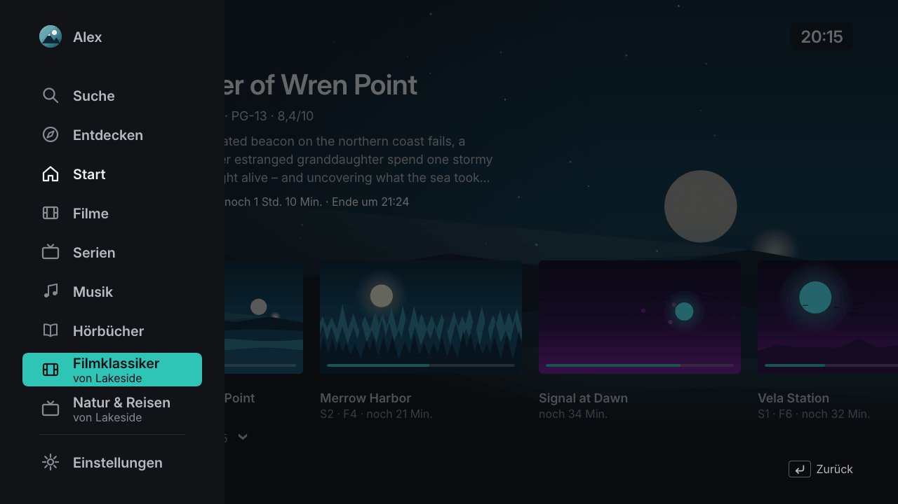 |
| **Profile** – Plex Home, PIN, Kinderprofile | **Seitenleiste** – eigene Bibliotheken und freigegebene von anderen Servern |
| 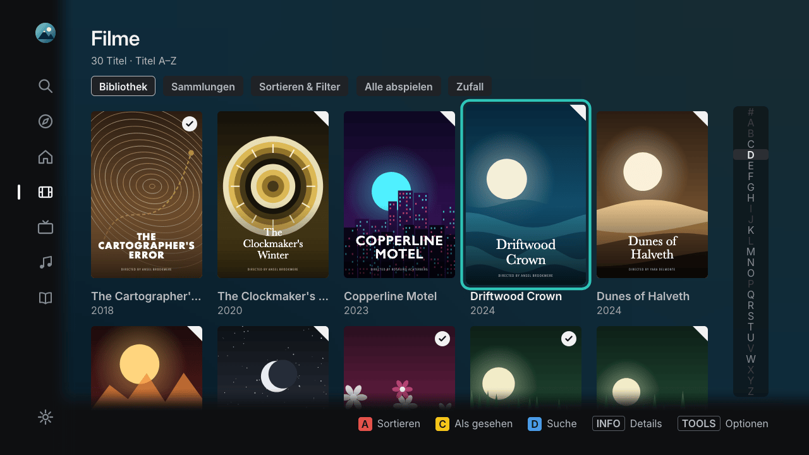 | 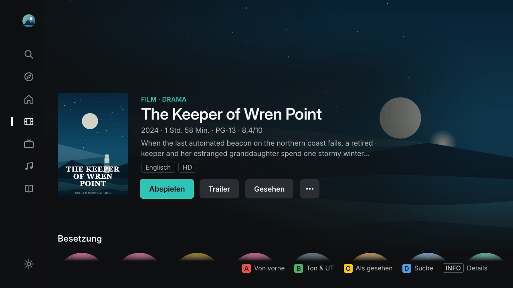 |
| **Bibliothek** – Raster, Sortieren, Filtern, A–Z und Farbstimmung des gewählten Titels | **Details** – alles zu einem Film |
| 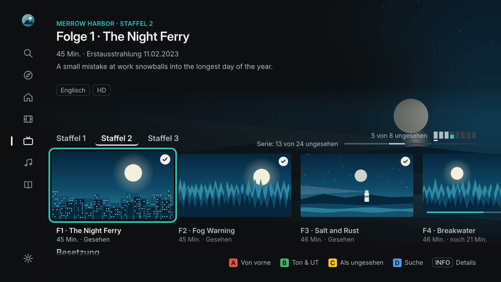 | 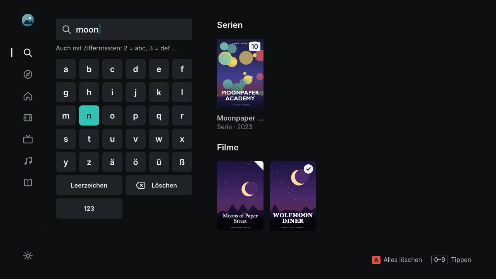 |
| **Serien** – Staffeln, Folgen, Fortschritt | **Suche** – Bildschirmtastatur oder Zifferntasten |
| 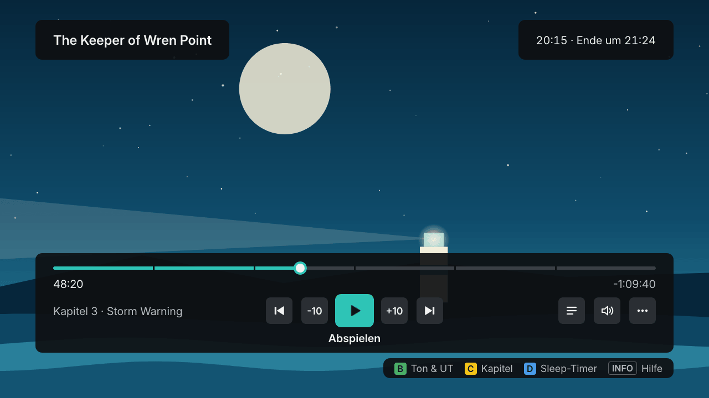 | 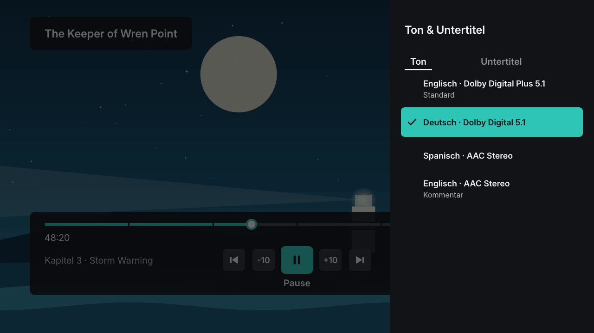 |
| **Player** – neue Bedienleiste, Kapitel, Überspringen, Sleep-Timer | **Ton & Untertitel** – lesbare Spurnamen |
| 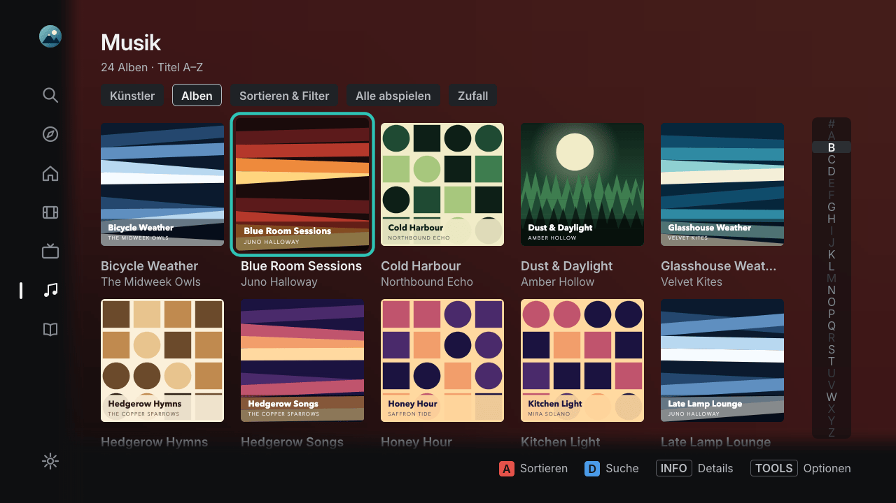 | 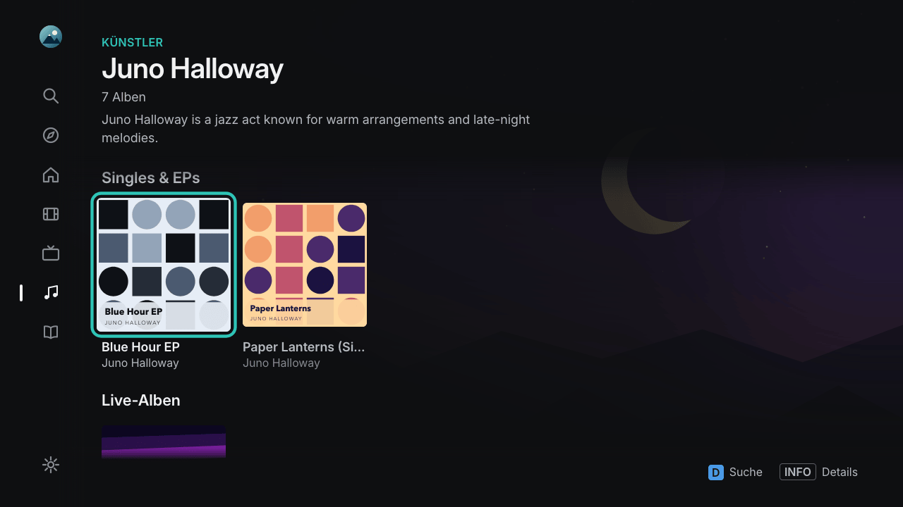 |
| **Musik** – Künstler und Alben | **Künstlerseite** – Alben, Singles & EPs, Live, Soundtracks, Kompilationen |
| 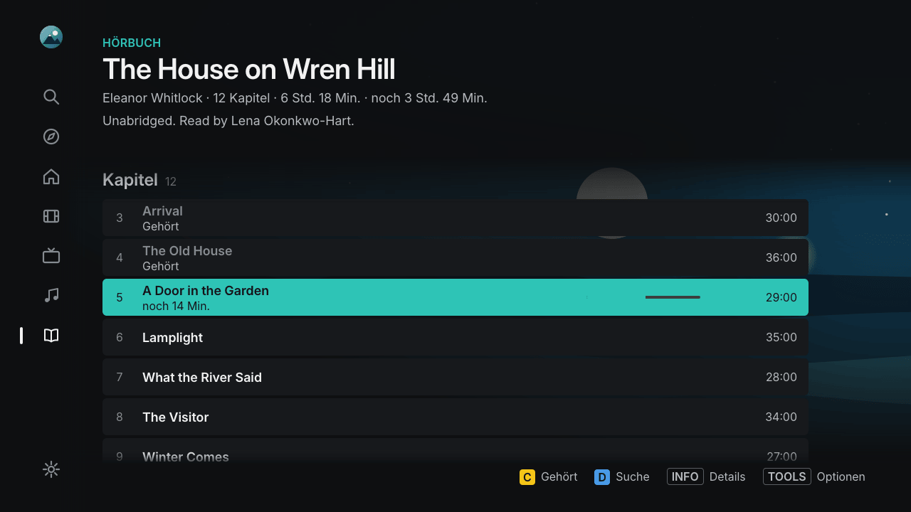 | 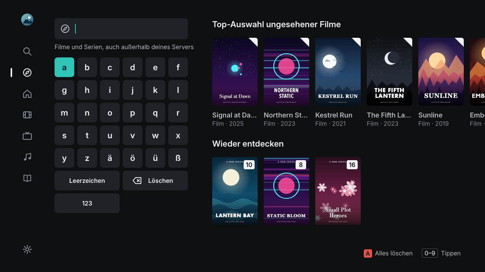 |
| **Hörbücher** – Kapitel und Fortschritt | **Entdecken** – die eigene Mediathek neu entdecken |
| 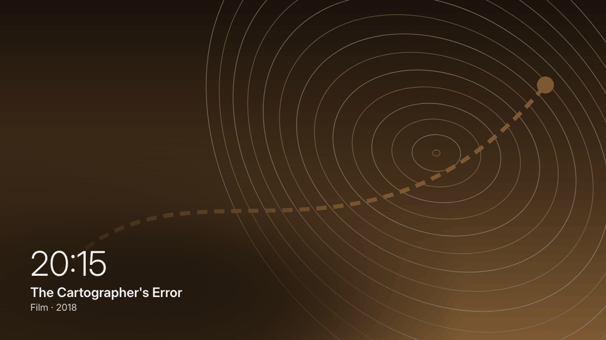 | 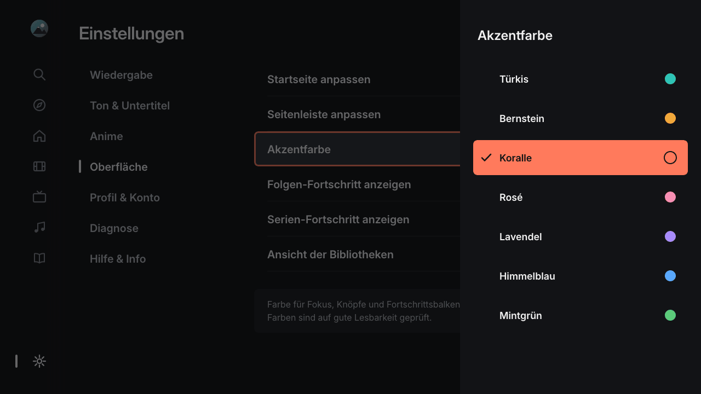 |
| **Bildschirmschoner** – Bilder aus deinen Bibliotheken, neun Übergänge (oder Zufall), sechs Einblendungen | **Akzentfarbe** – sieben Farben, je Profil; alle Einstellungen mit Erklärung |

<sub>Alle Titel, Personen und Bilder in den Bildschirmfotos sind erfundene Beispielinhalte. Englische Oberfläche:
[englische Übersicht](README.md#screenshots).</sub>

## Download

Das Einrichtungsprogramm für deinen Computer gibt es beim **[neuesten Release](https://github.com/itsab1989/neolume/releases/latest)**
(die TV-App ist darin enthalten):

| Computer | Datei |
|---|---|
| Windows 10/11 | `neolume-setup-windows-x64.exe` (ARM-Geräte: `neolume-setup-windows-arm64.exe`) |
| Mac mit Apple-Chip (M1 oder neuer) | `neolume-setup-macos-arm64.zip` |
| Mac mit Intel-Chip | `neolume-setup-macos-x64.zip` |
| Linux | `neolume-setup-linux-x64` bzw. `neolume-setup-linux-arm64` |
| Jedes System mit Python 3.8+ | `neolume-setup.pyz` |
| NAS / Docker (optionaler Helfer) | `ghcr.io/itsab1989/neolume-setup` |

## Schnellstart

Ausführlich, mit jeder Taste, Zeichnungen der Fernsehermenüs und Fehlerhilfe: **[Installationsanleitung](docs/INSTALL.de.md)**.

1. **Fernseher:** `MENU` → **Smart Hub** → **Samsung-Konto** → **Anmeld.** → Benutzer **`develop`** → **Anmelden** (ohne Passwort).
2. **Computer:** das heruntergeladene Einrichtungsprogramm starten – der Browser öffnet sich.
3. **Browser:** **Mit Plex anmelden**, Server und Profile wählen, **App-Paket erstellen**.
4. **Fernseher:** `SMART HUB` → **SAMSUNG APPS** → auf einer App **`OK` ca. 5 Sekunden halten** → **IP Setting** =
   angezeigte Adresse → erneut `OK` halten → **Start User App Sync**.
5. **Neolume** erscheint unter **EIGENE APPS**. Fertig – das Einrichtungsprogramm kannst du beenden.

Merkliste, die plex.tv-Reihen in „Entdecken“ und Infos zu Titeln, die nicht auf deinem Server sind, brauchen zusätzlich den optionalen Helfer auf einem Computer oder NAS im
Heimnetz: [Anleitung, Abschnitt 13](docs/INSTALL.de.md#13-optionaler-helfer-merkliste--trends).

> [!WARNING]
> Der Sync **entfernt alle selbst installierten Apps, die nicht in der Liste stehen** (Store-Apps nicht). Weitere eigene Apps
> vorher im Einrichtungsprogramm unter *Erweitert* eintragen.

## Welche Fernseher?

Neolume läuft auf Samsung-Fernsehern von **2014** mit dem Smart Hub „Orsay“ (H- und HU-Serie, entwickelt und getestet auf
einem UE48H8000); Einzelheiten und ältere Modelle stehen in den [Fragen](docs/FAQ.de.md#welche-fernseher-werden-unterstützt).
**Neuerer Fernseher?** Darauf läuft Neolume nicht. Die meisten neueren Geräte (Samsung Tizen, LG webOS, Android TV /
Google TV …) haben die offizielle Plex-App im App-Store – probiere zuerst die. Möchtest du trotzdem Aussehen und
Funktionen von Neolume dort haben, kann sie dir ein [KI-Agent nachbauen](#für-deinen-fernseher-bauen--mit-einem-ki-agenten).

## Für deinen Fernseher bauen – mit einem KI-Agenten

Neolume selbst läuft nur auf Samsung-Fernsehern von 2014. Für einen neueren Fernseher (Samsung Tizen, LG webOS,
Android TV / Google TV, Fire TV, Apple TV …) kann ein KI-Coding-Agent dieselbe App bauen. Alles, was er dafür braucht,
liegt in diesem Repository und wird mit dem Code aktuell gehalten. Du brauchst einen KI-Coding-Agenten, der einen Ordner
und ein Terminal auf deinem Computer benutzen darf, deinen Fernseher im Entwicklermodus und Geduld für mehrere Sitzungen;
programmieren tut der Agent, du erledigst die Handgriffe am Fernseher.

**1. Diesen Befehl in den Agenten kopieren** und den Teil in spitzen Klammern durch Marke und Modell deines Fernsehers
ersetzen (der Befehl ist Englisch, weil die Anleitungen für den Agenten Englisch sind – antworten kann er dir trotzdem auf
Deutsch):

<!-- gen:prompt -->
<!-- generated by tools/spec_gen.js – do not edit; run `npm run spec` -->
```text
Read https://raw.githubusercontent.com/itsab1989/neolume/main/docs/PORTING-WITH-AI.md and follow it exactly to build
the app for my TV: <brand and model, e.g. "LG OLED C1">. Work in a new folder; ask me only for things you cannot do yourself.
```
<!-- /gen:prompt -->

**2. Was dann passiert:** Der Agent findet heraus, wie man für deinen Fernseher entwickelt, bringt eine erste Test-App
darauf und baut dann Funktion für Funktion, jeweils geprüft mit Tests, Bildschirmfotos und Messläufen. Dich fragt er nur
nach Dingen am Fernseher (Entwicklermodus einschalten, Tasten drücken, sagen, was du siehst). Am Ende führt er dich mit der
Fernbedienung durch die Abnahmetests. Dein Plex-Passwort, Token oder deine PIN braucht er nie – fragt er danach, sag nein.

**3. Weitere Befehle** für später – in einer neuen Sitzung weitermachen, mit der Fernbedienung testen, auf eine neue
Version bringen, die eigene Portierung teilen – stehen im [Abschnitt „Prompts“ des Ablaufplans](docs/PORTING-WITH-AI.md#prompts).

**Was dein Agent liest** (du musst das nicht; alles auf Englisch):

| Dokument | Inhalt |
|---|---|
| [Ablaufplan für KI-Agenten](docs/PORTING-WITH-AI.md) | Der Arbeitsablauf Schritt für Schritt, die Liste der Quellen und die Teile dieser App, die er übernehmen kann |
| [Produktspezifikation](docs/SPEC.md) | Alle Bildschirme, Einstellungen, Tasten, Server-Anfragen und Leistungsziele, plattformneutral mit Anforderungs-IDs |
| [Abnahme-Testplan](docs/TEST-PLAN.md) | Ein Test je Anforderung – so geschrieben, dass ihn jemand mit der Fernbedienung machen kann – und ein 10-Minuten-Schnelltest |
| [Design-System](design/README.md) | Alle Farben, Schriftgrößen, Abstände und Animationswerte ([`tokens.json`](design/tokens.json)) und die [Symbole](design/icons/) als SVG |
| [Community-Portierungen](PORTS.md) | Apps, die andere für ihre Fernseher gebaut haben (nur Links; jede verantwortet ihr Autor) – eigene über das Formular *Port submission* eintragen |

`npm test` prüft Spezifikation, Ablaufplan und Testplan bei jeder Änderung gegen den Code – sie beschreiben also immer die
aktuelle App. Alle Dokumente nach Zweck sortiert: **[Doku-Übersicht](docs/README.md)** (Englisch). Bauen und Testen dieser
App: [README.md](README.md#for-developers), Regeln für Beiträge: [CONTRIBUTING.md](CONTRIBUTING.md).

## Lizenz und Marken

[MIT-Lizenz](LICENSE) · Fremde Bestandteile: [THIRD-PARTY.md](THIRD-PARTY.md).
„Plex“, „Plex Media Server“ und „Plex Pass“ sind Marken von Plex, Inc.; „Samsung“ und „Smart Hub“ sind Marken von Samsung
Electronics Co., Ltd. Sie werden nur genannt, um die Kompatibilität zu beschreiben.
