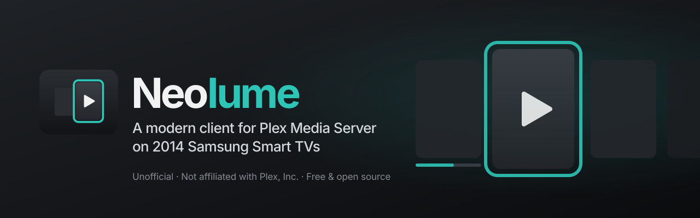

  

  <strong>Dein Samsung Smart TV von 2014 spielt deine Plex-Bibliothek wieder ab – schnell und modern.</strong>

  
  
  
  

  <strong><a href="https://itsab1989.github.io/neolume/">🌐 Website</a></strong> ·
  <strong><a href="https://github.com/itsab1989/neolume/releases/latest">⬇️ Download</a></strong> ·
  <strong><a href="docs/INSTALL.de.md">📖 Installation</a></strong> ·
  <strong><a href="docs/FAQ.de.md">❓ Fragen</a></strong> ·
  <a href="README.md">English</a>

**Neolume** ist ein kostenloser, quelloffener und **inoffizieller Client für Plex Media Server** für Samsung-Fernseher von
**2014** (Smart Hub „Orsay“, z. B. H- und HU-Serie). Die offizielle Plex-App dieser Geräte wird nicht mehr gepflegt und kann
sich nicht mehr anmelden, weil der Fernseher nur alte Verschlüsselung beherrscht. Neolume löst das: Ein kleines
Einrichtungsprogramm auf deinem Computer meldet sich **einmal** an, danach spricht der Fernseher **nur noch mit deinem
eigenen Plex Media Server im Heimnetz**.

> [!NOTE]
> **Neolume ist kein Produkt von Plex.** Es ist ein unabhängiges Hobbyprojekt und steht in keiner Verbindung zu Plex, Inc.
> oder Samsung. „Plex“ ist eine Marke von Plex, Inc. Bei Fragen hilft nicht der Plex-Support, sondern ein
> [Issue](https://github.com/itsab1989/neolume/issues) hier im Projekt.

  
   
  Neolume ist kostenlos und bleibt es. Wenn es deinem alten Fernseher ein zweites Leben schenkt, ist ein Kaffee ein schönes Dankeschön – ganz freiwillig, die App bleibt so oder so vollständig.

## Funktionen

- Startet in Sekundenbruchteilen aus dem eigenen Zwischenspeicher; Bedienung mit Fernbedienung **und** Smart-Control-Zeiger.
- Startseite mit Weiterschauen, Nächste Folgen, Neu je Bibliothek, Hintergrundbild und Staffelstreifen; je Profil anpassbar.
- Bibliotheken mit Raster, Sortieren, Filtern, A–Z; Detailseiten für Filme, Serien, Staffeln, Folgen; Suche.
- Player: Direktwiedergabe oder Umwandlung durch deinen Server (z. B. HEVC), Ton- und Untertitelwahl je Serie,
  Intro/Abspann überspringen, nächste Folge, Kapitel, Sleep-Timer, Vorschaubilder beim Spulen.
- Musik und Hörbücher; Plex-Home-Profile, Kinderprofile, eigene App-PIN je Profil.
- Entdecken und Plex-Merkliste über einen optionalen Helfer im Heimnetz.
- Oberfläche Deutsch und Englisch. Keine Werbung, kein Tracking.

Weitere Bildschirmfotos: [englische Übersicht](README.md#screenshots) (erfundene Beispielinhalte).

## Download

Das Einrichtungsprogramm für deinen Computer gibt es beim **[neuesten Release](https://github.com/itsab1989/neolume/releases/latest)**
(die TV-App ist darin enthalten):

| Computer | Datei |
|---|---|
| Windows 10/11 | `neolume-setup-windows-x64.exe` (ARM-Geräte: `neolume-setup-windows-arm64.exe`) |
| Mac mit Apple-Chip (M1 oder neuer) | `neolume-setup-macos-arm64.zip` |
| Mac mit Intel-Chip | `neolume-setup-macos-x64.zip` |
| Linux | `neolume-setup-linux-x64` bzw. `neolume-setup-linux-arm64` |
| Jedes System mit Python 3.8+ | `neolume-setup.pyz` |
| NAS / Docker (optionaler Helfer) | `ghcr.io/itsab1989/neolume-setup` |

## Schnellstart

Ausführlich, mit jeder Taste und Fehlerhilfe: **[Installationsanleitung](docs/INSTALL.de.md)**.

1. **Fernseher:** `MENU` → **Smart Hub** → **Samsung-Konto** → **Anmelden** → Benutzer **`develop`**.
2. **Computer:** das heruntergeladene Einrichtungsprogramm starten – der Browser öffnet sich.
3. **Browser:** **Mit Plex anmelden**, Server und Profile wählen, **App-Paket erstellen**.
4. **Fernseher:** `SMART HUB` → **SAMSUNG APPS** → auf einer App **`OK` ca. 5 Sekunden halten** → **IP Setting** =
   angezeigte Adresse → erneut `OK` halten → **Start User App Sync**.
5. **Neolume** erscheint unter **EIGENE APPS**.

> [!WARNING]
> Der Sync **entfernt alle selbst installierten Apps, die nicht in der Liste stehen** (Store-Apps nicht). Weitere eigene Apps
> vorher im Einrichtungsprogramm unter *Erweitert* eintragen.

## Lizenz und Marken

[MIT-Lizenz](LICENSE) · Fremde Bestandteile: [THIRD-PARTY.md](THIRD-PARTY.md).
„Plex“, „Plex Media Server“ und „Plex Pass“ sind Marken von Plex, Inc.; „Samsung“ und „Smart Hub“ sind Marken von Samsung
Electronics Co., Ltd. Sie werden nur genannt, um die Kompatibilität zu beschreiben.
