<p align="center">
  
</p>

<p align="center">
  <strong>Give your 2014 Samsung Smart TV a fast, modern way to watch your Plex library again.</strong>
</p>

<p align="center">
  <a href="https://github.com/itsab1989/neolume/releases/latest"></a>
  
  
  
  <a href="LICENSE"></a>
</p>

<p align="center">
  <strong><a href="https://itsab1989.github.io/neolume/">🌐 Website</a></strong>
  &nbsp;·&nbsp;
  <strong><a href="https://github.com/itsab1989/neolume/releases/latest">⬇️ Download</a></strong>
  &nbsp;·&nbsp;
  <strong><a href="docs/INSTALL.md">📖 Installation guide</a></strong>
  &nbsp;·&nbsp;
  <strong><a href="docs/FAQ.md">❓ FAQ</a></strong>
</p>

**Neolume** is a free, open-source, **unofficial client for Plex Media Server** made for Samsung Smart TVs from **2014**
(the "Orsay" Smart Hub, for example the H and HU series). The official Plex app for these TVs is no longer maintained and can
no longer sign in, because the TV only speaks old encryption that plex.tv no longer accepts. Neolume solves that: a small setup
program on your computer signs in **once**, and from then on the TV talks **only to your own Plex Media Server at home**.

> [!NOTE]
> **Neolume is not made by Plex.** It is an independent hobby project and is not affiliated with, endorsed or supported by
> Plex, Inc. or Samsung. "Plex" is a trademark of Plex, Inc. Please do not ask Plex support for help with Neolume – open an
> [issue](https://github.com/itsab1989/neolume/issues) here instead.

<p align="center">
  <a href="https://ko-fi.com/itsab1989"></a>
  <br>
  <sub>Neolume is free and always will be. If it brings your old TV back to life, a coffee is a kind way to say thanks – completely optional, and the app stays fully featured either way.</sub>
</p>

---

## Table of contents

- [Features](#features)
- [Screenshots](#screenshots)
- [What you need](#what-you-need)
- [Download](#download)
- [Quick start](#quick-start)
- [Which TVs work?](#which-tvs-work)
- [Privacy and security](#privacy-and-security)
- [FAQ](#faq)
- [For developers](#for-developers)
- [License and trademarks](#license-and-trademarks)

---

## Features

**Fast and made for the remote**
- Starts in a fraction of a second from its own cache, then refreshes quietly in the background.
- Smooth navigation on the TV's modest hardware; works with the normal remote **and** the Smart Control touch pointer.
- German and English interface (follows the TV's language, or choose in Settings).
- Choose your accent colour per profile: seven colours, all checked for readability.
- A screensaver that shows art from your whole libraries, with ten transitions and seven overlay styles to choose from.

**Home, libraries, details, search**
- Home with *Continue Watching*, *Up Next*, *Recently Added* per library, background art that follows the focus, and a
  season strip that shows at a glance how far you are in a show.
- *Customize Home* per profile: turn rows on/off, reorder them, add extra rows.
- Library grid with sort, filters, A–Z jump bar and several view sizes – remembered per library and profile.
- Detail pages for movies, shows, seasons and episodes with cast, extras, similar titles and version choice.
- Search across your libraries.

**Player**
- Direct Play of what the TV can decode itself; everything else (for example HEVC or 10-bit video) is converted by your
  Plex Media Server automatically.
- Audio and subtitle choice with readable track names, remembered per show; optional rule for anime (Japanese audio with subtitles).
- Skip intro / skip credits, next-episode countdown, chapters, sleep timer, "Still watching?", seek preview thumbnails
  (markers and thumbnails need the data your server provides).

**Music, profiles and more**
- Music and audiobooks.
- Plex Home profiles with avatars; kids profiles with reduced settings; an optional **app PIN** per profile.
- *Discover* rows and your Plex **watchlist** through an optional helper on your home network (everything else works without it).
- No ads, no tracking, no telemetry.

Deliberately **not** included: casting, downloads, Watch Together, remote access outside your home network.

## Screenshots

<p align="center"></p>

| | |
|---|---|
| 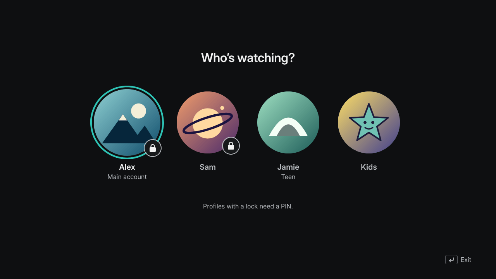 | 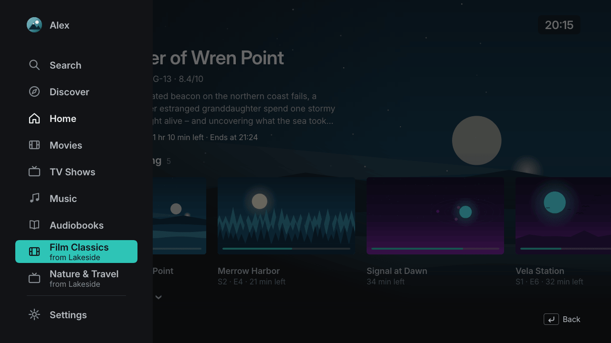 |
| **Profiles** – Plex Home, PINs, kids profiles | **Side menu** – libraries, search, Discover |
| 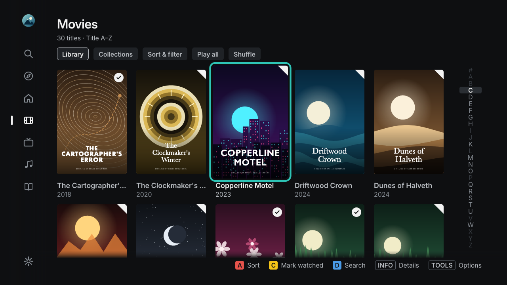 | 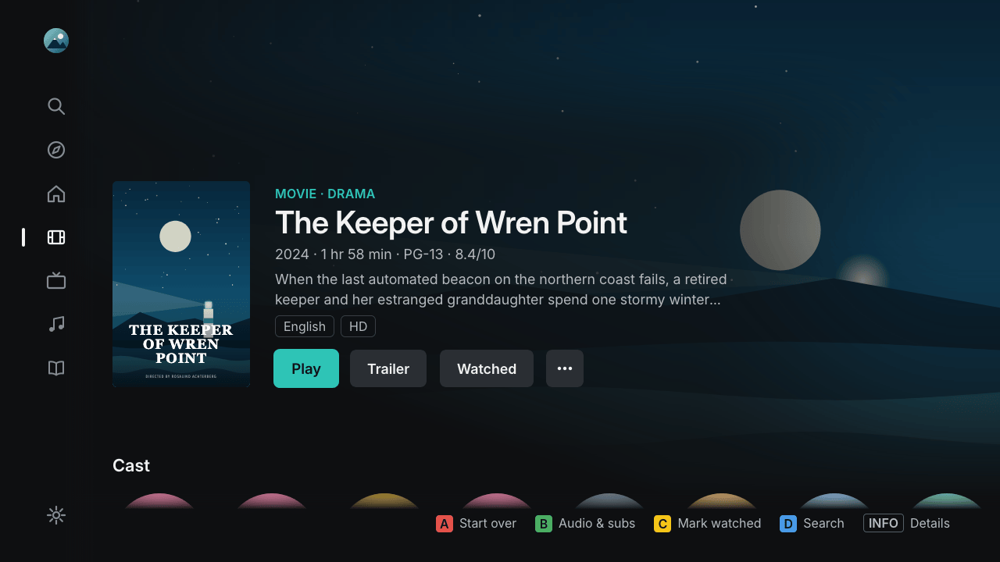 |
| **Library** – grid, sort and filter, A–Z | **Details** – everything about a movie |
| 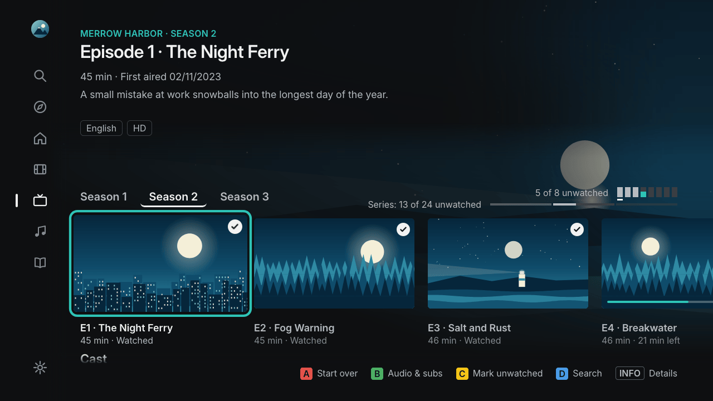 | 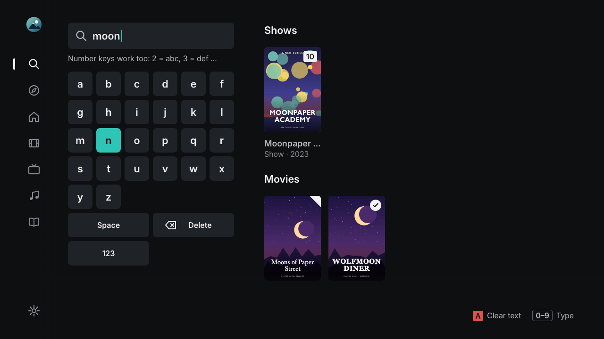 |
| **Shows** – seasons, episodes, progress | **Search** – on-screen keyboard or number keys |
| 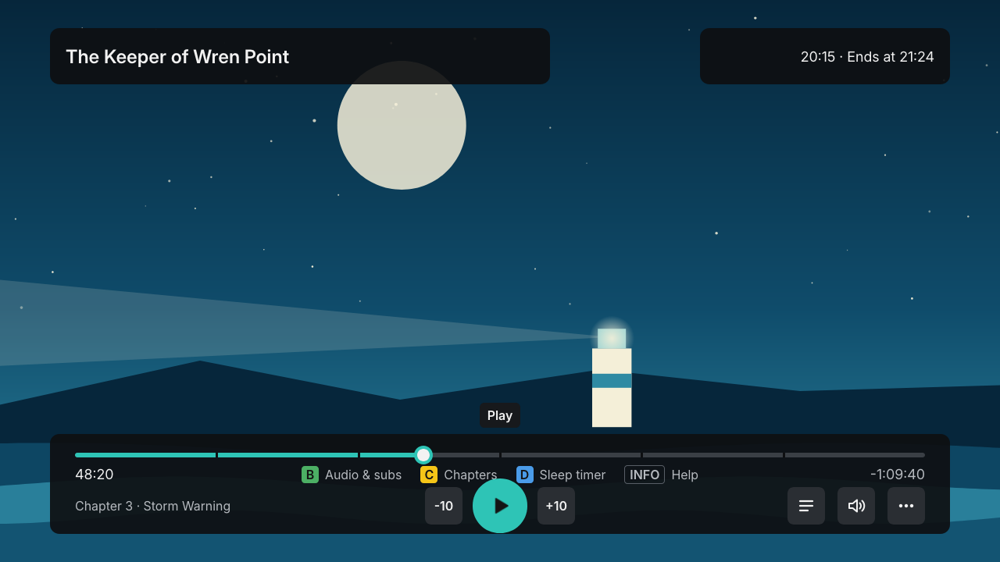 | 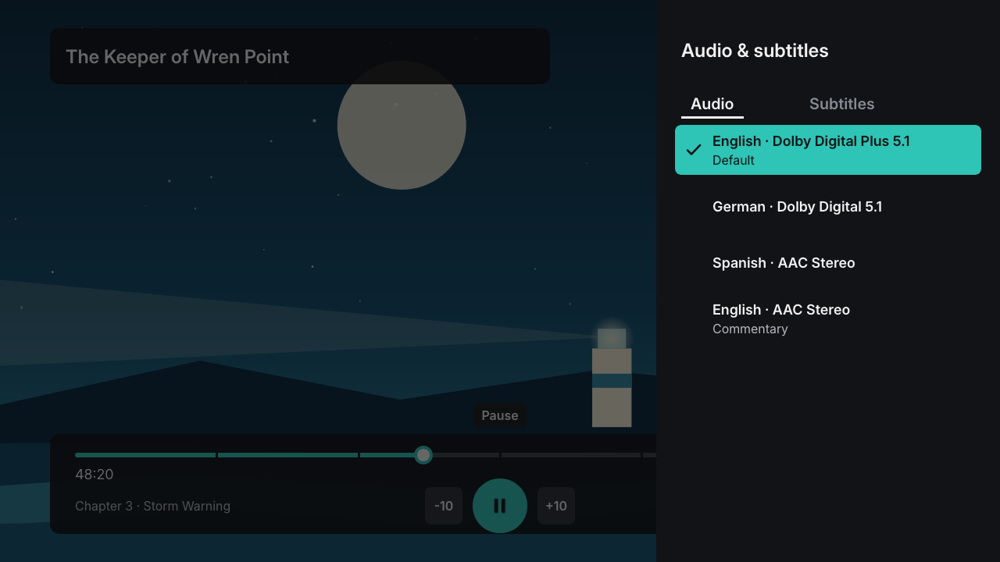 |
| **Player** – chapters, skip, sleep timer | **Audio & subtitles** – readable track names |
| 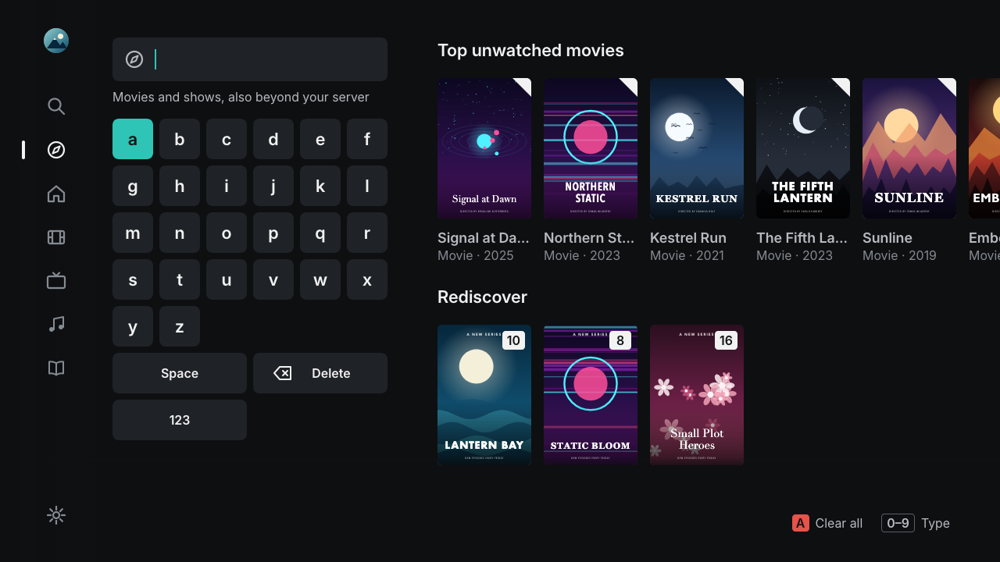 | 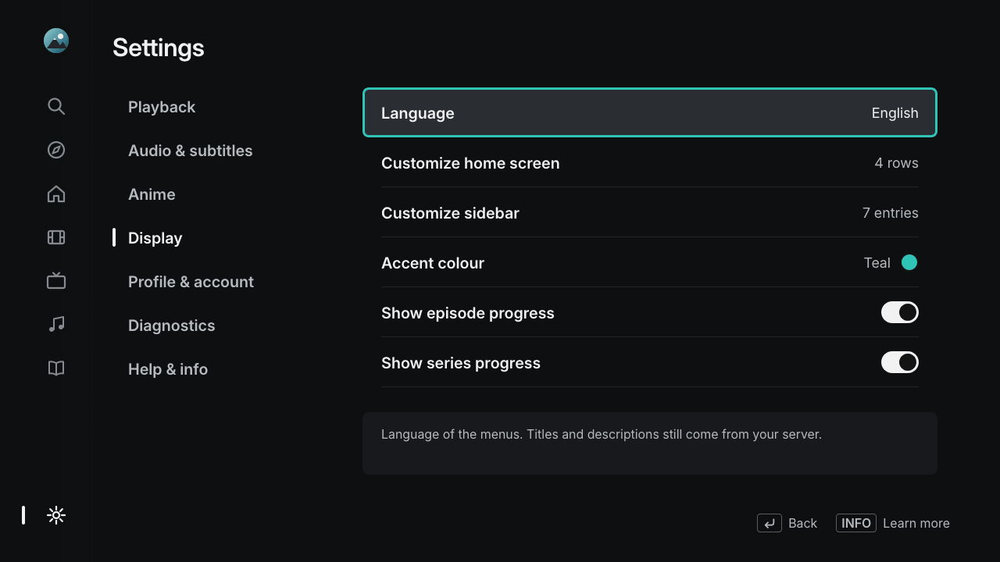 |
| **Discover** – rediscover your library | **Settings** – plain language, with explanations |
| 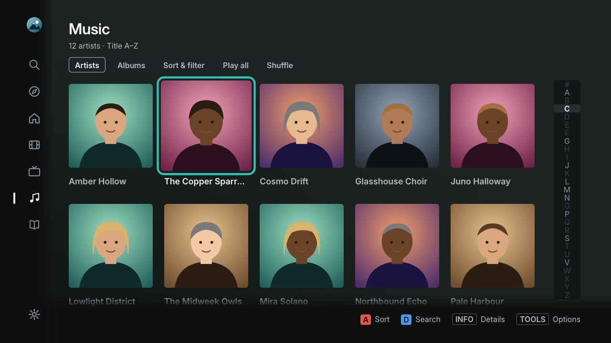 | 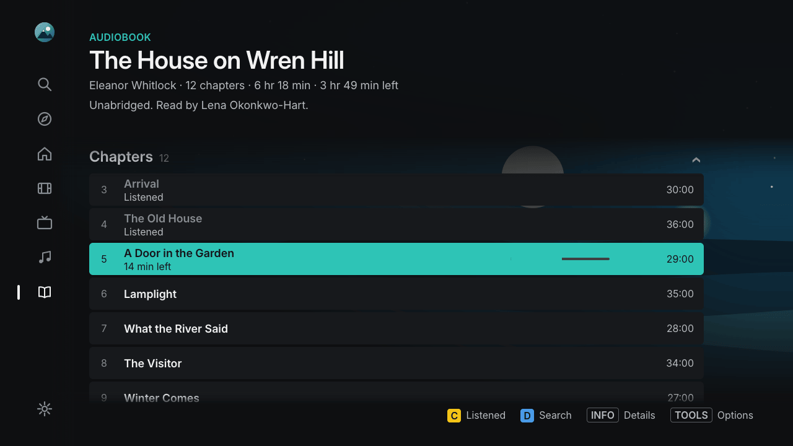 |
| **Music** – artists and albums | **Audiobooks** – chapters and progress |

<sub>All titles, people and artwork in the screenshots are invented demo content.</sub>

## What you need

- A **Samsung Smart TV from 2014** with the Orsay Smart Hub (see [Which TVs work?](#which-tvs-work)), connected to your home network.
- A **Plex Media Server** on the **same home network** that you **own** (you set up the profiles).
- A **computer** on the same network for the one-time setup and for updates: Windows, macOS or Linux.
  A NAS (for example Synology) can run the optional helper.
- About **20 minutes** and the TV remote.

No Plex Pass is needed. Some extras (skip-intro markers, seek thumbnails) use data that your server only creates with Plex Pass;
without it, just those extras are missing.

## Download

Get the setup program for your computer from the **[latest release](https://github.com/itsab1989/neolume/releases/latest)**.
It already contains the TV app – you do not need to build anything.

| Your computer | File to download |
|---|---|
| Windows 10/11 (most PCs) | `neolume-setup-windows-x64.exe` |
| Windows on ARM (e.g. Surface Pro X, Snapdragon laptops) | `neolume-setup-windows-arm64.exe` |
| Mac with Apple chip (M1 or newer) | `neolume-setup-macos-arm64.zip` |
| Mac with Intel chip | `neolume-setup-macos-x64.zip` |
| Linux (x86_64) | `neolume-setup-linux-x64` |
| Linux (ARM64, e.g. Raspberry Pi 4/5 with 64-bit OS) | `neolume-setup-linux-arm64` |
| Any system with Python 3.8+ | `neolume-setup.pyz` |
| NAS / Docker (optional helper) | `ghcr.io/itsab1989/neolume-setup` |

Not sure which Mac? Apple menu → *About This Mac*: "Chip: Apple …" or "Processor: Intel …".
Not sure which Windows you have? Press `Win` + `Pause` (or open *Settings → System → About*) and look at *System type*:
"x64-based" → x64, "ARM-based" → arm64.

## Quick start

The full beginner guide with every button and menu, plus troubleshooting, is here: **[Installation guide](docs/INSTALL.md)**.

1. **TV:** press `MENU` → **Smart Hub** → **Samsung Account** → **Log In** and sign in once with the user **`develop`**.
2. **Computer:** start the setup program you downloaded. Your browser opens the setup page.
3. **Browser:** click **Sign in with Plex**, choose your server and profiles, click **Create app package**.
4. **TV:** press `SMART HUB`, open **SAMSUNG APPS**, **hold `OK` for about 5 seconds** on any app →
   **IP Setting** → enter the address the setup program shows → hold `OK` again → **Start User App Sync**.
5. **Neolume** appears under **MY APPS**. Done – you can close the setup program.

> [!WARNING]
> The TV's sync **removes every self-installed app that is not on the sync list.** Apps from the Samsung store are not
> affected. If you use other self-installed apps, add them in the setup program under *Advanced* first.

## Which TVs work?

| TV | Status |
|---|---|
| Samsung **2014 H / HU series** with Smart Hub (Orsay), e.g. UE48H8000 | ✅ developed and tested on a UE48H8000 |
| Other 2014 Orsay models (H4xxx–H8xxx, HU 4K models) | should work – same platform, not tested yet |
| 2013 F series, 2012 E series (Orsay) | not tested; the install menu is different and the TV software is older |
| 2015 J series | **only** the models that still run Orsay (some entry-level J4xxx/J5xxx); most 2015 TVs run Tizen |
| 2015 and later with Tizen (J5500 and up, K, M, N, R, T … series) | ❌ not supported (different platform) |

Neolume draws its interface at 1280×720 and the TV scales it to the full screen, so it looks the same on 720p, 1080p and
4K (HU) panels. Video is not limited to 720p. Details in the [FAQ](docs/FAQ.md#which-tvs-does-neolume-run-on).

## Privacy and security

- **No telemetry, no ads, no analytics.** In daily use the TV talks only to your Plex Media Server.
- Your **Plex password** and **Plex PIN** are entered only on plex.tv, never in Neolume or the setup program.
- Every profile gets its own access that works **only with your server**; it is stored in the TV's app storage. You can
  revoke it any time on plex.tv under *Authorized Devices*.
- The setup program's page is reachable only from your own computer, keeps sign-in data in memory, and hands the app package
  only to devices on your home network.
- The TV cannot use modern encryption, so TV and server talk over plain HTTP **inside your home network**. Use Neolume only
  on a network you trust; public server addresses are never used.
- A diagnostic log is sent only when you ask for it, and only to a computer on your home network.

## FAQ

The most common questions – which TVs, Plex Pass, other apps on the TV, updating, uninstalling – are answered in the
**[FAQ](docs/FAQ.md)**. Something went wrong? See **[Troubleshooting](docs/INSTALL.md#12-troubleshooting)**.
Still stuck? [Open an issue](https://github.com/itsab1989/neolume/issues) and describe what you see on the TV and in the setup program.

## For developers

```sh
npm ci && npm test                         # build src/ -> app/app.js with ES5/CSS/i18n gates and unit tests (Node 22+)
cp local.example.json local.json           # optional: your own addresses for development (git-ignored)
python3 tools/dev.py build --mac-ip <your-computer-ip>   # package + widgetlist.xml for the TV's User App Sync
python3 tools/dev.py serve                 # development sync/app/log server
python3 -m unittest discover -s tests/installer          # setup program tests (offline)
```

The app is plain ES5 for the TV's 2014 browser engine, without frameworks. The setup program uses only the Python 3
standard library. Contributions are welcome – please keep the ES5 rule and run `npm test` before a pull request.

## License and trademarks

Neolume is released under the [MIT License](LICENSE). Third-party parts are listed in [THIRD-PARTY.md](THIRD-PARTY.md).
"Plex", "Plex Media Server" and "Plex Pass" are trademarks of Plex, Inc.; "Samsung" and "Smart Hub" are trademarks of
Samsung Electronics Co., Ltd. They are used only to describe compatibility. Neolume changes nothing in your TV's firmware or system.

<p align="center"><sub>Deutsch: <a href="README.de.md">README.de.md</a></sub></p>
