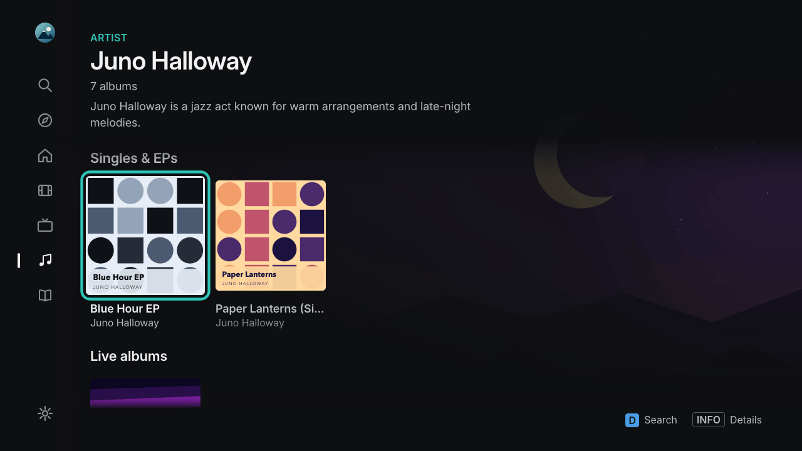
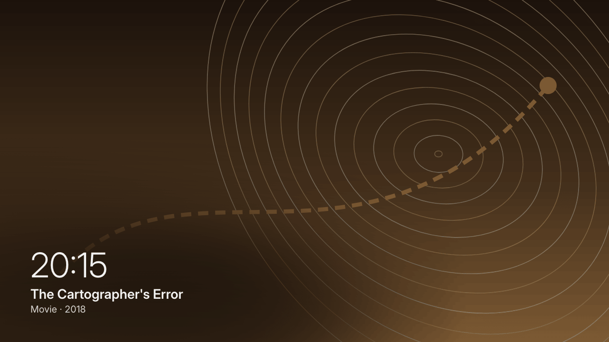
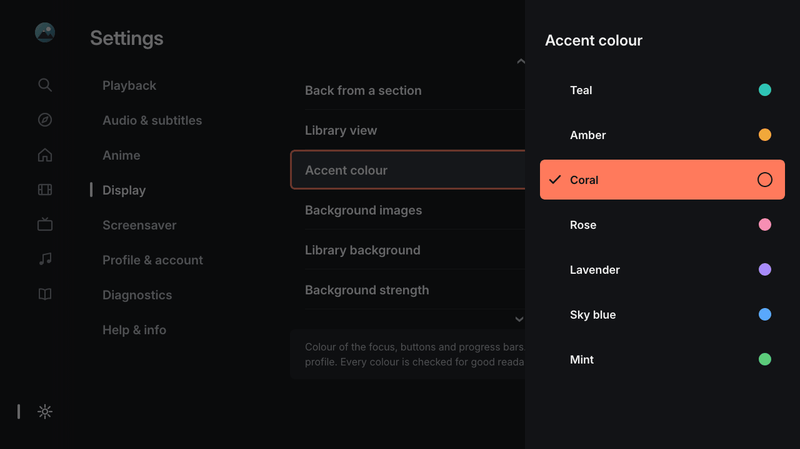

<p align="center">
  
</p>

<p align="center">
  <strong>Give your 2014 Samsung Smart TV a fast, modern way to watch your Plex library again.</strong>
</p>

<p align="center">
  <a href="https://github.com/itsab1989/neolume/releases/latest"></a>
  
  
  
  <a href="LICENSE"></a>
</p>

<p align="center">
  <strong><a href="https://itsab1989.github.io/neolume/">🌐 Website</a></strong>
  &nbsp;·&nbsp;
  <strong><a href="https://github.com/itsab1989/neolume/releases/latest">⬇️ Download</a></strong>
  &nbsp;·&nbsp;
  <strong><a href="docs/INSTALL.md">📖 Installation guide</a></strong>
  &nbsp;·&nbsp;
  <strong><a href="docs/FAQ.md">❓ FAQ</a></strong>
</p>

**Neolume** is a free, open-source, **unofficial client for Plex Media Server** made for Samsung Smart TVs from **2014**
(the "Orsay" Smart Hub, for example the H and HU series). The official Plex app for these TVs is no longer maintained and can
no longer sign in, because the TV only speaks old encryption that plex.tv no longer accepts. Neolume solves that: a small setup
program on your computer signs in **once**, and from then on the TV talks **only to your own Plex Media Server at home**.

> [!NOTE]
> **Neolume is not made by Plex.** It is an independent hobby project and is not affiliated with, endorsed or supported by
> Plex, Inc. or Samsung. "Plex" is a trademark of Plex, Inc. Please do not ask Plex support for help with Neolume – open an
> [issue](https://github.com/itsab1989/neolume/issues) here instead.

<p align="center">
  <a href="https://ko-fi.com/itsab1989"></a>
  <br>
  <sub>Neolume is free and always will be. If it brings your old TV back to life, a coffee is a kind way to say thanks – completely optional, and the app stays fully featured either way.</sub>
</p>

---

## Table of contents

**Use Neolume on your TV**
- [Features](#features)
- [Screenshots](#screenshots)
- [What you need](#what-you-need)
- [Download](#download)
- [Quick start](#quick-start)
- [Which TVs work?](#which-tvs-work)
- [Privacy and security](#privacy-and-security)
- [FAQ](#faq)

**Build, port and contribute**
- [For developers](#for-developers)
- [Build it for your TV with an AI agent](#build-it-for-your-tv-with-an-ai-agent)
- [Documentation](#documentation)
- [License and trademarks](#license-and-trademarks)

---

## Features

**Fast and made for the remote**
- Starts in a fraction of a second from its own cache, then refreshes quietly in the background.
- Smooth navigation on the TV's modest hardware; works with the normal remote **and** the Smart Control touch pointer.
- German and English interface (follows the TV's language, or choose in Settings).
- Choose your accent colour per profile: seven colours, all checked for readability.
- A screensaver that shows art from your whole libraries, with nine transitions (or Random) and six overlay styles to choose from;
  after a long time (2 hours by default) it shows only the clock on black, which is gentler on older TVs and the screen.
- `RETURN` works the way you expect: at the top of a library, Search, Discover or Settings it takes you to Home – or, if
  you prefer, back through the sections you opened, like Back in a web browser (*Back from a section* in Settings).
- Make it calmer if you like: four styles for the home screen clock, and button hints that always show, fade out after a
  few seconds or stay hidden (every button is still explained under Settings → Help & info → Remote control keys).

**Home, libraries, details, search**
- Home with *Continue Watching*, *Up Next*, *Recently Added* per library, background art that follows the focus, and a
  season strip that shows at a glance how far you are in a show; a show's page adds a bar for the whole series (both can
  be switched off).
- *Customize Home* per profile: turn rows on/off, reorder them, add extra rows.
- **Show all** at the end of a Home row, like in the Plex phone app: "New: Movies" opens the whole library sorted by
  *Recently added* (just for this visit), other rows open their full list as a grid with the view sizes Large, Medium,
  Small or List.
- A short notice fades in when something new arrives on your server (for example "New episode" with the show, season and
  episode) and fades out by itself – exact, general or off, and optionally also during a video. Home and the libraries
  pick up new titles by themselves, without moving what you have highlighted.
- Library grid with sort, filters, A–Z jump bar and several view sizes – remembered per library and profile.
- Optional library background: a soft colour mood of the selected title (default), its picture, or a new random picture each
  time you open the library – kept dark so text stays readable, or plain if you prefer.
- Detail pages for movies, shows, seasons and episodes with cast, extras, similar titles and version choice.
- Search across your libraries.

**Player**
- Direct Play of what the TV can decode itself; everything else (for example HEVC or 10-bit video) is converted by your
  Plex Media Server automatically.
- Audio and subtitle choice with readable track names, remembered per show; optional rule for anime (Japanese audio with subtitles).
- Skip intro / skip credits, next-episode countdown, chapters, sleep timer, "Still watching?", seek preview thumbnails
  (markers and thumbnails need the data your server provides).
- ⏮ / ⏭ jump to the previous/next episode, chapter or video; the skip buttons show their real length (for example -10 / +30).
- With the Smart Control: point at the progress bar to see the time (and a preview picture) before you click, and – if you
  like – hold still for fine scrubbing, which makes jumps in long movies much more precise.

**Music, profiles and more**
- Music and audiobooks.
- Plex Home profiles with avatars; kids profiles with reduced settings; an optional **app PIN** per profile.
- *Discover* rows, your Plex **watchlist** and details of titles that are not on your server through an optional helper on
  your home network (everything else works without it). The helper can start with your computer and shows a small icon in
  the menu bar or next to the clock; one click removes it completely.
  The plex.tv rows (Trending now, Just released, Coming soon) suggest only titles you don't have yet – switchable under Settings → Display.
- Optional: libraries of **servers that someone shared with you** (for example a friend), shown in the sidebar with their origin.
- No ads, no tracking, no telemetry.

Deliberately **not** included: casting, downloads, Watch Together, remote access outside your home network.

## Screenshots

<p align="center"></p>

| | |
|---|---|
|  |  |
| **Profiles** – Plex Home, PINs, kids profiles | **Sidebar** – your libraries plus libraries shared from other servers |
|  |  |
| **Library** – grid, sort, filter, A–Z and a colour mood from the selected title | **Details** – everything about a movie |
|  |  |
| **Shows** – seasons, episodes, progress | **Search** – on-screen keyboard or number keys |
|  |  |
| **Player** – new control bar, chapters, skip, sleep timer | **Audio & subtitles** – readable track names |
|  |  |
| **Music** – artists and albums | **Artist pages** – albums, singles & EPs, live, soundtracks, compilations |
|  |  |
| **Audiobooks** – chapters and progress | **Discover** – rediscover your library |
|  |  |
| **Screensaver** – pictures from your libraries, nine transitions (or Random), six overlay styles | **Accent colour** – seven colours, per profile; every setting explained |

<sub>All titles, people and artwork in the screenshots are invented demo content.</sub>

## What you need

- A **Samsung Smart TV from 2014** with the Orsay Smart Hub (see [Which TVs work?](#which-tvs-work)), connected to your home network.
- A **Plex Media Server** on the **same home network** that you **own** (you set up the profiles).
- A **computer** on the same network for the one-time setup and for updates: Windows, macOS or Linux.
  A NAS (for example Synology) can run the optional helper.
- About **20 minutes** and the TV remote.

No Plex Pass is needed. Some extras (skip-intro markers, seek thumbnails) use data that your server only creates with Plex Pass;
without it, just those extras are missing.

## Download

Get the setup program for your computer from the **[latest release](https://github.com/itsab1989/neolume/releases/latest)**.
It already contains the TV app – you do not need to build anything.

| Your computer | File to download |
|---|---|
| Windows 10/11 (most PCs) | `neolume-setup-windows-x64.exe` |
| Windows on ARM (e.g. Surface Pro X, Snapdragon laptops) | `neolume-setup-windows-arm64.exe` |
| Mac with Apple chip (M1 or newer) | `neolume-setup-macos-arm64.zip` |
| Mac with Intel chip | `neolume-setup-macos-x64.zip` |
| Linux (x86_64) | `neolume-setup-linux-x64` |
| Linux (ARM64, e.g. Raspberry Pi 4/5 with 64-bit OS) | `neolume-setup-linux-arm64` |
| Any system with Python 3.8+ | `neolume-setup.pyz` |
| NAS / Docker (optional helper) | `ghcr.io/itsab1989/neolume-setup` |

Not sure which Mac? Apple menu → *About This Mac*: "Chip: Apple …" or "Processor: Intel …".
Not sure which Windows you have? Press `Win` + `Pause` (or open *Settings → System → About*) and look at *System type*:
"x64-based" → x64, "ARM-based" → arm64.

## Quick start

The full beginner guide with every button and menu, drawings of the TV screens, plus troubleshooting, is here: **[Installation guide](docs/INSTALL.md)**.

1. **TV:** press `MENU` → **Smart Hub** → **Samsung Account** → **Log In** and sign in once with the user **`develop`** (no password needed).
2. **Computer:** start the setup program you downloaded. Your browser opens the setup page.
3. **Browser:** click **Sign in with Plex**, choose your server and profiles, click **Create app package**.
4. **TV:** press `SMART HUB`, open **SAMSUNG APPS**, **hold `OK` for about 5 seconds** on any app →
   **IP Setting** → enter the address the setup program shows → hold `OK` again → **Start User App Sync**.
5. **Neolume** appears under **MY APPS**. Done – you can close the setup program.

The watchlist, the plex.tv rows in Discover and the details of titles that are not on your server also need the optional helper on a computer or NAS in your home network:
[guide, section 13](docs/INSTALL.md#13-optional-the-helper-for-watchlist-and-discover).

> [!WARNING]
> The TV's sync **removes every self-installed app that is not on the sync list.** Apps from the Samsung store are not
> affected. If you use other self-installed apps, add them in the setup program under *Advanced* first.

## Which TVs work?

<!-- gen:platforms -->
<!-- generated by tools/spec_gen.js – do not edit; run `npm run spec` -->
These TVs have a ready-made download:

| TV system | Models | Download | Installation guide | Media servers | Last tested on a real TV | Status |
|---|---|---|---|---|---|---|
| **Samsung Smart TV 2014 (Orsay)** | 2014 H series (e.g. UE48H8000, UE40H6400)<br>2014 HU series, 4K (e.g. UE55HU7500) | [Setup program](#download) for your computer – it contains the TV app | [English](docs/INSTALL.md) · [Deutsch](docs/INSTALL.de.md) | Plex | 1.0.9 (2026-10-31, UE48H8000) | ✅ tested on a real TV by the maintainer |

No community port for other TVs yet – yours could be the first: [community ports](PORTS.md).
<!-- /gen:platforms -->

**Samsung in detail** – which 2012–2015 Samsung models can run Neolume:

| TV | Status |
|---|---|
| Samsung **2014 H / HU series** with Smart Hub (Orsay), e.g. UE48H8000 | ✅ developed and tested on a UE48H8000 |
| Other 2014 Orsay models (H4xxx–H8xxx, HU 4K models) | should work – same platform, not tested yet |
| 2013 F series, 2012 E series (Orsay) | not tested; the install menu is different and the TV software is older |
| 2015 J series | **only** the models that still run Orsay (some entry-level J4xxx/J5xxx); most 2015 TVs run Tizen |
| 2015 and later with Tizen (J5500 and up, K, M, N, R, T … series) | ❌ not supported (different platform) |

Neolume draws its interface at 1280×720 and the TV scales it to the full screen, so it looks the same on 720p, 1080p and
4K (HU) panels. Video is not limited to 720p. Details in the [FAQ](docs/FAQ.md#which-tvs-does-neolume-run-on).

**Newer TV?** Neolume does not run on it. Most newer TVs (Samsung Tizen, LG webOS, Android TV / Google TV …) have the
official Plex app in their app store – try that first. If you would still like Neolume's look and features there, you can
[let an AI coding agent build it for you](#build-it-for-your-tv-with-an-ai-agent).

## Privacy and security

- **No telemetry, no ads, no analytics.** In daily use the TV talks only to your Plex Media Server.
- Your **Plex password** and **Plex PIN** are entered only on plex.tv, never in Neolume or the setup program.
- Every profile gets its own access that works **only with your server**; it is stored in the TV's app storage. You can
  revoke it any time on plex.tv under *Authorized Devices*.
- The setup program's page is reachable only from your own computer, keeps sign-in data in memory, and hands the app package
  only to devices on your home network.
- The TV cannot use modern encryption, so TV and server talk over plain HTTP **inside your home network**. Use Neolume only
  on a network you trust; public server addresses are never used.
- A diagnostic log is sent only when you ask for it, and only to a computer on your home network.

## FAQ

The most common questions – which TVs, Plex Pass, other apps on the TV, updating, uninstalling – are answered in the
**[FAQ](docs/FAQ.md)**. Something went wrong? See **[Troubleshooting](docs/INSTALL.md#12-troubleshooting)**.
Still stuck? [Open an issue](https://github.com/itsab1989/neolume/issues) and describe what you see on the TV and in the setup program.

## For developers

```sh
npm ci && npm test                         # build src/ -> app/app.js with ES5/CSS/i18n gates and unit tests (Node 22+)
cp local.example.json local.json           # optional: your own addresses for development (git-ignored)
python3 tools/dev.py build --mac-ip <your-computer-ip>   # package + widgetlist.xml for the TV's User App Sync
python3 tools/dev.py serve                 # development sync/app/log server
python3 -m unittest discover -s tests/installer          # setup program tests (offline)
npm run hooks                              # optional: spec check before each commit, npm test before each push
```

The app is plain ES5 for the TV's 2014 browser engine, without frameworks. The setup program uses only the Python 3
standard library. Contributions are welcome – please read [CONTRIBUTING.md](CONTRIBUTING.md) (keep the ES5 rule, update
the spec with every user-visible change, run `npm test` before a pull request). Working with an AI coding agent in this
repository? It finds its rules in [CLAUDE.md](CLAUDE.md) and CONTRIBUTING.md; a ready prompt is in
[CONTRIBUTING.md](CONTRIBUTING.md#working-with-an-ai-coding-agent).

## Build it for your TV with an AI agent

Neolume itself runs only on 2014 Samsung TVs. For a newer TV – Samsung Tizen, LG webOS, Android TV / Google TV, Fire TV,
Apple TV … – an AI coding agent can build the same app for you. Everything it needs is in this repository and kept in step
with the code. You need an AI coding agent that can use a folder and a terminal on your computer, your TV in its developer
mode, a way for the agent to see the TV screen, and patience for several sessions; the agent does the programming, you do
the steps on the TV. To see the screen, the agent uses the TV's own screenshot command where there is one (Android TV,
Google TV and Fire TV have one) or a camera pointed at the TV – a webcam, an old phone with an IP-camera app or a network
camera on a stand. Without either you describe the screen in words; that works, but it is much slower and small mistakes
slip through.

**1. Copy this prompt into your agent** and replace the part in angle brackets:

<!-- gen:prompt -->
<!-- generated by tools/spec_gen.js – do not edit; run `npm run spec` -->
```text
Read https://raw.githubusercontent.com/itsab1989/neolume/main/docs/PORTING-WITH-AI.md and follow it exactly to build
the app for my TV: <brand and model, e.g. "LG OLED C1">. Work in a new folder; ask me only for things you cannot do yourself.
```
<!-- /gen:prompt -->

**2. What happens next:** the agent finds out how apps are made for your TV, gets a first test app onto it, then builds
the app feature by feature and checks every step with tests, screenshots and speed measurements. It asks you only for
things on the TV (switch on developer mode, press buttons, tell it what you see). At the end it walks you through the
acceptance tests with your remote. It never needs your Plex password, token or PIN – if it asks for one, say no.

**3. More prompts** for later – continue in a new session, test with your remote, update to a new version, share your
port – are in the [Prompts section of the playbook](docs/PORTING-WITH-AI.md#prompts).

**What your agent reads** (you don't have to):

| Document | What's in it |
|---|---|
| [Porting playbook](docs/PORTING-WITH-AI.md) | The step-by-step workflow the agent follows, the list of sources and the parts of this app it can reuse |
| [Product specification](docs/SPEC.md) | Every screen, setting, key, server request and performance budget, platform-neutral, with requirement IDs |
| [Acceptance test plan](docs/TEST-PLAN.md) | One test per requirement – written so a person with a remote can do it – plus a 10-minute smoke test |
| [Design system](design/README.md) | Every colour, font size, spacing and animation value ([`tokens.json`](design/tokens.json)) and the [icons](design/icons/) as SVG |
| [Community ports](PORTS.md) | Apps others built for their TVs (links only; each port is the responsibility of its author) – add yours with the *Port submission* issue form |

`npm test` checks the specification, the playbook and the test plan against the code on every change, so they always
describe the current app.

## Documentation

All guides and reference documents, sorted by what you want to do: **[documentation overview](docs/README.md)**.

## License and trademarks

Neolume is released under the [MIT License](LICENSE). Third-party parts are listed in [THIRD-PARTY.md](THIRD-PARTY.md).
"Plex", "Plex Media Server" and "Plex Pass" are trademarks of Plex, Inc.; "Samsung" and "Smart Hub" are trademarks of
Samsung Electronics Co., Ltd. They are used only to describe compatibility. Neolume changes nothing in your TV's firmware or system.

<p align="center"><sub>Deutsch: <a href="README.de.md">README.de.md</a></sub></p>
