# Neolume installieren – Schritt für Schritt

[English version](INSTALL.md) · [FAQ](FAQ.de.md) · [Zurück zur Übersicht](../README.de.md)

Diese Anleitung ist für Menschen **ohne Technik-Vorwissen** geschrieben. Geh sie einfach von oben nach unten durch: Jede Taste
auf der Fernbedienung und jedes Menü am Fernseher ist genannt, und die wichtigen Bildschirme sind gezeichnet. Rechne beim
ersten Mal mit etwa **20 Minuten**.

> **So liest du diese Anleitung**
> - `DIES` ist eine **Taste auf der Fernbedienung** (z. B. `MENU`, `OK`, `RETURN`, `SMART HUB`).
> - **Dies** ist ein **Wort auf dem Bildschirm**, das du auswählst.
> - → heißt „dann wählen“.
> - Die Menüs des Fernsehers folgen seiner Spracheinstellung. Hier stehen die deutschen Namen, in Klammern die englischen.
>   Einige Einträge (**IP Setting**, **Start User App Sync**) sind auch auf deutschen Geräten englisch.
> - Die **Zeichnungen** sind vereinfachte Skizzen, keine Fotos. Orange Nummern zeigen die Reihenfolge. **Graue Balken**
>   stehen für Einträge, die du nicht brauchst – dein Fernseher zeigt dort Text. Farben und Positionen können leicht abweichen.
> - Schritte mit *(noch zu prüfen)* wurden in dieser Sprache noch nicht wortgenau an einem Fernseher geprüft. Sieht es bei dir
>   anders aus, sag uns bitte in einem [Issue](https://github.com/itsab1989/neolume/issues) Bescheid, damit wir die Anleitung verbessern.

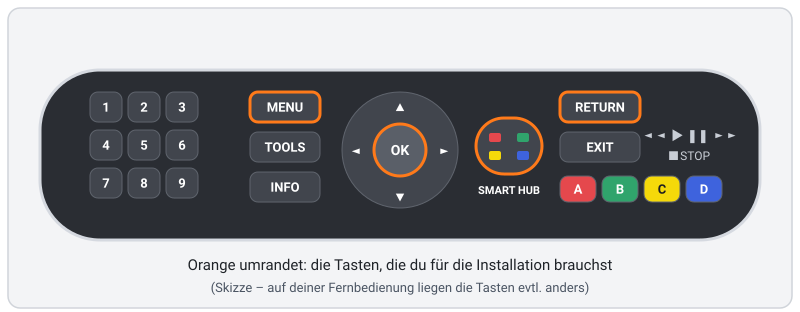

## Inhalt

1. [Was du brauchst](#1-was-du-brauchst)
2. [Wie es funktioniert (in einer Minute)](#2-wie-es-funktioniert-in-einer-minute)
3. [Fernseher vorbereiten (einmalig)](#3-fernseher-vorbereiten-einmalig)
4. [Einrichtungsprogramm herunterladen und starten](#4-einrichtungsprogramm-herunterladen-und-starten)
5. [Anmelden, Server und Profile wählen](#5-anmelden-server-und-profile-wählen)
6. [App-Paket erstellen](#6-app-paket-erstellen)
7. [App auf den Fernseher übertragen](#7-app-auf-den-fernseher-übertragen)
8. [So sieht Erfolg aus](#8-so-sieht-erfolg-aus)
9. [Erster Start am Fernseher](#9-erster-start-am-fernseher)
10. [Aktualisieren](#10-aktualisieren)
11. [Deinstallieren](#11-deinstallieren)
12. [Fehlerbehebung](#12-fehlerbehebung)
13. [Optionaler Helfer (Merkliste & Trends)](#13-optionaler-helfer-merkliste--trends)
14. [Weitere Server (optional)](#14-weitere-server-optional)

---

## 1. Was du brauchst

- ✅ Einen **Samsung-Fernseher von 2014** mit Smart Hub. Entwickelt wird Neolume auf einem **UE48H8000**.
  - Wo steht die Modellnummer? Auf dem Aufkleber **hinten am Fernseher**, oder am Fernseher: `MENU` → **Unterstützung**
    (Support) → **Samsung kontaktieren** (Contact Samsung). Dort stehen **Modellcode** und **Softwareversion**.
  - Das **fünfte Zeichen** verrät das Baujahr: **H** = 2014 (z. B. UE48**H**8000, UE55**HU**7500). Andere Jahrgänge: siehe
    [FAQ](FAQ.de.md#welche-fernseher-werden-unterstützt).
- ✅ Der Fernseher ist **mit dem Heimnetz verbunden** (WLAN oder Kabel).
- ✅ Ein **Plex Media Server**, der im **selben Heimnetz** läuft, und **du bist sein Besitzer**.
- ✅ Dein **Plex-Konto** (E-Mail und Passwort oder Google-/Apple-Anmeldung).
- ✅ Ein **Computer** (Windows, Mac oder Linux) im **selben Heimnetz** – nicht im Gast-WLAN und ohne eingeschaltetes VPN.
- ✅ Die **Fernbedienung**. Mit der normalen Fernbedienung geht es am leichtesten; die Smart Control (mit Touchpad) geht auch.

Einen Plex Pass brauchst du nicht, und auf deinem Plex-Server muss nichts installiert werden.

## 2. Wie es funktioniert (in einer Minute)

Samsung nimmt für Fernseher von 2014 keine neuen Apps mehr in seinen Store auf. Jeder Samsung-Fernseher dieser Zeit hat
aber einen offiziellen **Entwicklermodus** für eigene Apps:

1. Du meldest dich am Fernseher im Smart Hub mit dem besonderen Benutzer **`develop`** an.
2. Du sagst dem Fernseher die **Adresse deines Computers** (**IP Setting**).
3. Du drückst **Start User App Sync**. Der Fernseher lädt dann eine App-Liste und das App-Paket von deinem Computer.

Den Rest erledigt das **Einrichtungsprogramm** auf deinem Computer: Es meldet dich einmal bei Plex an, holt die Zugänge
für deine Profile, baut das App-Paket und gibt es dem Fernseher. Danach spricht der Fernseher **nur noch mit deinem
eigenen Plex-Server** – der Computer kann aus sein.

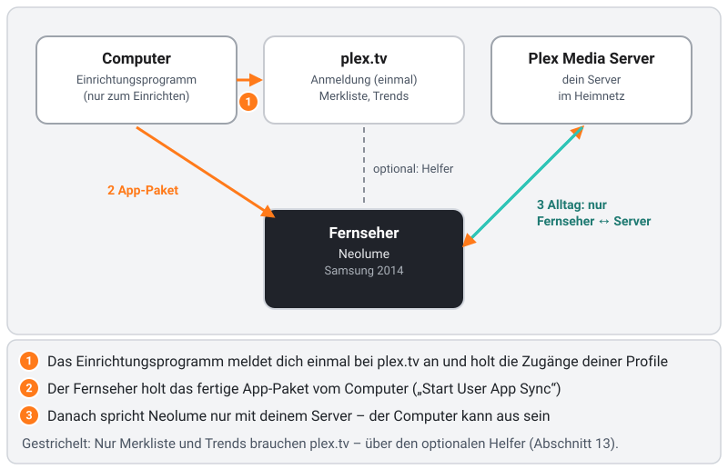

> ⚠️ **Wichtig:** Beim Sync **entfernt der Fernseher alle selbst installierten Apps, die nicht in der Liste stehen.** Apps aus
> dem Samsung-Store (Netflix, YouTube, …) sind davon **nicht** betroffen. Nutzt du weitere selbst installierte Apps, siehe
> [Schritt 5.4](#54-weitere-selbst-installierte-apps-erweitert).

## 3. Fernseher vorbereiten (einmalig)

Das machst du nur einmal. Der Fernseher merkt es sich, auch nach dem Ausschalten.

### 3.1 Prüfen, ob der Fernseher online ist
1. `MENU` drücken.
2. **Netzwerk** (Network) → **Netzwerkstatus** (Network Status) wählen.
3. Dort soll stehen, dass der Fernseher verbunden ist. Wenn nicht: zuerst unter **Netzwerk** → **Netzwerkeinstellungen** verbinden.
4. Mit `RETURN` (oder `EXIT`) das Menü verlassen.

### 3.2 Mit dem Benutzer „develop“ anmelden

Warum? Nur solange `develop` angemeldet ist, bietet der Fernseher die beiden Entwickler-Einträge **IP Setting** und
**Start User App Sync** an, mit denen Neolume auf den Fernseher kommt. Deine Store-Apps funktionieren weiter wie bisher.

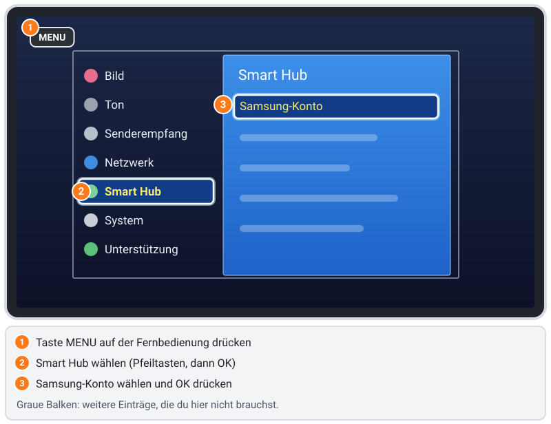

1. `MENU` drücken.
   *Smart Control:* `MORE` drücken und auf dem Bildschirm **Menü** wählen *(noch zu prüfen)*.
2. **Smart Hub** → **Samsung-Konto** (Samsung Account) wählen.
   - Bist du angemeldet, beginnt die Liste mit **Abmelden** (Log out) und unten rechts steht das angemeldete Konto.
     Steht dort schon `develop`, bist du fertig – weiter mit [Schritt 3.3](#33-den-bildschirm-samsung-apps-öffnen).
     Ist ein anderes Konto angemeldet, zuerst **Abmelden** wählen.
3. **Anmeld.** wählen. Es erscheint die Liste der Konten auf diesem Fernseher.
4. **`develop` steht in der Liste:** markieren und **Anmelden** wählen. **Ein Passwort ist nicht nötig.**
5. **`develop` fehlt noch:** mit der Bildschirmtastatur **`develop`** (alles klein) als Kennung eintippen. Das Passwort füllt
   sich meist selbst aus; bleibt es leer, **`any`** eintippen *(Anlage auf einem Fernseher, der `develop` noch nie hatte – noch
   zu prüfen; manche Geräte erwarten laut Berichten `111111`)*. Dann **Anmelden**.

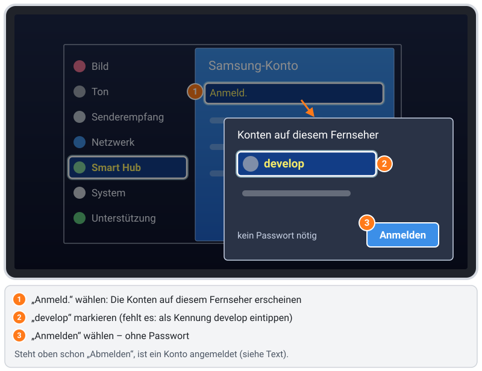

Du bleibst als `develop` angemeldet, auch nach dem Ausschalten. Store-Apps funktionieren weiter.
Ohne `develop`-Anmeldung gibt es die Einträge **IP Setting** und **Start User App Sync** (Schritt 7) nicht.

### 3.3 Den Bildschirm SAMSUNG APPS öffnen
1. `SMART HUB` drücken (die bunte Taste in der Mitte der Fernbedienung).
2. Unten erscheint eine Leiste mit zuletzt genutzten Apps und der Gruppe **Featured**. Dort das türkise Feld
   **SAMSUNG APPS** wählen (neben *Multimedia* und *Tutorial*) und `OK` drücken *(deutsche Gruppennamen noch zu prüfen)*.
3. Der Bildschirm SAMSUNG APPS öffnet sich, mit den Abschnitten **EMPFOHLEN** und **EIGENE APPS** (englisch:
   RECOMMENDED / MY APPS).

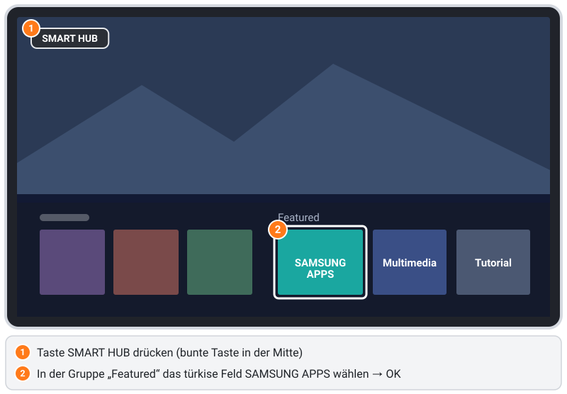

Lass den Fernseher auf diesem Bildschirm und geh an den Computer.

### 3.4 Optional: Fernseher schaltet sich nach 4 Stunden ab

Viele Fernseher von 2014 schalten sich nach **4 Stunden ohne Tastendruck** von selbst ab – auch mitten im Film oder bei
langer Musik. Das ist die Energiesparfunktion des Fernsehers, nicht Neolume. Stört es dich: `MENU` → **System** →
**Öko-Lösung** (Eco Solution) → **Autom. Aussch.** (Auto Power Off) → **Aus** oder eine längere Zeit. Diesen Schritt kannst
du auch überspringen.

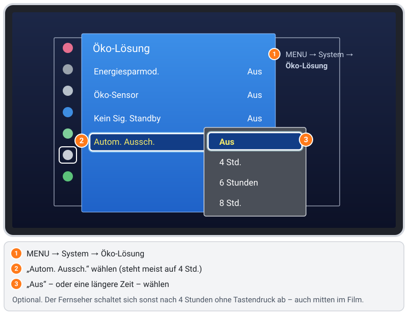

## 4. Einrichtungsprogramm herunterladen und starten

### 4.1 Herunterladen
Öffne am Computer das **[neueste Release](https://github.com/itsab1989/neolume/releases/latest)**. Lade unter **Assets** die Datei
für deinen Computer:

| Dein Computer | Datei |
|---|---|
| Windows 10/11, normaler PC oder Laptop | `neolume-setup-windows-x64.exe` |
| Windows auf ARM (Surface Pro X, Snapdragon-Laptops) | `neolume-setup-windows-arm64.exe` |
| Mac mit Apple-Chip (M1, M2, M3, M4 …) | `neolume-setup-macos-arm64.zip` |
| Mac mit Intel-Chip | `neolume-setup-macos-x64.zip` |
| Linux-PC | `neolume-setup-linux-x64` |
| Linux auf ARM (z. B. Raspberry Pi 4/5 mit 64-Bit-System) | `neolume-setup-linux-arm64` |
| Alles andere mit Python 3.8 oder neuer | `neolume-setup.pyz` |

Welcher Mac? Apple-Menü → **Über diesen Mac**: „Chip: Apple …“ = Apple-Chip, „Prozessor: Intel …“ = Intel.
Welches Windows? **Einstellungen → System → Info → Systemtyp**: „x64-basiert“ = x64, „ARM-basiert“ = ARM.

Die TV-App steckt schon in dieser einen Datei – du musst nichts bauen, und auf deinem Computer wird nichts installiert (nur
den optionalen Helfer aus Abschnitt 13 kannst du installieren, wenn du ihn möchtest).

### 4.2 Starten

**Windows**
1. Den Ordner **Downloads** öffnen und `neolume-setup-windows-x64.exe` **doppelklicken**.
2. Erscheint ein blaues Fenster **„Der Computer wurde durch Windows geschützt“**: **Weitere Informationen** → **Trotzdem
   ausführen**. (Das Programm ist nicht mit einem kostenpflichtigen Zertifikat signiert; deshalb fragt Windows.)
3. Die Windows-Sicherheit fragt *„Möchten Sie öffentlichen und privaten Netzwerken den Zugriff auf diese App gestatten?“*
   für **„Neolume Setup & Helper“**: **Zulassen** klicken (ältere Windows-Versionen: **Private Netzwerke** ankreuzen →
   **Zugriff zulassen**). Warum: Der Fernseher holt die App von deinem Computer ab – eine eingehende Verbindung, die Windows
   erst nach Rückfrage erlaubt. Ins Internet wird dabei nichts geöffnet; dein Router hält das Internet draußen.
4. Ein schwarzes Fenster öffnet sich, und dein Browser zeigt die Einrichtungsseite. **Das schwarze Fenster offen lassen**, bis
   du fertig bist.

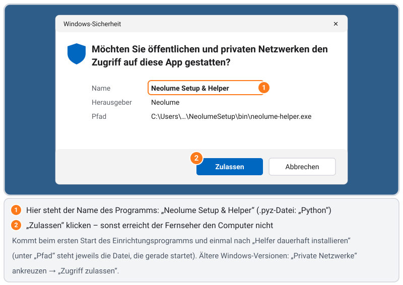

**Mac**
1. Den Ordner **Downloads** öffnen und die `.zip`-Datei **doppelklicken**. Es erscheint eine Datei `neolume-setup`.
2. `neolume-setup` **doppelklicken**. Beim ersten Mal lehnt macOS Programme unbekannter Entwickler ab (das Programm ist nicht
   von Apple beglaubigt):
   - **macOS 15 (Sequoia) und neuer:** **Fertig** klicken, **Systemeinstellungen → Datenschutz & Sicherheit** öffnen, nach
     unten zu *„neolume-setup“ wurde blockiert* → **Dennoch öffnen**, mit deinem Passwort bestätigen, dann erneut doppelklicken.
   - **macOS 14 und älter:** Rechtsklick (oder `ctrl`-Klick) auf `neolume-setup` → **Öffnen** → **Öffnen**.
   - Per Terminal: `xattr -d com.apple.quarantine ~/Downloads/neolume-setup`, dann erneut doppelklicken.
3. Ein Terminal-Fenster öffnet sich (das ist das Programm), und dein Browser zeigt die Einrichtungsseite.
   Fragt macOS **„Soll das Programm „neolume-setup“ eingehende Netzwerkverbindungen akzeptieren?“**: **Erlauben** klicken
   (gleicher Grund wie bei Windows).
4. **Das Terminal-Fenster offen lassen**, bis du fertig bist. Beenden kannst du das Programm später mit **„Programm beenden“**
   auf der Einrichtungsseite.

**Linux**
1. Ein Terminal im Ordner mit dem Download öffnen und ausführen:
   ```sh
   chmod +x neolume-setup-linux-x64
   sudo ./neolume-setup-linux-x64
   ```
   (`sudo` ist nötig, weil der Fernseher Apps immer über Port 80 abholt. Auf ARM `neolume-setup-linux-arm64` nehmen.)
2. Nutzt du eine Firewall: Port 80 für die Installation freigeben, z. B. `sudo ufw allow 80/tcp`.

**Python-Fassung (`.pyz`, jedes System)**
- Mac/Linux: `python3 neolume-setup.pyz` (Linux: `sudo python3 neolume-setup.pyz`).
- Windows: `py neolume-setup.pyz` in der Eingabeaufforderung (Python von python.org, mit Haken bei „Add python.exe to PATH“).
  Die Firewall-Frage nennt dann **„Python“** statt „Neolume Setup & Helper“.

Öffnet sich der Browser nicht von selbst, gib **http://127.0.0.1:32480/** selbst ein. Startest du das Programm ein zweites
Mal, öffnet es einfach die Seite des schon laufenden.

## 5. Anmelden, Server und Profile wählen

Die Einrichtungsseite gibt es auf Deutsch und Englisch (Knöpfe **DE** / **EN** oben rechts). Oben zeigt eine Leiste, wo du
gerade bist: **1. Anmelden · 2. Server · 3. Profile · 4. Übersicht · 5. Auf den Fernseher · 6. Fertig**.

### 5.1 Mit Plex anmelden
1. **„Mit Plex anmelden“** klicken.
2. Ein Fenster von plex.tv öffnet sich. Wie gewohnt anmelden und **Zulassen** (Allow) klicken.
3. Die Einrichtungsseite geht von selbst weiter.

Kein Fenster? **„Lieber mit Code auf plex.tv/link“** nehmen: `plex.tv/link` auf irgendeinem Gerät öffnen (auch am Handy),
anmelden und den Code von der Einrichtungsseite eintippen.

Dein Plex-Passwort tippst du **nur bei plex.tv** ein – nie in Neolume.

### 5.2 Server wählen
Deine Server werden aufgelistet. **Klicke deinen Server an.** Er sollte **„im Heimnetz gefunden“** und **„dein Server“** zeigen.
Wird er nicht gefunden, siehe [Server wird nicht gefunden](#server-wird-nicht-gefunden).

### 5.3 Profile prüfen
Alle Profile deines Plex Home stehen in der Liste und sind angekreuzt. Jedes Profil bekommt einen eigenen Zugang zu deinem
Server – mit eigenen Bibliotheken und eigenem Gesehen-Status. Nimm den Haken bei einem Profil weg, das nicht auf den
Fernseher soll.
- Steht bei einem Profil **„kein Zugriff auf diesen Server“**? In Plex (Web-App) unter **Einstellungen → Benutzer & Freigaben**
  den Server für dieses Profil freigeben, dann auf der Einrichtungsseite **Zurück** klicken und den Server erneut wählen.
- Eine PIN für die Profile legst du hier nicht fest: Neolume hat eigene App-PINs, die du später am Fernseher festlegst
  ([Abschnitt 9](#9-erster-start-am-fernseher)).

### 5.4 Weitere selbst installierte Apps (Erweitert)
Öffne **Erweitert** nur, wenn einer dieser Punkte zutrifft:
- **Du nutzt weitere selbst installierte Apps** auf dem Fernseher (nicht aus dem Samsung-Store). Trage je Zeile den Pfad zur
  `.zip`-Datei der App ein. **Sonst löscht der Fernseher sie beim Sync.**
- **Nur dein Fernseher** soll die App abholen dürfen: die IP-Adresse des Fernsehers eintragen. Du findest sie am Fernseher
  unter `MENU` → **Netzwerk** → **Netzwerkstatus** → **IP-Einstellungen** *(noch zu prüfen)*.

Dann **Weiter** klicken.

## 6. App-Paket erstellen


1. Die **Übersicht** prüfen. Dort gibt es Extras – alle aus, solange du sie nicht ankreuzt:
   - **App-PINs zurücksetzen** – nur, wenn du die App-PIN des Hauptprofils vergessen hast ([Details](#app-pin-vergessen)).
   - **Weitere Server** – Server, die jemand für dich freigegeben hat ([Abschnitt 14](#14-weitere-server-optional)).
   - **Helfer einrichten** – für deine Plex-Merkliste, die Entdecken-Reihen von plex.tv und Infos zu Titeln, die nicht auf deinem Server sind ([Abschnitt 13](#13-optionaler-helfer-merkliste--trends)).
     Unsicher? Lass es aus; du kannst es später jederzeit nachholen, indem du die Einrichtung erneut ausführst.
2. **„App-Paket erstellen“** klicken.
3. Die Seite zeigt jetzt **die Adresse deines Computers in großen Ziffern** (z. B. `192.168.1.20`) und wartet auf den
   Fernseher. Schreib sie dir auf – du brauchst sie im nächsten Schritt.

## 7. App auf den Fernseher übertragen

Zurück zum Fernseher. Du solltest noch auf dem Bildschirm **SAMSUNG APPS** aus [Schritt 3.3](#33-den-bildschirm-samsung-apps-öffnen) sein.

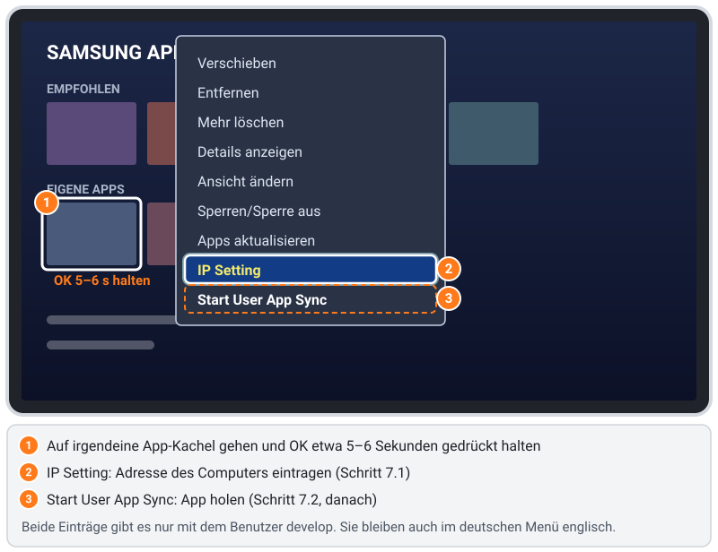

### 7.1 Dem Fernseher die Adresse des Computers sagen (IP Setting)
1. Mit den Pfeiltasten auf **irgendeine App-Kachel** gehen (z. B. eine vorinstallierte App).
2. **`OK` etwa 5–6 Sekunden gedrückt halten**, bis ein Menü erscheint. Es enthält **Verschieben**, **Entfernen**,
   **Mehr löschen**, **Details anzeigen**, **Ansicht ändern**, **Sperren/Sperre aus**, **Apps aktualisieren**, **IP Setting**
   und **Start User App Sync** (die letzten beiden immer englisch).
   Kein Menü? Steht der Fokus wirklich auf einer App-Kachel, und bist du als `develop` angemeldet ([Schritt 3.2](#32-mit-dem-benutzer-develop-anmelden))?
3. **IP Setting** wählen und `OK` drücken. Der Dialog **Develop IP Setting** öffnet sich mit **vier leeren Kästchen** und **OK**.
   > ⚠️ Der Fernseher **zeigt die gespeicherte Adresse nie an** – die Kästchen sind immer leer, auch wenn eine Adresse
   > gespeichert ist. **Den leeren Dialog nicht mit OK bestätigen**: Das kann die gespeicherte Adresse löschen. Entweder die
   > ganze Adresse neu eintippen oder mit `RETURN` abbrechen.
4. Die Adresse von der Einrichtungsseite mit den **Zahlentasten** eintippen, je Kästchen einen Block, und **nach jedem
   Block `OK` drücken** – dann springt der Fernseher ins nächste Kästchen (am Gerät geprüft). Beispiel: `192` `OK`, `168`
   `OK`, `1` `OK`, `20` `OK`. Mit **`◄`** kommst du zurück, um eine Ziffer zu korrigieren.
5. **OK** markieren und `OK` drücken.

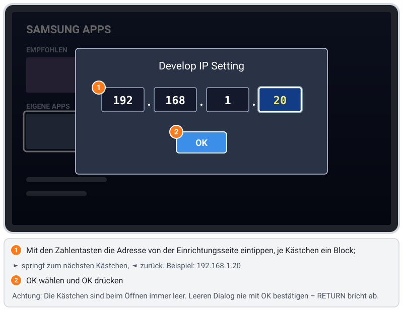

Das musst du nur wiederholen, wenn sich die Adresse deines Computers ändert.

### 7.2 Sync starten
1. Wieder **`OK` etwa 5 Sekunden halten** auf einer App-Kachel.
2. **Start User App Sync** wählen und `OK` drücken.
3. Die Meldung **„User Apps Sync is requested“** erscheint (englisch, auch auf deutschen Fernsehern). **Nur einmal** `OK` drücken.
   Ist danach das Menü noch offen und ein Eintrag wie **Verschieben** wirkt aktiv: `RETURN` drücken – das ist harmlos.
4. Warten. Der Fernseher holt erst die App-Liste, dann die App; das dauert meist **20–30 Sekunden**.

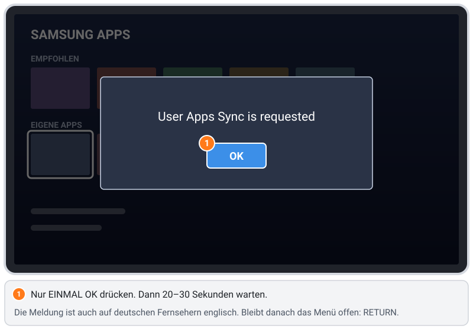

## 8. So sieht Erfolg aus

- **Auf der Einrichtungsseite** erscheint nacheinander: *„Fernseher … hat widgetlist.xml abgeholt“* und *„Fernseher … hat
  Neolume.zip abgeholt“*, dann *„Die App ist auf dem Fernseher angekommen.“*
- **Am Fernseher** steht **Neolume** unter **EIGENE APPS** (MY APPS) mit seinem Symbol – eine hervorgehobene Posterkarte mit
  Abspiel-Dreieck. Nicht da? Smart Hub schließen (`SMART HUB` oder `EXIT`) und wieder öffnen, oder den Fernseher mit der
  Fernbedienung aus- und wieder einschalten.
- Weitere selbst installierte Apps, die du in [Schritt 5.4](#54-weitere-selbst-installierte-apps-erweitert) eingetragen hast, sind noch da.

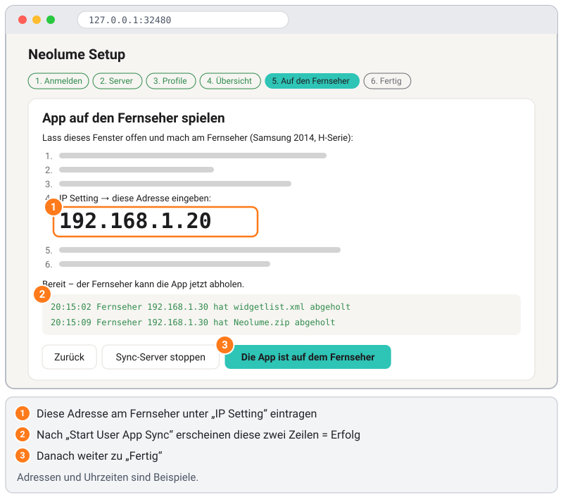

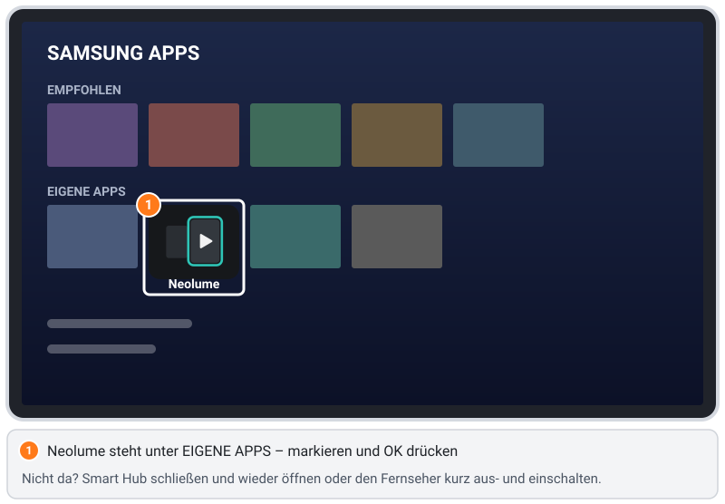

Dann auf der Einrichtungsseite **„Die App ist auf dem Fernseher“** → **„Zugangsdaten aus dem Speicher löschen und beenden“**
klicken. Optional auf dieser Seite: **„Einstellungen auf diesem Computer merken (ohne Zugangsdaten)“** – speichert Sprache und
die Liste aus Schritt 5.4 für das nächste Mal. Browser-Tab schließen und **„Programm beenden“** klicken (oder das
schwarze/Terminal-Fenster schließen oder darin `Ctrl` + `C` drücken).

Hast du **„Helfer einrichten“** angekreuzt? Dann das Programm **noch nicht** beenden – weiter mit [Abschnitt 13.2](#132-einrichten-und-ausprobieren).

## 9. Erster Start am Fernseher

1. In **EIGENE APPS** **Neolume** markieren und `OK` drücken.
2. Neolume startet direkt im **Hauptprofil** (dem Besitzer). Zum Wechseln mit `◄` die Seitenleiste öffnen und oben dein
   Profilbild wählen: Die Profilwahl **„Wer schaut gerade?“** öffnet sich. Unter **Einstellungen → Profil & Konto →
   Startprofil** kannst du stattdessen mit der Profilwahl (**Profilauswahl zeigen**) oder dem zuletzt genutzten Profil starten.
3. **App-PINs:** Neolume hat eigene PINs (deine Plex-PIN wird nicht benutzt, und das Einrichtungsprogramm fragt nie danach).
   Gibt es ein Kinderprofil und hat dein Profil noch keine App-PIN, erinnert die Profilwahl mit **„Erwachsenenprofile
   schützen?“** – **Verstanden** oder **Später erinnern** wählen. PINs legst du unter **Einstellungen → Profil & Konto** fest.
   Eine PIN gilt nur für Neolume auf diesem Fernseher.
4. Die Startseite lädt Weiterschauen, Nächste Folgen und Neues aus deinen Bibliotheken.
5. Nach kurzer Zeit auf der Startseite zeigt eine Karte **„So bedienst du Neolume“** die Tasten. Du findest sie später unter
   **Einstellungen** → **Hilfe & Info**.

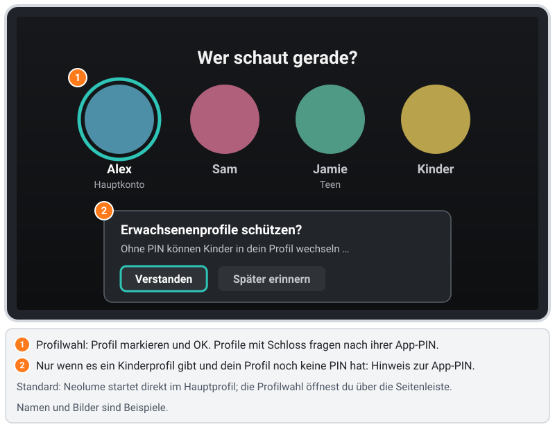

Ab jetzt spricht Neolume **nur mit deinem Server**. Dein Computer kann aus bleiben; zum Schauen braucht es kein Internet
(dein Server nutzt das Internet natürlich weiter für Poster und Metadaten).

**Tasten auf einen Blick**
| Taste | Was sie tut |
|---|---|
| Pfeiltasten, `OK` | Bewegen, auswählen |
| `RETURN` | Zurück (auf der Startseite: Seitenleiste öffnen, dann *Beenden*) |
| `PLAY` / `PAUSE` / `STOP` | Wiedergabe |
| `◄◄` / `►►` | Zurück / vor springen (in Listen: mehrere Einträge springen) |
| `TOOLS` | Optionen zum markierten Eintrag (im Player das Menü „Mehr“) |
| `INFO` | Informationen / Hilfe zum aktuellen Bildschirm |
| `A` rot / `B` grün / `C` gelb / `D` blau | Unten auf jedem Bildschirm erklärt (z. B. gelb = als gesehen markieren, blau = Suche) |
| Zahlentasten | In einer Bibliothek zu einem Buchstaben springen (wie beim Handy-Tippen) |

## 10. Aktualisieren

1. Die neue Version des Einrichtungsprogramms herunterladen ([Schritt 4](#4-einrichtungsprogramm-herunterladen-und-starten)).
2. Starten und die Schritte 5 bis 7 wiederholen. **IP Setting** ist nur nötig, wenn sich die Adresse deines Computers geändert hat.
   Nutzt du den Helfer? **„Helfer einrichten“** ist schon angekreuzt, wenn dieser Computer seinen Zugang gemerkt hat – angekreuzt
   lassen (Haken wegnehmen entfernt den Helfer, siehe [13.7](#137-vollständig-entfernen)).
3. Der Sync ersetzt Neolume – es entsteht keine zweite App. Deine Einstellungen und App-PINs in Neolume bleiben erhalten.
4. Den [Helfer](#13-optionaler-helfer-merkliste--trends) dauerhaft installiert? In seiner Karte auf der Einrichtungsseite auf
   **„Helfer aktualisieren“** klicken ([13.6](#136-aktualisieren)).

Führe die Einrichtung außerdem erneut aus, wenn du **ein Profil hinzufügst**, **deinen Server für ein neues Profil freigibst**,
**dein Plex-Passwort änderst** oder auf plex.tv **„Von allen Geräten abmelden“** nutzt. Neolume sagt dir, wann das nötig ist
(**„Einrichtung erneut ausführen“**).

## 11. Deinstallieren

1. `SMART HUB` → **SAMSUNG APPS** öffnen → auf **Neolume** gehen.
2. **`OK` etwa 5–6 Sekunden halten** → **Entfernen** (Delete) → bestätigen *(Wortlaut der Rückfrage noch zu prüfen)*.
3. Auf plex.tv unter **Konto** → **Autorisierte Geräte** den Eintrag **Neolume** entfernen. Damit ist der Zugang aufgehoben.
4. Optional: Freigaben in Plex entfernen, die du nur für Neolume angelegt hast.
5. Optional: am Fernseher von `develop` abmelden: `MENU` → **Smart Hub** → **Samsung-Konto** → **Abmelden**.
6. Den [Helfer](#13-optionaler-helfer-merkliste--trends) installiert? Mit **„Helfer entfernen …“** entfernen
   ([13.7](#137-vollständig-entfernen)).
7. Am Computer: die heruntergeladene Datei löschen. Hast du **„Einstellungen merken“** angekreuzt, auch den Einstellungsordner
   löschen (Windows: `%APPDATA%\NeolumeSetup`, Mac: `~/Library/Application Support/NeolumeSetup`, Linux: `~/.config/NeolumeSetup`).

An der Firmware oder am System des Fernsehers ändert Neolume nichts.

## 12. Fehlerbehebung

### Das Menü mit „IP Setting“ / „Start User App Sync“ erscheint nicht
- Bist du als **`develop`** angemeldet? ([Schritt 3.2](#32-mit-dem-benutzer-develop-anmelden)) Nur dann gibt es diese Einträge.
- Bist du auf dem Bildschirm **SAMSUNG APPS**, und steht der Fokus auf einer App-Kachel unter **EIGENE APPS** (nicht auf einer Kategorie)?
- **`OK` lange genug halten** (5–6 Sekunden), statt mehrmals zu drücken.

### Der Sync läuft, aber keine App erscheint
- Hat die Einrichtungsseite *„widgetlist.xml abgeholt“* gemeldet?
  - **Nein** → Der Fernseher erreicht deinen Computer nicht. Siehe nächster Abschnitt.
  - **Ja, aber kein App-Paket** → Sync erneut starten. Klappt es wiederholt nicht, **„App-Paket erstellen“** erneut klicken.
  - **Beides ja** → Smart Hub schließen und wieder öffnen oder den Fernseher aus- und einschalten. In **EIGENE APPS** nachsehen,
    nicht nur in der kleinen Leiste.
- Ist unter **IP Setting** genau die Adresse eingetragen, die die Einrichtungsseite zeigt? Der Dialog zeigt die gespeicherte
  Adresse nie an – also einfach neu eintippen (alle vier Kästchen) und **OK** – und den leeren Dialog nie bestätigen.

### Der Fernseher erreicht den Computer nicht
- **Firewall:** Dein Computer muss eingehende Verbindungen auf **Port 80** annehmen.
  - Windows: **Windows-Sicherheit** → **Firewall- & Netzwerkschutz** → **Zugriff von App durch Firewall zulassen** →
    **Einstellungen ändern** → **Neolume Setup & Helper** (`.pyz`: **Python**) für **Privat** erlauben. Dein Netzwerk muss als
    **Privat** eingestuft sein, nicht „Öffentlich“ (*Einstellungen → Netzwerk und Internet → Eigenschaften*).
  - Mac: **Systemeinstellungen** → **Netzwerk** → **Firewall** → **Optionen** → `neolume-setup` (`.pyz`: `python3`) auf
    **Eingehende Verbindungen erlauben** stellen.
  - Linux: z. B. `sudo ufw allow 80/tcp`, solange du installierst.
- **Port 80 belegt:** Meldet die Einrichtungsseite, der Port sei belegt, läuft ein anderer Webserver (oder das Programm zweimal).
  Diesen beenden und erneut versuchen.
- **Gleiches Netz:** Computer und Fernseher müssen im selben Heimnetz sein – kein Gast-WLAN, kein VPN, kein getrenntes
  „IoT-Netz“. Manche Router trennen WLAN-Geräte voneinander („Client-Isolation“ / „AP-Isolation“) – im Router ausschalten.
- **Auf den ersten Fernseher festgelegt:** Nach dem ersten Abholen bedient das Programm nur noch dieses Gerät. Hat ein anderes
  Gerät zuerst abgeholt, auf der Einrichtungsseite **„Freigeben“** klicken.

### Nach dem Sync sind andere selbst installierte Apps verschwunden
So arbeitet der Sync des Fernsehers: Er **entfernt alle selbst installierten Apps, die nicht in der Liste stehen**. Trage die
`.zip`-Dateien **aller** gewünschten Apps unter **Erweitert** ein ([Schritt 5.4](#54-weitere-selbst-installierte-apps-erweitert)),
erstelle das Paket neu und synce erneut. In diesen Apps musst du dich evtl. neu anmelden.

### Server wird nicht gefunden
- Läuft dein Plex Media Server? Am Computer im Browser `http://<Server-Adresse>:32400/web` öffnen.
- Ist der Computer im selben Netz wie der Server?
- Ist der Server mit **deinem** Plex-Konto angemeldet (Plex → Einstellungen → Allgemein)? Nur der Besitzer kann einrichten.
- Neolume nutzt nur Adressen im Heimnetz. Ein Server, der nur über das Internet erreichbar ist, wird nicht unterstützt.

### „Der Computer wurde durch Windows geschützt“ / macOS sagt, die App „kann nicht geöffnet werden“
Das Einrichtungsprogramm ist nicht mit einem kostenpflichtigen Zertifikat signiert. Windows: **Weitere Informationen** →
**Trotzdem ausführen**. Mac: **Systemeinstellungen** → **Datenschutz & Sicherheit** → **Dennoch öffnen** (Details in
[Schritt 4.2](#42-starten)).

### „Port 80 darf nicht geöffnet werden“
Linux: das Programm mit `sudo` starten. Mac/Windows: die Firewall-Frage erlauben, dann das Programm neu starten.

### Warum nicht HTTPS?
Der Fernseher kann nur alte Verschlüsselung (bis TLS 1.1); plex.tv verlangt TLS 1.2 oder neuer. Deshalb übernimmt der
Computer die Anmeldung, und der Fernseher spricht mit deinem Server **per HTTP innerhalb deines Heimnetzes**. Am Fernseher
lässt sich das nicht ändern. Nutze Neolume nur in einem Heimnetz, dem du vertraust.

### Neolume meldet „Einrichtung erneut ausführen“
Ein Zugang ist ungültig geworden (neues Plex-Passwort, „Von allen Geräten abmelden“, geänderte Freigabe). Schritte 4 bis 7 wiederholen.

### App-PIN vergessen
Das Hauptprofil kann die PIN jedes Profils unter **Einstellungen** → **Profil & Konto** → **PINs aller Profile** ändern oder
entfernen. PIN des **Hauptprofils** vergessen? Einrichtung erneut ausführen, in der Übersicht **„App-PINs zurücksetzen“**
ankreuzen und neu aufspielen.

### Der Fernseher schaltet sich nach einigen Stunden von selbst ab
Das ist das **automatische Ausschalten** des Fernsehers (nach 4 Stunden ohne Tastendruck). Siehe [Schritt 3.4](#34-optional-fernseher-schaltet-sich-nach-4-stunden-ab).

### Smart Hub zurücksetzen – letzter Ausweg
**Smart Hub zurücksetzen** (Reset Smart Hub, unter `MENU` → **Smart Hub**) löscht **alle** selbst installierten Apps samt Daten
und meldet `develop` ab. Danach Schritt 3.2 und Schritte 4 bis 7 wiederholen. Ein Zurücksetzen auf Werkseinstellungen hat
dieselbe Wirkung (und mehr).

### Ältere Fernseher (2012/2013, E-/F-Serie)
Nicht getestet, und das Entwicklermenü ist anders. Berichteter Weg: `SMART HUB` → rote Taste `A` (Anmelden) → `develop`
(Passwort evtl. `111111`) → `TOOLS` → **Einstellungen** → **Entwicklung** → **Server-IP** → **Synchronisieren**
*(noch zu prüfen)*.

Kommst du nicht weiter? [Öffne ein Issue](https://github.com/itsab1989/neolume/issues) mit Fernsehermodell, was du am Fernseher
siehst und was die Einrichtungsseite meldet. Weitere Fragen: [FAQ](FAQ.de.md).

## 13. Optionaler Helfer (Merkliste & Trends)

### 13.1 Was der Helfer ist – und warum der Fernseher ihn braucht

Alles in Neolume funktioniert mit deinem Plex-Server allein. Nur wenige Dinge liegen nicht auf deinem Server, sondern bei
**plex.tv** (der Plex-Webseite): deine **Plex-Merkliste**, in „Entdecken“ die Reihen **„Gerade beliebt“**,
**„Neu erschienen“** und **„Bald verfügbar“** und die Infos (Inhalt, Genres, Laufzeit, Besetzung) zu einem Titel, der nicht
auf deinem Server ist, wenn du ihn in „Entdecken“ öffnest.

Der Fernseher (2014) kommt an plex.tv nicht selbst heran: plex.tv verlangt eine neuere Verschlüsselung (TLS 1.2), der
Fernseher kann nur ältere (bis TLS 1.1). Der **Helfer** ist ein kleines Programm auf einem Computer in deinem Heimnetz, das
genau diese eine Aufgabe für den Fernseher übernimmt:

- **Was er holt:** deine Plex-Merkliste (merkst du am Fernseher etwas vor oder entfernst es, gibt er das an plex.tv weiter)
  die drei Entdecken-Reihen und – wenn du in „Entdecken“ einen Titel öffnest, der nicht auf deinem Server ist – dessen
  Inhalt, Genres, Laufzeit und Besetzung aus dem Plex-Katalog. Sonst nichts. Nutzt du [freigegebene Server anderer Leute](#14-weitere-server-optional),
  fragt er außerdem deren aktuelle Adresse ab.
- **Was er nicht tut:** keine Videos weiterleiten (Videos kommen immer direkt von deinem Plex-Server), nicht aus dem Internet
  erreichbar, leitet keine fremden Anfragen weiter. Er antwortet nur Geräten in deinem Heimnetz,
  ruft nur eine feste Liste von plex.tv-Adressen ab und schickt Daten nur an plex.tv.
- **Was er speichert:** die Zugangsdatei `helper.json` – nur für dein Benutzerkonto lesbar – im Einstellungsordner
  (Mac: `~/Library/Application Support/NeolumeSetup`, Windows: `%APPDATA%\NeolumeSetup`, Linux: `~/.config/NeolumeSetup`).
  Dauerhaft installiert (13.3) zusätzlich eine Programmkopie, einen Autostart-Eintrag und ein Protokoll (`helper.log`,
  ohne Zugangsdaten).
- **Ist er aus:** Neolume läuft ganz normal weiter – nur die Merkliste, diese Reihen und die Infos zu Titeln außerhalb
  deines Servers fehlen.

Die Merkliste gibt es für den Besitzer und für Plex-Home-Profile **ohne** Plex-PIN (das Einrichtungsprogramm fragt nie nach
Plex-PINs und speichert keine). Kinderprofile haben kein Entdecken und keine Merkliste.

**Wo soll er laufen?** Auf einem Gerät, das an ist, wann immer du fernsiehst: dein normaler Computer (dann klappt es, solange
du dort angemeldet bist), ein Mac oder PC, der immer läuft, oder ein NAS ([13.8](#138-nas--docker)). Er braucht keine
Administratorrechte und kaum Strom.

### 13.2 Einrichten und ausprobieren

1. Im Einrichtungsprogramm in der **Übersicht** **„Helfer einrichten“** ankreuzen. Unter **„Erweitert“** den Haken bei
   **„Zugang auf diesem Computer merken“** gesetzt lassen – den braucht „Helfer dauerhaft installieren“.
2. **„App-Paket erstellen“** klicken und die App wie gewohnt auf den Fernseher übertragen (Abschnitt 7). Im App-Paket steht
   jetzt die Adresse des Helfers – so weiß der Fernseher, wen er fragen soll.
3. Darunter erscheint die Karte **„Optionaler Helfer: Merkliste & Trends“**. Auf **„Helfer starten“** klicken. Der Helfer
   läuft jetzt, solange das Einrichtungsprogramm offen ist (*Helfer läuft auf Port 32499 (nur Heimnetz)*).
4. Am Fernseher prüfen ([13.5](#135-prüfen-ob-es-funktioniert)). Gefällt es dir? Dauerhaft installieren (13.3) – sonst endet
   der Helfer, sobald du das Einrichtungsprogramm beendest.

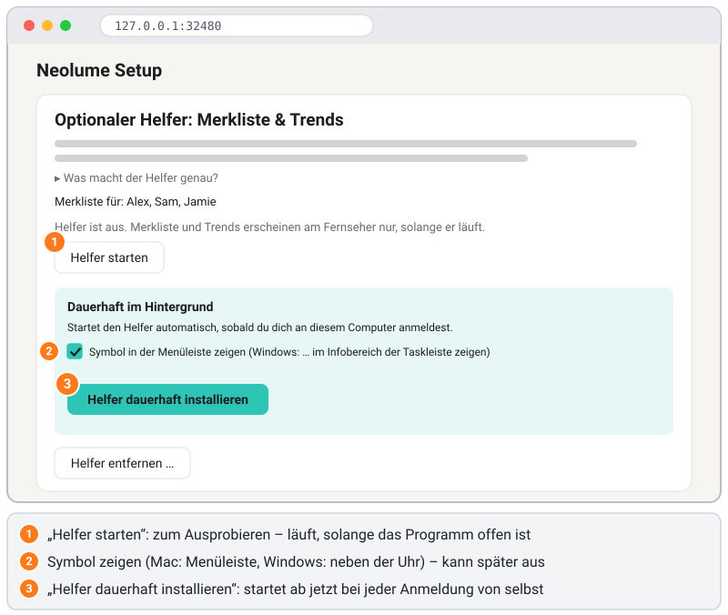

### 13.3 Dauerhaft installieren (startet automatisch mit dem Computer)

Damit der Helfer auch nach dem Schließen des Einrichtungsprogramms und nach einem Neustart läuft:

1. In der Helfer-Karte auf **„Helfer dauerhaft installieren“** klicken. Den Haken bei **„Symbol in der Menüleiste zeigen“**
   (Mac) bzw. **„Symbol im Infobereich der Taskleiste zeigen“** (Windows) gesetzt lassen, wenn du sehen möchtest, dass er läuft.
2. Die Seite zeigt ein **Ergebnis**, z. B. *Programmkopie angelegt*, *Autostart eingerichtet* und *Helfer läuft jetzt im
   Hintergrund*, und die Karte meldet **„Läuft im Hintergrund (Port 32499, nur Heimnetz).“**
3. Windows fragt evtl. noch einmal nach der Firewall – diesmal für die installierte Kopie (siehe Bild in [4.2](#42-starten)):
   **Zulassen** klicken. Auf dem Mac erscheint die Mitteilung **„Hintergrundobjekte hinzugefügt“** (Bild unten) – das ist so gewollt.
4. Jetzt kannst du das Einrichtungsprogramm mit **„Programm beenden“** schließen. Der Helfer läuft weiter und startet bei jeder
   Anmeldung von selbst.


Was dabei auf deinem Computer passiert:

| | Programmkopie | Autostart |
|---|---|---|
| Mac | `~/Library/Application Support/NeolumeSetup/bin/` (dazu die kleine App „Neolume Helfer.app“ daneben) | startet bei deiner Anmeldung („LaunchAgent“ in `~/Library/LaunchAgents`) |
| Windows | `%LOCALAPPDATA%\NeolumeSetup\bin\` (`.exe`: zwei Dateien, siehe unten) | startet bei deiner Anmeldung (Verknüpfung „Neolume Helfer“ in deinem **Autostart**-Ordner) |
| Linux | `~/.local/share/NeolumeSetup/bin/` | systemd-Benutzerdienst `neolume-helper.service` |

Die Kopie gibt es, weil die heruntergeladene Datei oft im Download-Ordner liegt, den man gern aufräumt. Für all das braucht
es keine Administratorrechte.

**Wie der Helfer auf deinem Computer heißt – und wo du ihn siehst.** Der Helfer erscheint immer unter dem Namen der App plus
„Helfer“ – hier **„Neolume Helfer“** – mit eigenem kleinen Fernseher-Symbol in der Farbe der App. Auf Englisch („Neolume
Helper“) heißt er, wenn die Einrichtungsseite bzw. dein Computer auf Englisch eingestellt ist.
- **Mac:** Gleich nach dem Installieren zeigt macOS die Mitteilung **„Hintergrundobjekte hinzugefügt“** – *„Neolume Helfer“
  ist ein Objekt, das im Hintergrund ausgeführt werden kann*. Das ist so gewollt und heißt: Der Autostart funktioniert. Du
  findest ihn unter **Systemeinstellungen → Allgemein → Anmeldeobjekte & Erweiterungen** (in der Liste der Objekte, die im
  Hintergrund laufen dürfen; bei neueren macOS-Versionen unter **App-Hintergrundaktivitäten**) und kannst ihn dort auch
  ausschalten. Unter dem Namen schreibt macOS evtl. *„Objekt eines unbekannten Entwicklers“*, weil der Helfer nicht mit
  einem kostenpflichtigen Apple-Zertifikat signiert ist. Damit macOS diesen Namen zeigt (und nicht etwa „python3“), startet
  der Helfer über eine winzige App, `Neolume Helfer.app`, im Programmordner oben.
- **Windows:** Der Task-Manager unter **Autostart von Apps** (und **Einstellungen → Apps → Autostart**) zeigt nicht den
  Namen der Verknüpfung, sondern die Beschreibung des Programms dahinter: **„Neolume Setup & Helper“** mit dem
  Herausgeber **„Neolume“** bei der heruntergeladenen `.exe` (nutzt du die `.pyz`-Datei mit eigenem Python, steht dort
  **„Python“**). Derselbe Name steht in der Prozessliste des Task-Managers und in der Firewall-Frage. Dort lässt sich der
  Autostart auch deaktivieren. In deinem Autostart-Ordner (`Win + R` → `shell:startup`) ist es eine normale Verknüpfung
  namens **„Neolume Helfer“**.
- **Windows, kein Fenster bei der Anmeldung:** Der Helfer startet still im Hintergrund – ohne Fenster und ohne Schaltfläche
  in der Taskleiste, nur sein Symbol neben der Uhr erscheint. Dafür liegt die `.exe` zweimal im Programmordner:
  `neolume-helper.exe` ist der Helfer, den der Autostart und das Symbol starten; Windows behandelt ihn als Programm mit
  Fenster-Oberfläche und öffnet für ihn deshalb nie ein Konsolenfenster. `neolume-setup.exe` ist das normale
  Einrichtungsprogramm für die Eingabeaufforderung (und für **Einrichtungsprogramm öffnen …** im Symbol-Menü). Beides ist
  dasselbe Programm, deshalb tragen beide den Namen „Neolume Setup & Helper“. Die `.pyz`-Datei nutzt aus demselben
  Grund `pythonw.exe` (Python ohne Fenster).
- **Linux:** `systemctl --user status neolume-helper` zeigt ihn. Ein Symbol gibt es nicht.
- `--helper-status` ([13.10](#1310-für-fortgeschrittene-befehlszeile-mac-der-immer-läuft-linux)) zeigt den Namen ebenfalls.

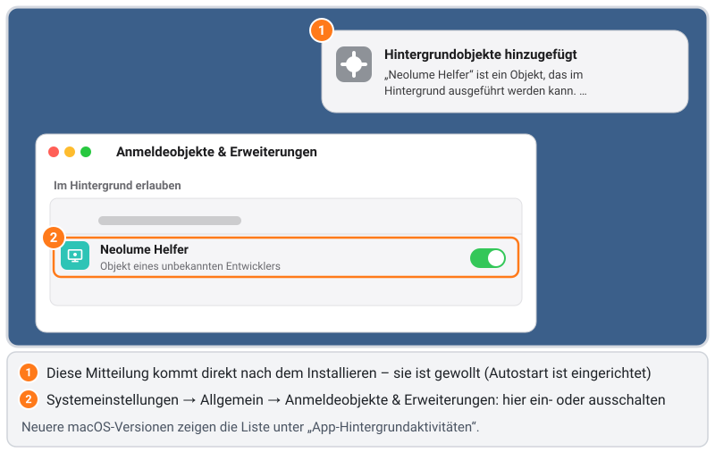

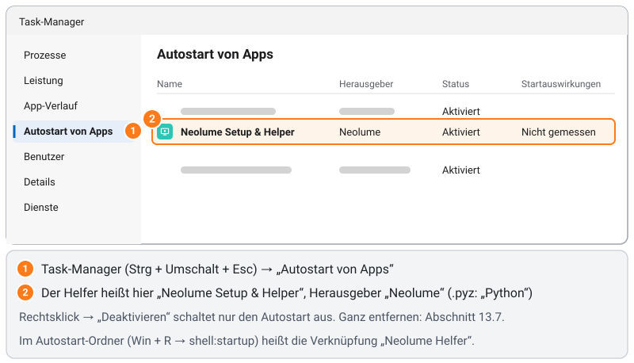

### 13.4 Das Symbol: zeigen oder ausblenden

Auf dem Mac zeigt der Helfer ein kleines Fernseher-Symbol in der **Menüleiste** (oben rechts), unter Windows im
**Infobereich** der Taskleiste (neben der Uhr – Windows legt es anfangs evtl. unter den kleinen Pfeil **^**; zieh es neben die
Uhr, dann bleibt es sichtbar). Ein Klick darauf zeigt:

- drei Zustandszeilen (grau, nicht anklickbar) – was sie bedeuten, steht in [13.5](#135-prüfen-ob-es-funktioniert),
- **„Pausieren“** / **„Fortsetzen“** – solange pausiert, bekommt der Fernseher keine Merkliste und Trends; der Helfer läuft weiter,
- **„Einrichtungsprogramm öffnen …“** – öffnet die Einrichtungsseite bei der Helfer-Karte,
- **„Was macht der Helfer?“** – eine kurze Erklärung und wo seine Zugangsdatei liegt,
- **„Helfer beenden“** – beendet ihn bis zu deiner nächsten Anmeldung (oder bis **„Jetzt starten“** in der Helfer-Karte),
- **„Helfer entfernen …“** – entfernt ihn vollständig ([13.7](#137-vollständig-entfernen)).

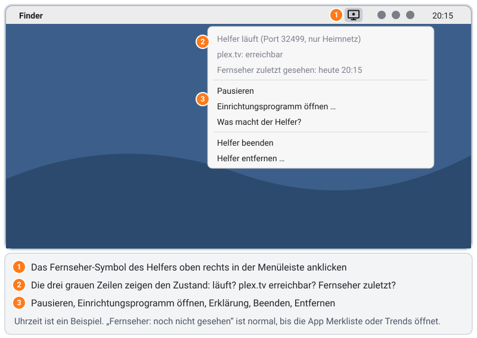

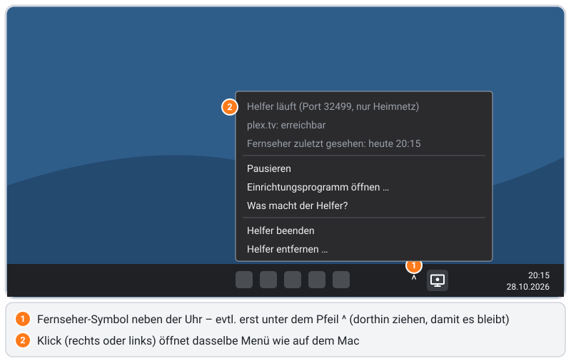

Symbol ausblenden: Einrichtungsprogramm starten und in der Helfer-Karte den Haken bei **„Symbol in der Menüleiste zeigen“**
bzw. **„Symbol im Infobereich der Taskleiste zeigen“** entfernen. Der Helfer läuft unsichtbar weiter. Haken wieder setzen
holt das Symbol zurück. Unter Linux gibt es kein Symbol.

### 13.5 Prüfen, ob es funktioniert

**Am Fernseher:**
1. Neolume öffnen → **Einstellungen** → **Oberfläche** → **Merkliste**. Sie lässt sich schalten und ist an.
   - Dort steht **„Nicht eingerichtet“**: Das App-Paket auf dem Fernseher kennt noch keinen Helfer – **„Helfer einrichten“**
     ankreuzen, Paket erstellen und erneut syncen (13.2).
   - Die Zeile ist grau mit *„Der Helfer von Neolume antwortet gerade nicht …“*: Der Fernseher kennt den Helfer, erreicht ihn aber
     nicht – siehe [13.9](#139-fehlerbehebung-beim-helfer). Neolume versucht es nach einer Minute erneut.
2. In der Seitenleiste **Entdecken** öffnen: Dort stehen **Deine Merkliste** und – bevor du tippst – die Reihen „Gerade
   beliebt“, „Neu erschienen“, „Bald verfügbar“ (welche Reihen: **Einstellungen** → **Oberfläche** → **Inspiration
   anpassen**). Standardmäßig schlagen sie nur Titel vor, die noch nicht auf deinem Server sind (**Einstellungen** →
   **Oberfläche** → **Nur Titel, die du noch nicht hast**).

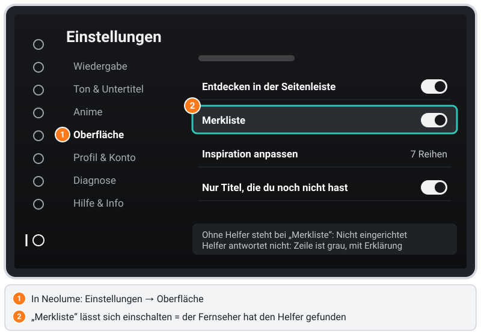

**Am Computer** – die drei Zustandszeilen im Symbol-Menü:

| Zeile | Bedeutung |
|---|---|
| *Helfer läuft (Port 32499, nur Heimnetz)* | Er läuft. *Helfer pausiert – …* heißt: Du hast **Pausieren** geklickt. |
| *plex.tv: erreichbar* | Er erreicht plex.tv. *wird geprüft …* direkt nach dem Start; *nicht erreichbar – Internet prüfen* siehe 13.9. |
| *Fernseher zuletzt gesehen: heute 20:15* | Der Fernseher hat zu dieser Zeit zuletzt etwas abgefragt. *Fernseher: noch nicht gesehen* ist normal, bis Neolume zum ersten Mal Merkliste oder Entdecken öffnet. |

Ohne Symbol: Die Helfer-Karte meldet **„Läuft im Hintergrund“**, oder `--helper-status` sagt *Läuft: ja (Port 32499)*.

### 13.6 Aktualisieren

- **Neue Version des Einrichtungsprogramms:** herunterladen, starten und in der Helfer-Karte auf **„Helfer aktualisieren“**
  klicken (erscheint, wenn die installierte Kopie eine andere Version ist). Ohne Browser: die neue Datei mit
  `--install-helper` starten.
- **Neue Profile oder neue Einrichtung:** einfach die Einrichtung erneut ausführen (**„Helfer einrichten“** bleibt angekreuzt →
  **„App-Paket erstellen“**). Der installierte Helfer übernimmt die neue Zugangsdatei nach wenigen Sekunden von selbst.

### 13.7 Vollständig entfernen

Jeder dieser Wege entfernt alles, was der Helfer installiert hat:

- Einrichtungsseite → Helfer-Karte → **„Helfer entfernen …“** → bestätigen,
- Symbol-Menü → **„Helfer entfernen …“** → **„Entfernen“**,
- bei einer neuen Einrichtung den Haken bei **„Helfer einrichten“** wegnehmen und **„App-Paket erstellen“** klicken,
- Befehlszeile: `./neolume-setup --uninstall-helper` (mit `sudo`, wenn du `--at-boot` benutzt hast).

Dabei wird der Helfer beendet, und Autostart, Programmkopie (auf dem Mac auch die Helfer-App `Neolume Helfer.app`), seine
Einstellungen und sein Protokoll, die Zugangsdatei `helper.json` sowie die danach leeren Ordner werden gelöscht. Entfernst du
ihn unter Windows über das Symbol-Menü, sind Programmkopie und Protokoll noch kurz in Benutzung: Sie werden gelöscht, sobald
sich der Helfer beendet hat (gleich nach dem Klick auf **OK**). Hat der Helfer bei plex.tv einen eigenen Geräteeintrag, wird
auch der entfernt – außer er nutzt denselben Zugang wie der Fernseher (dann wäre der Fernseher abgemeldet). Ein **Ergebnis**
zeigt, was entfernt wurde und was bleibt. Die App auf dem Fernseher kennt die Adresse des Helfers noch, bis du das
App-Paket ohne **„Helfer einrichten“** neu erstellst und synchronisierst; bis dahin meldet sie kurz „Helfer von Neolume
nicht erreichbar“, wenn sie ihn sucht. Alles andere läuft weiter.

**Was übrig bleiben kann – und warum:**
- **Der Einstellungsordner** mit der `settings.json` des Einrichtungsprogramms, wenn du „Einstellungen merken“ angekreuzt hast –
  sie gehört zum Einrichtungsprogramm, nicht zum Helfer. Lösche den Ordner selbst, wenn du ihn nicht mehr brauchst (Pfade in
  [13.1](#131-was-der-helfer-ist--und-warum-der-fernseher-ihn-braucht)).
- **Ein Geräteeintrag bei plex.tv**, wenn das Ergebnis es sagt: unter **plex.tv → Konto → Autorisierte Geräte** entfernen.
- **Deine heruntergeladene Datei** bleibt, wo sie ist – lösche sie selbst, wenn du sie nicht mehr brauchst.
- **Die Firewall-Erlaubnis** (Windows/Mac): Das System behält den Eintrag „erlaubt“ für die Programmdatei. Das ist harmlos
  (die Datei ist ja weg). Zum Aufräumen: Windows **Zugriff von App durch Firewall zulassen** → **Einstellungen ändern** →
  **Neolume Setup & Helper** markieren → **Entfernen**; Mac **Firewall → Optionen** → markieren → **–**.
- **Der Fernseher kennt noch die Adresse des Helfers** aus seinem App-Paket. Neolume zeigt die Merkliste dann als „antwortet
  nicht“ – harmlos. Damit der Fernseher ihn vergisst: Einrichtung ohne **„Helfer einrichten“** erneut ausführen und syncen.
- Wird dieselbe `helper.json` auch auf einem anderen Gerät benutzt (NAS, ein Mac, der immer läuft), dort ebenfalls entfernen
  oder für dieses Gerät neu einrichten.

**„Autostart ausschalten“** (in der Helfer-Karte) ist die sanfte Variante: Sie beendet den Helfer und entfernt Autostart und
Programmkopie, behält aber die Zugangsdatei – **„Helfer starten“** im Einrichtungsprogramm funktioniert weiter, und du kannst
ihn später ohne neue Einrichtung wieder dauerhaft installieren.

### 13.8 NAS / Docker

**NAS / Docker (z. B. Synology Container Manager):** Das Docker-Image enthält nur den Helfer; die Einrichtung selbst läuft immer
auf einem Computer mit Browser.
1. Den Helfer einmal auf einem Computer einrichten: **„Helfer einrichten“** ankreuzen, **„Zugang auf diesem Computer merken“**
   angekreuzt lassen und unter **„Erweitert“** → **„Helfer läuft auf einem anderen Gerät“** die IP-Adresse des NAS eintragen.
   Paket erstellen und auf den Fernseher übertragen. Die Helfer-Karte sagt dann, dass der Helfer auf das andere Gerät gehört –
   auf dem Computer weder starten noch installieren.
2. Die Datei `helper.json` aus dem Einstellungsordner (13.1) in einen Ordner auf dem NAS kopieren, z. B. `/volume1/docker/neolume/`.
3. Den Container starten (`--net=host`, damit der Helfer die echte Adresse des Fernsehers sieht; `--user` muss ein Benutzer
   sein, der `helper.json` lesen darf – auf einer Synology per SSH `id` ausführen, z. B. `1026:100`):
   ```sh
   docker run -d --name neolume-helper --restart unless-stopped --net=host \
     --user 1026:100 -v /volume1/docker/neolume:/data:ro ghcr.io/itsab1989/neolume-setup:latest
   ```
   Synology Container Manager: **Projekt → Erstellen**, die
   [`docker-compose.yml`](https://github.com/itsab1989/neolume/blob/main/installer/docker-compose.yml) einfügen und `user:` anpassen.
4. Nach einer neuen Einrichtung die neue `helper.json` auf das NAS kopieren und den Container neu starten.

Der Docker-Helfer hat kein Symbol; entfernen: Container und `helper.json` auf dem NAS löschen (die Kopie auf dem Computer
behalten, wenn du ihn später mit demselben Schlüssel wieder einrichten willst).

### 13.9 Fehlerbehebung beim Helfer

**„Helfer von Neolume nicht erreichbar“ am Fernseher** – Ist der Computer an und angemeldet (Mac/Windows) bzw. der immer laufende
Mac auf automatische Anmeldung eingestellt? `--helper-status` ausführen oder aufs Symbol schauen. Ist der Fernseher im selben
Heimnetz (kein Gast-WLAN)? Hat dein Computer eine neue IP-Adresse bekommen? Dann die Einrichtung erneut ausführen und syncen –
der Fernseher hat die Adresse des Helfers in seinem App-Paket gespeichert.

**Port 32499 ist belegt** – Den Port des Helfers kann nur ein Programm nutzen. Meist läuft im Einrichtungsprogramm noch
**„Helfer starten“** oder der **Update-Server**, oder ein zweiter Helfer (z. B. in Docker). Das andere beenden; der installierte
Helfer versucht es alle 30 Sekunden von selbst. Im Protokoll (`helper.log` im Einstellungsordner) steht dann „Port 32499 belegt“.

**plex.tv nicht erreichbar** (Symbol-Menü oder Protokoll) – Ist der Computer online? Firewall, Proxy oder Werbeblocker im
Netz müssen `plex.tv` und `discover.provider.plex.tv` erlauben.

**Mac, der immer läuft, ohne angemeldeten Benutzer** – Ein normal installierter Helfer startet erst nach einer Anmeldung.
Automatische Anmeldung einschalten (13.10) oder mit `sudo … --install-helper --at-boot` installieren.

**Firewall-Frage auf dem Mac** („Soll das Programm … eingehende Netzwerkverbindungen akzeptieren?“) – **Erlauben** klicken.
Verpasst? **Systemeinstellungen → Netzwerk → Firewall → Optionen …**, `neolume-setup` bzw. **Neolume Helfer** suchen und auf
**„Eingehende Verbindungen erlauben“** stellen.

**Firewall-Frage unter Windows** – Beim ersten Start des Helfers fragt Windows *„Möchten Sie öffentlichen und privaten
Netzwerken den Zugriff auf diese App gestatten?“* (ältere Windows-Versionen: *„Die Windows Defender Firewall hat einige
Features dieser App blockiert“*). Was das heißt: Der Helfer wartet darauf, dass der Fernseher ihn nach der Merkliste fragt –
das ist eine *eingehende* Verbindung, und dafür fragt Windows jedes Programm einmal nach Erlaubnis. **Zulassen** klicken
(ältere Windows-Versionen: **Private Netzwerke** ankreuzen, dann **Zugriff zulassen**); ohne das erreicht der Fernseher den
Helfer nicht. Damit wird nichts fürs Internet geöffnet: Dein Router hält das Internet draußen, und der Helfer selbst
antwortet nur Geräten in deinem Heimnetz. In der Frage steht das Programm, das läuft: **„Neolume Setup & Helper“** bei der
`.exe`, **„Python“**, wenn du die `.pyz`-Datei benutzt (Python führt sie aus). Windows fragt einmal pro Programmdatei, und
der installierte Helfer (`neolume-helper.exe`) ist für Windows eine neue Datei – die Frage kommt deshalb meist gleich nach
dem Installieren noch einmal (und einmal nach dem Update von einer Version vor 1.0.5). Verpasst? **Systemsteuerung →
Windows Defender Firewall → Eine App oder ein Feature durch die Windows Defender Firewall zulassen** → **Einstellungen
ändern** → **Andere App zulassen …** → `%LOCALAPPDATA%\NeolumeSetup\bin\neolume-helper.exe` wählen
(`.pyz`-Variante: `pythonw.exe` deines Pythons) → **Privat** ankreuzen.

**Mac meldet, das Programm „kann nicht geöffnet werden“** – Es ist nicht mit einem kostenpflichtigen Apple-Zertifikat
signiert. Einmal wie in [Schritt 4.2](#42-starten) öffnen (**Systemeinstellungen → Datenschutz & Sicherheit → „Dennoch
öffnen“**). Per SSH vor dem ersten Start einmal `xattr -d com.apple.quarantine ./neolume-setup` ausführen. Die installierte
Kopie braucht das nicht noch einmal.

**Windows: „Der Computer wurde durch Windows geschützt“** – SmartScreen warnt vor der heruntergeladenen, nicht signierten
Datei: **Weitere Informationen → Trotzdem ausführen**. Die installierte Kopie startet bei der Anmeldung ohne diese Frage.

**Kein Symbol** – Ist in der Helfer-Karte **„Symbol … zeigen“** angekreuzt? Unter Windows unter dem Pfeil **^** neben der Uhr
nachsehen und das Symbol auf die Taskleiste ziehen. Per SSH installiert, während niemand am Bildschirm angemeldet war? Dann
läuft er bis zu deiner nächsten Anmeldung ohne Symbol (`--helper-status` zeigt das). Mit `--at-boot` oder unter Linux gibt es
nie ein Symbol.

**„Helfer dauerhaft installieren“ meldet, der Helfer sei nicht eingerichtet** – Die Zugangsdatei fehlt: zuerst in der Übersicht
**„Helfer einrichten“** (mit **„Zugang auf diesem Computer merken“**) ankreuzen und **„App-Paket erstellen“** klicken.

**Keine Portweiterleitung für Port 32499 im Router einrichten.** Der Helfer ist nur fürs Heimnetz gedacht.

### 13.10 Für Fortgeschrittene: Befehlszeile, Mac, der immer läuft, Linux

**Ohne Browser (z. B. per SSH auf einem Mac, der immer läuft):** Wenn der Helfer eingerichtet ist (13.2 oder „Mac, der immer
läuft“ unten), das Programm mit `--install-helper` starten:
```sh
./neolume-setup --install-helper            # Mac / Linux
neolume-setup-windows-x64.exe --install-helper
```
Es zeigt dieselbe Ergebnisliste – auf Deutsch, wenn dein Computer auf Deutsch eingestellt ist. Mit `--no-tray` ohne Symbol.

| Befehl | Was er tut |
|---|---|
| `--install-helper` | dauerhaft installieren (oder die installierte Kopie aktualisieren) |
| `--install-helper --no-tray` | dasselbe, ohne Symbol |
| `--helper-status` | eingerichtet? installiert? läuft? Name im System, Symbol, Protokolldatei |
| `--uninstall-helper` | vollständig entfernen (13.7) |
| `--uninstall-helper --keep-access` | nur den Autostart ausschalten, Zugangsdatei behalten |
| `sudo … --install-helper --at-boot` | nur Mac: beim Hochfahren starten, ohne Anmeldung (siehe unten) |

Installierst du per SSH auf einem Computer, an dem du auch am Bildschirm angemeldet bist, startet der Helfer in deiner
Bildschirm-Sitzung – das Symbol erscheint sofort. Ist niemand am Bildschirm angemeldet, läuft er vorerst ohne Symbol; bei
deiner nächsten Anmeldung löst ihn der Autostart durch einen mit Symbol ab (`--helper-status` zeigt dann „an, aber gerade
nicht sichtbar“).

**Mac, der immer läuft (z. B. einer ohne Bildschirm):**
- Der Helfer startet, sobald **dein Benutzer angemeldet** ist. Für einen Mac ohne Bildschirm **Systemeinstellungen →
  Benutzer:innen & Gruppen → „Automatisch anmelden als“** → deinen Benutzer einstellen (geht nicht mit eingeschaltetem
  FileVault). Dann läuft er auch nach einem Stromausfall wieder von selbst.
- Alles per SSH: Auf diesem Mac **Systemeinstellungen → Allgemein → Teilen → „Entfernte Anmeldung“** einschalten. Die
  Einrichtung auf dem Laptop machen; unter **„Erweitert“** bei **„Helfer läuft auf einem anderen Gerät“** die IP-Adresse
  dieses Macs eintragen, Paket erstellen und auf den Fernseher übertragen. Dann Zugangsdatei und Programm auf diesen Mac
  kopieren und dort installieren (`192.168.1.20` steht für seine IP-Adresse):
  ```sh
  scp ~/Downloads/neolume-setup "$HOME/Library/Application Support/NeolumeSetup/helper.json" du@192.168.1.20:
  ssh du@192.168.1.20
  mkdir -p "$HOME/Library/Application Support/NeolumeSetup" && mv helper.json "$HOME/Library/Application Support/NeolumeSetup/"
  chmod 600 "$HOME/Library/Application Support/NeolumeSetup/helper.json"
  xattr -d com.apple.quarantine ./neolume-setup 2>/dev/null; ./neolume-setup --install-helper
  ```
  Die Datei für den Chip dieses Macs nehmen (Abschnitt 4.1). Den Helfer nicht zusätzlich auf dem Laptop starten – dessen
  `helper.json` aber behalten: Die nächste Einrichtung auf dem Laptop nutzt denselben Schlüssel, Fernseher und Mac
  passen dann weiter zusammen (nach einer neuen Einrichtung `helper.json` erneut auf diesen Mac kopieren).
- Ist gerade niemand an diesem Mac angemeldet, steht das im Ergebnis: Der Helfer wird für jetzt direkt gestartet (ohne
  Symbol), bei der nächsten Anmeldung übernimmt der Autostart – dann mit Symbol.
- Muss er **ganz ohne Anmeldung** laufen? `sudo ./neolume-setup --install-helper --at-boot` installiert ihn als
  Systemdienst („LaunchDaemon“), der beim Hochfahren startet und als dein Benutzer läuft. Abwägung: einmal das
  Administratorpasswort nötig, kein Symbol in der Menüleiste, und Entfernen geht dann auch nur mit `sudo`
  (`sudo ./neolume-setup --uninstall-helper`). Mit FileVault wartet der Mac beim Hochfahren ohnehin auf das Passwort – für
  die meisten ist die automatische Anmeldung (oben) der einfachere Weg.

**Linux:** Ein systemd-Benutzerdienst läuft nur, solange du angemeldet bist. Damit er immer läuft, einmal ausführen:
`loginctl enable-linger $USER`. Lief die Einrichtung mit `sudo`, liegt die Zugangsdatei in `/root/.config/NeolumeSetup/`:
nach `~/.config/NeolumeSetup/` kopieren, dir zuweisen (`sudo chown $USER: ~/.config/NeolumeSetup/helper.json`,
`chmod 600`) und `--install-helper` **ohne** `sudo` ausführen.

## 14. Weitere Server (optional)

Hat jemand seinen Plex-Server für dich freigegeben, z. B. ein Freund? Dann kann Neolume dessen Bibliotheken **zusätzlich zu
deinem eigenen Server** zeigen – standardmäßig aus.

1. In der **Übersicht** auf **„Freigegebene Server suchen“** klicken. Das Programm schaut nach, welche Server für die gewählten
   Profile freigegeben sind (nur dein eigener Zugang – es fragt nie nach fremden Passwörtern oder Zugängen), und prüft jeden
   von deinem Computer aus.
2. Gewünschte Server ankreuzen, **„App-Paket erstellen“** und wie gewohnt aufspielen. Jedes Profil bekommt nur die Server, die
   für **dieses** Profil freigegeben sind.
3. Am Fernseher stehen die Bibliotheken in der Seitenleiste mit dem Zusatz „von <Server>“. Ausblenden oder verschieben kannst
   du sie unter **Einstellungen → Oberfläche → Seitenleiste anpassen**. Suche und Startseite bleiben bei deinem eigenen Server.

Was die Anzeige neben einem Server bedeutet:
- **erreichbar** – passt, der Fernseher kann ihn nutzen.
- **nur sichere Verbindungen** – der Server erlaubt nur verschlüsselte Verbindungen, die der Fernseher (2014) nicht kann. Der
  Besitzer kann in Plex unter **Einstellungen → Netzwerk** „Sichere Verbindungen“ auf **„Bevorzugt“** stellen; danach erneut suchen.
- **gerade nicht erreichbar** – vielleicht ist er aus oder nur über das Plex-Relay erreichbar (eine verschlüsselte Umleitung
  über Plex, die der Fernseher nicht nutzen kann). Du kannst ihn trotzdem ankreuzen; die App versucht es später erneut.
- **keine Adresse** – Plex kennt keine Adresse dieses Servers. Frag den Besitzer, ob er läuft und mit seinem Plex-Konto
  verbunden ist; danach erneut suchen.

Ist alles eingerichtet, zeigt am Fernseher **Einstellungen → Profil & Konto → Weitere Server**, wie viele dieser Server gerade
erreichbar sind.

> ⚠️ Der Fernseher kann nicht verschlüsseln. Die Verbindung zu einem freigegebenen Server läuft deshalb **unverschlüsselt über
> das Internet**; dein Zugang zu diesem Server könnte unterwegs mitgelesen werden. Dein eigener Server bleibt wie bisher nur im
> Heimnetz. Kreuze einen Server nur an, wenn das für dich in Ordnung ist.

Wechselt die Internet-Adresse des Servers, findet der optionale [Helfer](#13-optionaler-helfer-merkliste--trends) die neue von
selbst; ohne Helfer die Einrichtung erneut ausführen. Ist ein freigegebener Server nicht erreichbar, zeigen nur seine
Bibliotheken eine Meldung – alles andere läuft weiter.
