# Installing Neolume – step by step

[Deutsche Fassung](INSTALL.de.md) · [FAQ](FAQ.md) · [Back to the overview](../README.md)

This guide is written for people **without any technical background**. Follow it from top to bottom; every button on the
remote and every menu on the TV is named, and the important screens are shown as drawings. Plan about **20 minutes** the
first time.

> **How to read this guide**
> - `THIS` means a **button on the remote** (for example `MENU`, `OK`, `RETURN`, `SMART HUB`).
> - **This** means a **word on the screen** that you select.
> - → means "then choose".
> - The TV's menus follow the TV's language. The English names are given here; on a German TV the German name is in brackets.
>   A few entries (**IP Setting**, **Start User App Sync**) are always in English.
> - The **drawings** are simplified sketches, not photos. Orange numbers show the order of the steps. **Grey bars** stand
>   for entries you do not need – your TV shows text there. Colours and positions on your TV may differ a little.
> - A step marked *(to be verified)* has not yet been checked word for word on a real TV in that language. If what you see
>   differs, please tell us in an [issue](https://github.com/itsab1989/neolume/issues) so we can fix the guide.

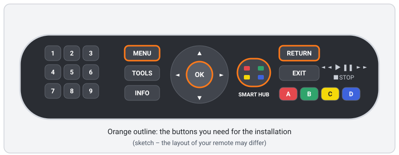

## Contents

1. [What you need](#1-what-you-need)
2. [How it works (in one minute)](#2-how-it-works-in-one-minute)
3. [Prepare the TV (once)](#3-prepare-the-tv-once)
4. [Download and start the setup program](#4-download-and-start-the-setup-program)
5. [Sign in, choose server and profiles](#5-sign-in-choose-server-and-profiles)
6. [Build the app package](#6-build-the-app-package)
7. [Send the app to the TV](#7-send-the-app-to-the-tv)
8. [What success looks like](#8-what-success-looks-like)
9. [First start on the TV](#9-first-start-on-the-tv)
10. [Updating](#10-updating)
11. [Uninstalling](#11-uninstalling)
12. [Troubleshooting](#12-troubleshooting)
13. [Optional: the helper for Watchlist and Discover](#13-optional-the-helper-for-watchlist-and-discover)
14. [Optional: other servers (shared with you)](#14-optional-other-servers-shared-with-you)

---

## 1. What you need

- ✅ A **Samsung Smart TV from 2014** with Smart Hub. Neolume is developed on a **UE48H8000**.
  - Where is the model number? On the sticker on the **back of the TV**, or on the TV: `MENU` → **Support** →
    **Contact Samsung** (Unterstützung → Samsung kontaktieren). This screen shows the **Model Code** and the **Software Version**.
  - The **fifth character** tells the year: **H** = 2014 (for example UE48**H**8000, UE55**HU**7500). See the
    [FAQ](FAQ.md#which-tvs-does-neolume-run-on) for other years.
- ✅ The TV is **connected to your home network** (Wi-Fi or cable).
- ✅ A **Plex Media Server** that is running on the **same home network**, and **you are its owner**.
- ✅ Your **Plex account** (e-mail and password, or Google/Apple sign-in).
- ✅ A **computer** (Windows, Mac or Linux) on the **same home network** – not on a guest Wi-Fi, and with any VPN switched off.
- ✅ The TV **remote**. The standard remote is easiest; the Smart Control (touchpad remote) also works.

No Plex Pass is needed, and nothing needs to be installed on your Plex server.

## 2. How it works (in one minute)

Samsung no longer accepts new apps for 2014 TVs in its store. But every Samsung TV of that time has an official
**developer mode** for installing your own apps:

1. On the TV you sign in to Smart Hub with the special user **`develop`**.
2. You tell the TV the **address of your computer** (**IP Setting**).
3. You press **Start User App Sync**. The TV then downloads a list of apps and the app package from your computer.

The **setup program** on your computer does the rest: it signs you in to Plex once, fetches access for your profiles,
builds the app package and hands it to the TV. Afterwards the TV talks **only to your own Plex server** – the computer can
be switched off.

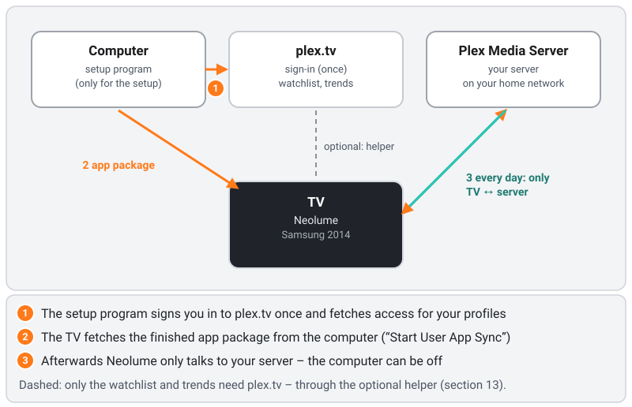

> ⚠️ **Important:** during the sync the TV **removes every self-installed app that is not on the list.** Apps from the
> Samsung store (Netflix, YouTube, …) are **not** affected. If you have other self-installed apps, see
> [step 5.4](#54-other-self-installed-apps-advanced).

## 3. Prepare the TV (once)

You only do this once. The TV remembers it, even after switching off.

### 3.1 Check that the TV is online
1. Press `MENU`.
2. Choose **Network** (Netzwerk) → **Network Status** (Netzwerkstatus).
3. It should say that the TV is connected. If not, connect it first under **Network** → **Network Settings**.
4. Press `RETURN` (or `EXIT`) to leave the menu.

### 3.2 Sign in as the user "develop"

Why? Only while `develop` is signed in does the TV offer the two developer entries **IP Setting** and **Start User App
Sync** that install Neolume. Your store apps keep working as before.

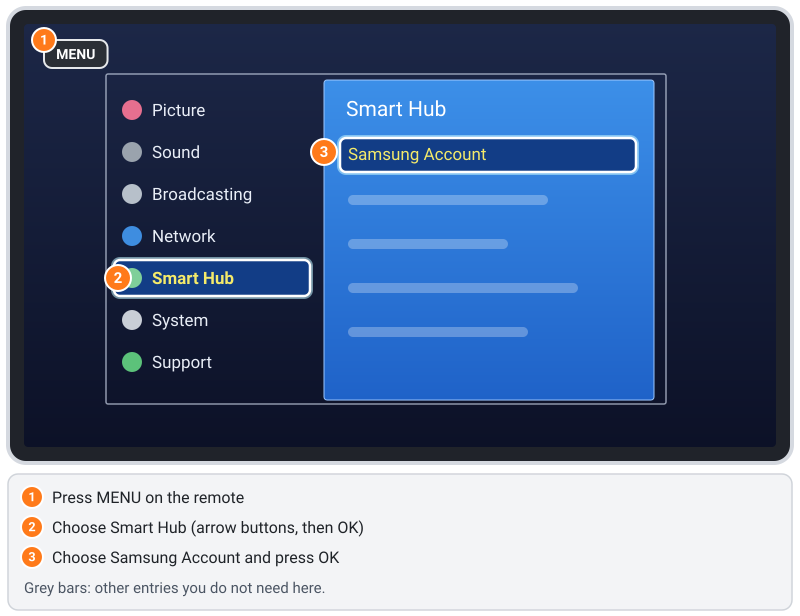

1. Press `MENU`.
   *Smart Control:* press `MORE` and choose **Menu** on the screen *(to be verified)*.
2. Choose **Smart Hub** → **Samsung Account** (Samsung-Konto).
   - If you are signed in, the list starts with **Log out** and the bottom right corner shows *My Account: …*.
     If it already says *My Account: develop*, you are done – skip to [step 3.3](#33-open-the-samsung-apps-screen).
     If another account is signed in, choose **Log out** first.
3. Choose the sign-in entry (German menu: **Anmeld.**; English: **Log In** *(to be verified)*). A list of the accounts on
   this TV appears.
4. **`develop` is in the list:** select it and choose **Log In** (Anmelden). **No password is needed.**
5. **`develop` is not in the list yet:** add it by typing **`develop`** (all lower case) as the ID with the on-screen
   keyboard. The password usually fills in by itself; if it stays empty, type **`any`** *(first-time creation on a TV
   that never had `develop` – to be verified; some TVs reportedly expect `111111`)*. Then choose **Log In**.

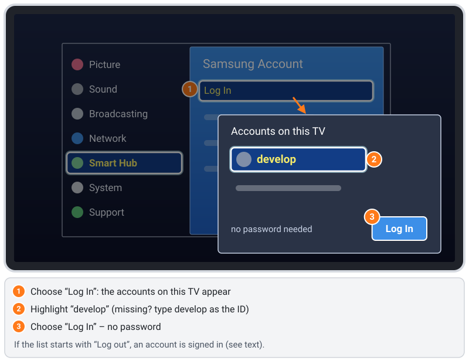

You stay signed in as `develop`, even after switching off. Store apps keep working.
Without the `develop` sign-in, the entries **IP Setting** and **Start User App Sync** (step 7) do not exist.

### 3.3 Open the SAMSUNG APPS screen
1. Press `SMART HUB` (the colourful button in the middle of the remote).
2. A bar appears at the bottom of the screen with the groups **Recent** and **Featured**. In **Featured**, select the
   turquoise **SAMSUNG APPS** tile (next to *Multimedia* and *Tutorial*) and press `OK`.
3. The SAMSUNG APPS screen opens. It has the sections **RECOMMENDED** and **MY APPS** (German menu: EMPFOHLEN /
   EIGENE APPS); further down are *Most Popular*, *What's New* and *Categories*.

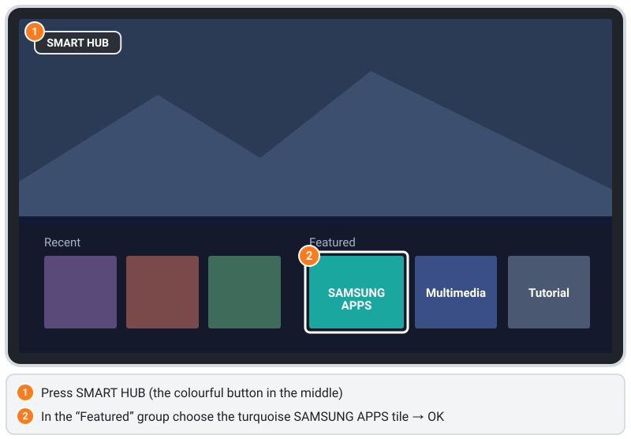

Leave the TV on this screen and go to your computer.

### 3.4 Optional: stop the TV from switching itself off after 4 hours

Many 2014 TVs switch themselves off after **4 hours without a button press** – also in the middle of a film or a long
music session. That is the TV's energy saving, not Neolume. If it bothers you: `MENU` → **System** → **Eco Solution**
(Öko-Lösung) → **Auto Power Off** (Autom. Aussch.) → **Off** (Aus) or a longer time. You can skip this step.

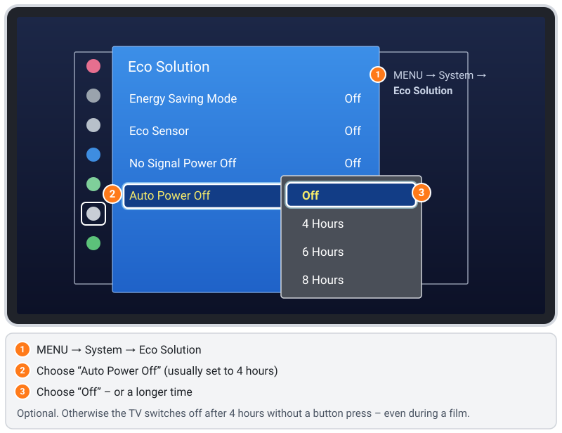

## 4. Download and start the setup program

### 4.1 Download
Open the **[latest release](https://github.com/itsab1989/neolume/releases/latest)** on your computer. Under **Assets**, download
the file for your computer:

| Your computer | File |
|---|---|
| Windows 10/11, normal PC or laptop | `neolume-setup-windows-x64.exe` |
| Windows on an ARM device (Surface Pro X, Snapdragon laptops) | `neolume-setup-windows-arm64.exe` |
| Mac with Apple chip (M1, M2, M3, M4 …) | `neolume-setup-macos-arm64.zip` |
| Mac with Intel chip | `neolume-setup-macos-x64.zip` |
| Linux PC | `neolume-setup-linux-x64` |
| Linux on ARM (e.g. Raspberry Pi 4/5 with 64-bit system) | `neolume-setup-linux-arm64` |
| Anything else with Python 3.8 or newer | `neolume-setup.pyz` |

Not sure which Mac? Apple menu → **About This Mac**: "Chip: Apple …" = Apple chip, "Processor: Intel …" = Intel.
Not sure which Windows? **Settings → System → About → System type**: "x64-based" = x64, "ARM-based" = ARM.

The TV app is already inside this one file – you do not need to build anything, and nothing is installed on your computer
(only the optional helper, section 13, can be installed if you want it).

### 4.2 Start it

**Windows**
1. Open your **Downloads** folder and **double-click** `neolume-setup-windows-x64.exe`.
2. If a blue window says **"Windows protected your PC"**: click **More info** → **Run anyway**.
   (The program is not signed with a paid certificate; that is why Windows asks.)
3. Windows Security asks *"Do you want to allow public and private networks to access this app?"* for
   **"Neolume Setup & Helper"**: click **Allow** (older Windows: tick **Private networks** → **Allow access**).
   Why: the TV fetches the app from your computer – an incoming connection, which Windows only allows after asking you.
   Nothing is opened to the internet; your router keeps the internet out.
4. A black window opens and your browser shows the setup page. **Keep the black window open** until you are finished.

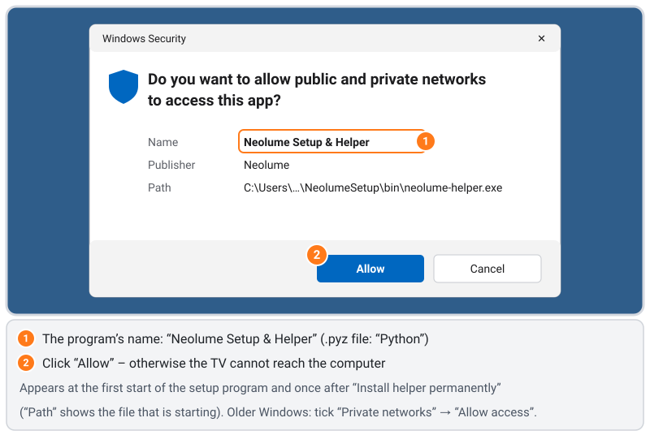

**Mac**
1. Open your **Downloads** folder and **double-click** the `.zip` file. A file called `neolume-setup` appears.
2. **Double-click** `neolume-setup`. The first time, macOS refuses programs from unknown developers
   (the program is not notarised by Apple):
   - **macOS 15 (Sequoia) and newer:** click **Done**, open **System Settings → Privacy & Security**, scroll down to
     *"neolume-setup" was blocked* → **Open Anyway**, confirm with your password, then double-click it again.
   - **macOS 14 and older:** right-click (or `Ctrl`-click) `neolume-setup` → **Open** → **Open**.
   - Terminal alternative: `xattr -d com.apple.quarantine ~/Downloads/neolume-setup`, then double-click it again.
3. A Terminal window opens (that is the program) and your browser shows the setup page.
   If macOS asks **"Do you want the application "neolume-setup" to accept incoming network connections?"**: click **Allow**
   (same reason as on Windows).
4. **Keep the Terminal window open** until you are finished. To stop the program later, click **Quit program** on the setup page.

**Linux**
1. Open a terminal in the folder with the download and run:
   ```sh
   chmod +x neolume-setup-linux-x64
   sudo ./neolume-setup-linux-x64
   ```
   (`sudo` is needed because the TV always fetches apps on port 80. Use `neolume-setup-linux-arm64` on ARM.)
2. If you use a firewall: allow port 80 while you install, e.g. `sudo ufw allow 80/tcp`.

**Python version (`.pyz`, any system)**
- Mac/Linux: `python3 neolume-setup.pyz` (Linux: `sudo python3 neolume-setup.pyz`).
- Windows: `py neolume-setup.pyz` in the Command Prompt (Python from python.org, with "Add python.exe to PATH" ticked).
  The firewall prompt then names **"Python"** instead of "Neolume Setup & Helper".

If the browser does not open by itself, open **http://127.0.0.1:32480/** yourself. Starting the program a second time
simply opens the page of the one that is already running.

## 5. Sign in, choose server and profiles

The setup page is available in English and German (buttons **DE** / **EN** at the top right). A row at the top shows where
you are: **1. Sign in · 2. Server · 3. Profiles · 4. Summary · 5. To the TV · 6. Done**.

### 5.1 Sign in with Plex
1. Click **Sign in with Plex**.
2. A plex.tv window opens. Sign in as usual and click **Allow**.
3. The setup page continues by itself.

No pop-up? Use **Use a code on plex.tv/link instead**: open `plex.tv/link` on any device (your phone works too), sign in and
type the code shown on the setup page.

You type your Plex password **only on plex.tv** – never into Neolume.

### 5.2 Choose your server
Your servers are listed. **Click your server.** It should show **found on your network** and **your server**.
If it is not found, see [Server not found](#server-not-found).

### 5.3 Check the profiles
All profiles of your Plex Home are listed and ticked. Each profile gets its own access to your server – with its own
libraries and its own watched status. Untick a profile that should not appear on the TV.
- A profile shows **no access to this server**? In Plex (web app), open **Settings → Users & Sharing**, share your server
  with that profile, then click **Back** on the setup page and choose the server again.
- A PIN for the profiles is not set here: Neolume has its own app PINs, which you set later on the TV ([section 9](#9-first-start-on-the-tv)).

### 5.4 Other self-installed apps (Advanced)
Open **Advanced** only if one of these applies:
- **You use other self-installed apps** on the TV (not from the Samsung store). Enter the path of each app's `.zip` file,
  one per line. **Otherwise the TV deletes them during the sync.**
- You want that **only your TV** may fetch the app: enter the TV's IP address. You find it on the TV under `MENU` →
  **Network** → **Network Status** → **IP Settings** *(to be verified)*.

Then click **Next**.

## 6. Build the app package

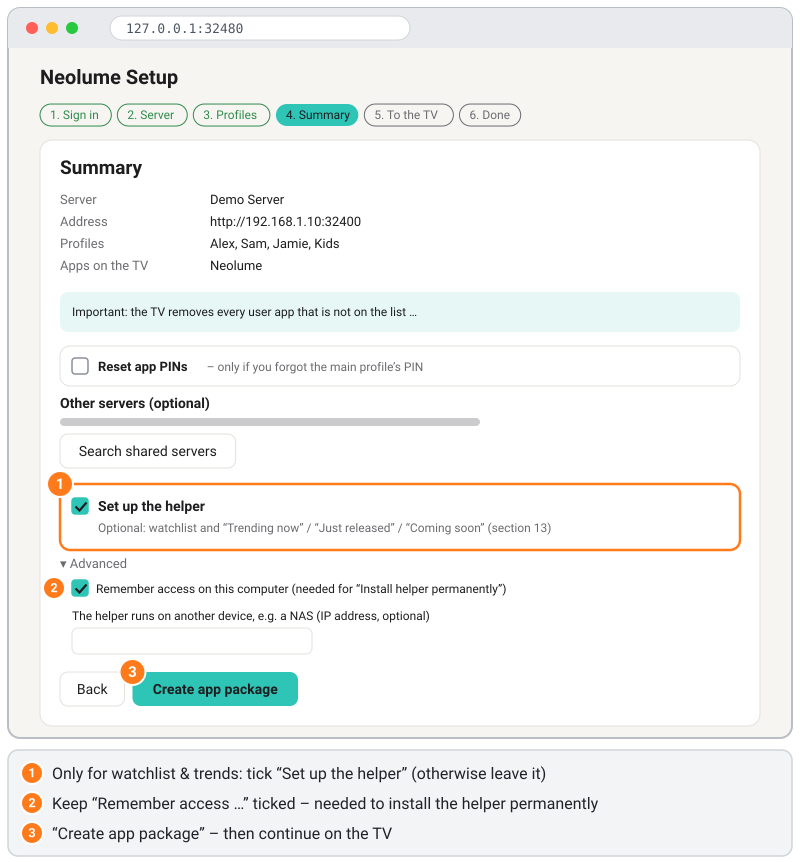

1. Check the **Summary**. Optional extras there – all off unless you tick them:
   - **Reset app PINs** – only if you forgot the main profile's app PIN ([details](#i-forgot-the-app-pin)).
   - **Other servers** – servers that someone shared with you ([section 14](#14-optional-other-servers-shared-with-you)).
   - **Set up the helper** – for your Plex watchlist, the Discover rows from plex.tv and details of titles that are not on your server ([section 13](#13-optional-the-helper-for-watchlist-and-discover)).
     Not sure? Leave it off; you can add it later by simply running the setup again.
2. Click **Create app package**.
3. The page now shows **your computer's address in large digits** (for example `192.168.1.20`) and waits for the TV.
   Write it down – you need it in the next step.

## 7. Send the app to the TV

Go back to the TV. You should still be on the **SAMSUNG APPS** screen from [step 3.3](#33-open-the-samsung-apps-screen).

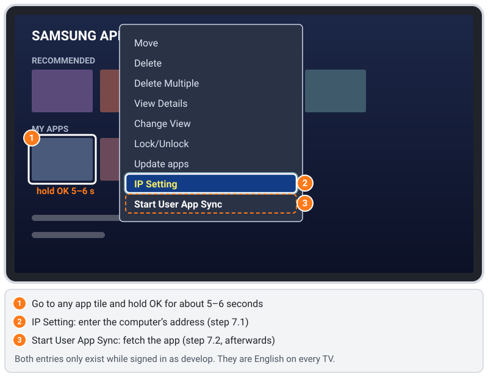

### 7.1 Tell the TV your computer's address (IP Setting)
1. With the arrow buttons, move to **any app tile** (for example a preinstalled app).
2. **Press and hold `OK` for about 5–6 seconds** until a menu appears. Its entries are **Move**, **Delete**,
   **Delete Multiple**, **View Details**, **Change View**, **Lock/Unlock**, **Update apps**, **IP Setting** and
   **Start User App Sync** (German menu: Verschieben, Entfernen, Mehr löschen, Details anzeigen, Ansicht ändern,
   Sperren/Sperre aus, Apps aktualisieren – the last two entries stay in English).
   No menu? Make sure the focus is really on an app tile and that you are signed in as `develop` ([step 3.2](#32-sign-in-as-the-user-develop)).
3. Choose **IP Setting** and press `OK`. The dialog **Develop IP Setting** opens with **four empty boxes** and an **OK** button.
   > ⚠️ The TV **never shows the address it has stored** – the boxes are always empty, even if an address is saved.
   > **Do not confirm the empty dialog with OK**: that can erase the stored address. Either type the full address again,
   > or leave with `RETURN`.
4. Type the address from the setup page with the **number buttons**, one block per box, and **press `OK` after each
   block** – the TV then moves to the next box (verified on the TV). Example: `192` `OK`, `168` `OK`, `1` `OK`, `20` `OK`.
   Go back with **`◄`** to correct a digit.
5. Select **OK** and press `OK`.

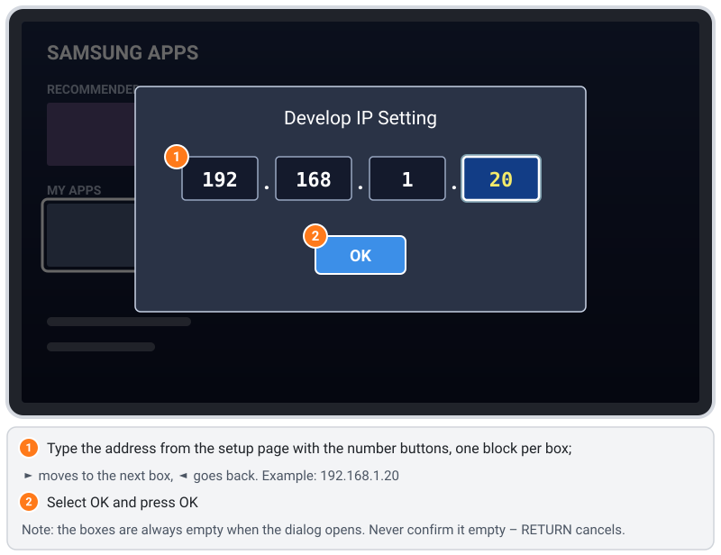

You only need to do this again if your computer's address changes.

### 7.2 Start the sync
1. Again **hold `OK` for about 5 seconds** on an app tile.
2. Choose **Start User App Sync** and press `OK`.
3. The message **"User Apps Sync is requested"** appears (in English, also on a German TV). Press `OK` **once only**.
   If the menu is still open afterwards and an entry such as **Move** looks active, press `RETURN` – that is harmless.
4. Wait. The TV first fetches the app list, then the app; this usually takes **20–30 seconds**.

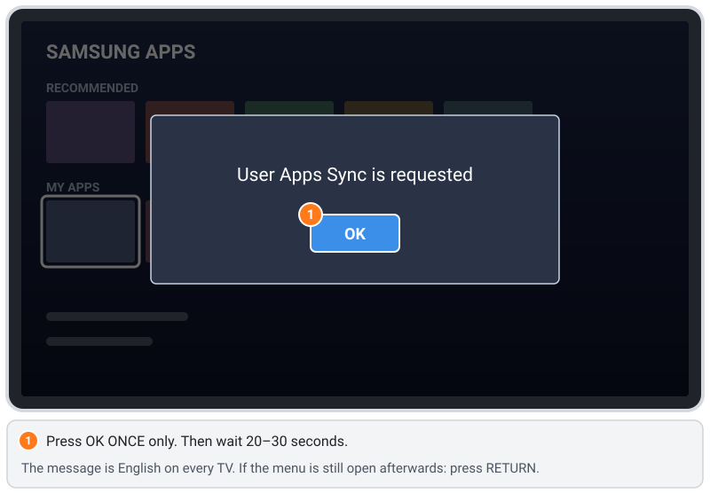

## 8. What success looks like

- **On the setup page** you see, one after the other: *"TV … fetched widgetlist.xml"* and *"TV … fetched Neolume.zip"*,
  then *"The app has arrived on the TV."*
- **On the TV**, **Neolume** appears under **MY APPS** (EIGENE APPS) with its icon – a highlighted poster card with a play symbol.
  Not there? Close Smart Hub (`SMART HUB` or `EXIT`) and open it again, or switch the TV off and on with the remote.
- Other self-installed apps that you entered in [step 5.4](#54-other-self-installed-apps-advanced) are still there.

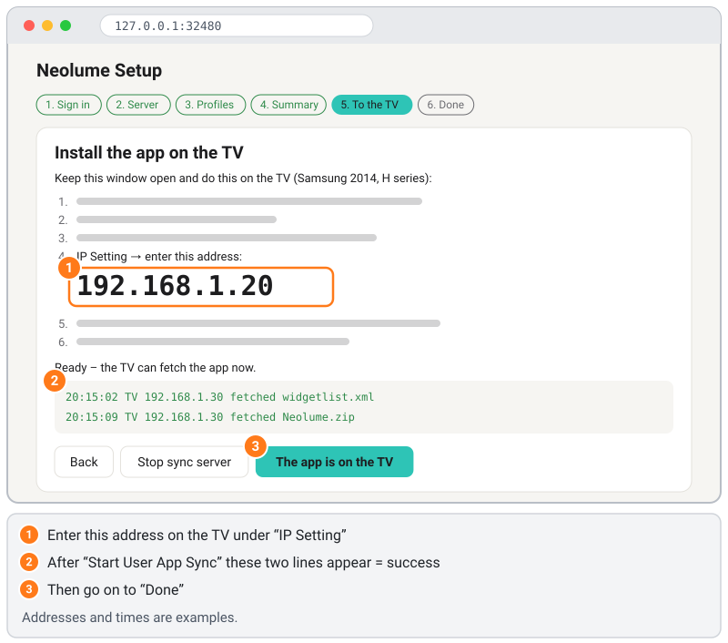

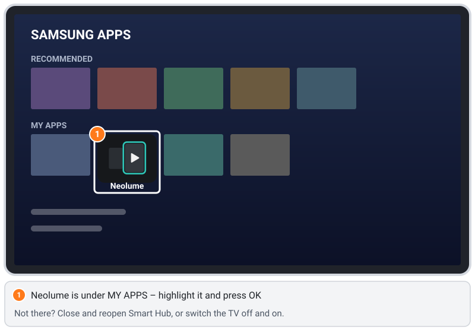

Then click **The app is on the TV** → **Clear access data from memory and finish** on the setup page. Optional on that
page: **Remember settings on this computer (no access data)** – saves the language and the list from step 5.4 for next
time. Close the browser tab and click **Quit program** (or close the black/Terminal window, or press `Ctrl` + `C` in it).

Did you tick **Set up the helper**? Then do **not** quit yet – continue with [section 13.2](#132-set-it-up-and-try-it).

## 9. First start on the TV

1. In **MY APPS**, select **Neolume** and press `OK`.
2. Neolume opens directly in the **main profile** (the owner). To switch, open the sidebar with `◄` and select your
   avatar at the top: the profile picker **Who's watching?** opens. Under **Settings → Profile & account → Start profile**
   you can choose to start with the profile picker (**Show profile picker**) or with the last used profile instead.
3. **App PINs:** Neolume has its own PINs (your Plex PIN is not used, and the setup program never asks for it). If there is
   a kids profile and your profile has no app PIN yet, the profile picker reminds you with **Protect adult profiles?** –
   choose **Got it** or **Remind me later**. You set PINs under **Settings → Profile & account**. A PIN only applies to
   Neolume on this TV.
4. Home loads Continue Watching, Up Next and what is new in your libraries.
5. After a moment on Home, a card **How to use Neolume** shows the remote buttons. You can open it again under
   **Settings** → **Help & info**.

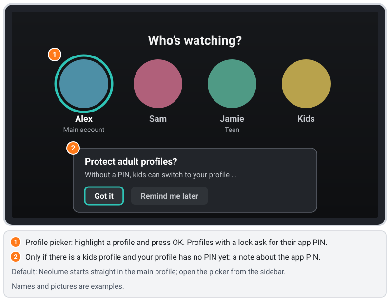

From now on Neolume talks **only to your server**. Your computer can stay off; the internet is not needed for watching
(your server still uses the internet for posters and metadata).

**Remote cheat sheet**
| Button | What it does |
|---|---|
| Arrow buttons, `OK` | Move, select |
| `RETURN` | Back. In a library, Search, Discover or Settings it first goes to the top, then to Home (or to the section before – *Back from a section* under **Settings → Display**). On Home: to the first card, then *Exit*. The sidebar opens with ◀ |
| `PLAY` / `PAUSE` / `STOP` | Playback |
| `◄◄` / `►►` | Skip back / forward (in lists: jump several items) |
| `TOOLS` | Options for the focused item ("More" menu in the player) |
| `INFO` | Information / help for the current screen |
| `A` red / `B` green / `C` yellow / `D` blue | Shown at the bottom of each screen (for example yellow = mark as watched, blue = search) |
| Number buttons | Jump to a letter in a library (like phone typing) |

## 10. Updating

1. Download the new version of the setup program ([step 4](#4-download-and-start-the-setup-program)).
2. Start it and repeat steps 5 to 7. **IP Setting** is only needed if your computer's address changed.
   Using the helper? **Set up the helper** is already ticked if this computer remembers its access – leave it ticked
   (unticking it removes the helper, see [13.7](#137-remove-it-completely)).
3. The sync replaces Neolume – no second app appears. Your settings and app PINs in Neolume are kept.
4. Installed the [helper](#13-optional-the-helper-for-watchlist-and-discover) permanently? Click **Update helper** in its
   card on the setup page ([13.6](#136-update)).

Run the setup again also when you **add a profile**, **share your server with a new profile**, **change your Plex password**
or use **Sign out of all devices** on plex.tv. Neolume tells you when this is needed (**Please run the setup again**).

## 11. Uninstalling

1. Press `SMART HUB` → open **SAMSUNG APPS** → move to **Neolume**.
2. **Hold `OK` for about 5–6 seconds** → **Delete** (Entfernen) → confirm *(wording of the confirmation to be verified)*.
3. On plex.tv, open **Account** → **Authorized Devices** and remove the **Neolume** entry. This cancels the access.
4. Optional: remove shares in Plex that you created only for Neolume.
5. Optional: sign out of `develop` on the TV: `MENU` → **Smart Hub** → **Samsung Account** → **Log out**.
6. Installed the [helper](#13-optional-the-helper-for-watchlist-and-discover)? Remove it with **Remove helper …**
   ([13.7](#137-remove-it-completely)).
7. On the computer: delete the downloaded setup file. If you ticked **Remember settings**, also delete the settings folder
   (Windows: `%APPDATA%\NeolumeSetup`, Mac: `~/Library/Application Support/NeolumeSetup`, Linux: `~/.config/NeolumeSetup`).

Nothing in the TV's firmware or system is changed by Neolume.

## 12. Troubleshooting

### The menu with "IP Setting" / "Start User App Sync" does not appear
- Are you signed in as **`develop`**? ([step 3.2](#32-sign-in-as-the-user-develop)) Only then do these entries exist.
- Are you in the **SAMSUNG APPS** screen, with the focus on an app tile under **MY APPS** (not on a category)?
- **Hold `OK` long enough** (5–6 seconds) instead of pressing it several times.

### The sync runs, but no app appears
- Did the setup page report *"fetched widgetlist.xml"*?
  - **No** → the TV cannot reach your computer. See the next section.
  - **Yes, but not the app package** → start the sync again. If it keeps failing, click **Create app package** again.
  - **Both yes** → close and reopen Smart Hub, or switch the TV off and on. Look in **MY APPS**, not only in the small bar.
- Is the address under **IP Setting** exactly the one shown on the setup page? The dialog never shows the stored address,
  so simply type it again (all four boxes) and select **OK** – and never confirm the empty dialog.

### The TV cannot reach the computer
- **Firewall:** your computer must accept incoming connections on **port 80**.
  - Windows: **Windows Security** → **Firewall & network protection** → **Allow an app through firewall** → **Change
    settings** → allow **Neolume Setup & Helper** (`.pyz`: **Python**) for **Private**. Your network must be set to
    **Private**, not "Public" (*Settings → Network & Internet → Properties*).
  - Mac: **System Settings** → **Network** → **Firewall** → **Options** → set `neolume-setup` (`.pyz`: `python3`) to **Allow incoming connections**.
  - Linux: for example `sudo ufw allow 80/tcp` while you install.
- **Port 80 in use:** if the setup page says the port is busy, another web server is running (or the setup program twice).
  Close it and try again.
- **Same network:** computer and TV must be on the same home network – no guest Wi-Fi, no VPN, no separate "IoT" network.
  Some routers isolate Wi-Fi devices from each other ("client isolation" / "AP isolation") – switch that off in the router.
- **Locked to the first TV:** after the first fetch the setup program only serves that device. If a different device fetched
  first, click **Unlock** on the setup page.

### Other self-installed apps disappeared after the sync
That is how the TV's sync works: it **removes every self-installed app that is not on the list**. Add the `.zip` files of
**all** apps you want under **Advanced** ([step 5.4](#54-other-self-installed-apps-advanced)), create the package again and
sync again. You may have to sign in to those apps again.

### Server not found
- Is your Plex Media Server running? On the computer, open `http://<server address>:32400/web` in the browser.
- Is the computer on the same network as the server?
- Is the server signed in with **your** Plex account (Plex → Settings → General)? Only the owner can set it up.
- Neolume only uses home-network addresses. A server that is only reachable over the internet is not supported.

### "Windows protected your PC" / macOS says the app "cannot be opened"
The setup program is not signed with a paid certificate. Windows: **More info** → **Run anyway**. Mac: **System Settings**
→ **Privacy & Security** → **Open Anyway** (details in [step 4.2](#42-start-it)).

### "Port 80 may not be opened"
Linux: start the program with `sudo`. Mac/Windows: allow the firewall prompt, then start the program again.

### Why not HTTPS?
The TV only supports old encryption (TLS 1.1 and older); plex.tv requires TLS 1.2 or newer. That is why the computer does
the sign-in, and the TV talks to your server **over HTTP inside your home network**. This cannot be changed on the TV. Use
Neolume only on a home network you trust.

### Neolume says "Please run the setup again"
An access became invalid (new Plex password, "Sign out of all devices", changed share). Repeat steps 4 to 7.

### I forgot the app PIN
The main profile can change or remove every profile's PIN under **Settings** → **Profile & account** → **PINs of all profiles**.
Forgot the **main profile's** PIN? Run the setup again, tick **Reset app PINs** in the summary and install again.

### The TV switches off by itself after a few hours
That is the TV's **Auto Power Off** (after 4 hours without a button press). See [step 3.4](#34-optional-stop-the-tv-from-switching-itself-off-after-4-hours).

### Resetting Smart Hub – last resort
**Reset Smart Hub** (Smart Hub zurücksetzen, under `MENU` → **Smart Hub** → **Reset Smart Hub**) deletes **all**
self-installed apps with their data and signs `develop` out. Afterwards repeat step 3.2 and steps 4 to 7. A factory reset
has the same effect (and more).

### Older TVs (2012/2013, E/F series)
Not tested, and the developer menu is different. Reported path: `SMART HUB` → red button `A` (log in) → `develop`
(password possibly `111111`) → `TOOLS` → **Settings** → **Development** → **Server IP** → **User Application Synchronization**
*(to be verified)*.

Still stuck? [Open an issue](https://github.com/itsab1989/neolume/issues) with your TV model, what you see on the TV and
what the setup page says.

## 13. Optional: the helper for Watchlist and Discover

### 13.1 What the helper is – and why the TV needs it

Everything in Neolume works with your Plex Media Server alone. Only a few things live on **plex.tv** (Plex's website)
instead of on your server: your **Plex watchlist**, the Discover rows **Trending now**, **Just released** and **Coming soon**,
and the details (story, genres, runtime, cast) of a title that is not on your server when you open it in Discover.

The 2014 TV cannot reach plex.tv by itself: plex.tv requires newer encryption (TLS 1.2), the TV only knows older versions
(up to TLS 1.1). The **helper** is a small program on a computer in your home network that does this one job for the TV:

- **What it fetches:** your Plex watchlist (and passes it on to plex.tv when you add or remove a title on the TV), the
  three Discover rows and – when you open a title in Discover that is not on your server – its story, genres, runtime and
  cast from the Plex catalogue. Nothing else. If you use [servers other people shared with you](#14-optional-other-servers-shared-with-you),
  it also looks up their current address.
- **What it does not do:** no video traffic (videos always come straight from your Plex server), not reachable from the
  internet, and does not pass on requests for anyone else. It only answers devices in your home network,
  only calls a fixed list of plex.tv addresses and sends data only to plex.tv.
- **What it stores:** the access file `helper.json` – readable only by your user account – in the settings folder
  (Mac: `~/Library/Application Support/NeolumeSetup`, Windows: `%APPDATA%\NeolumeSetup`, Linux: `~/.config/NeolumeSetup`).
  When installed permanently (13.3) also a copy of the program, an autostart entry and a log file (`helper.log`, without
  any access data).
- **When it is off:** Neolume keeps working as usual – only the watchlist, these rows and the details of titles outside
  your server are missing.

The watchlist is available for the owner and for Plex Home profiles **without** a Plex PIN (the setup program never asks for
or stores Plex PINs). Kids profiles have no Discover and no watchlist.

**Where should it run?** On a device that is switched on whenever you watch TV: your usual computer (it then works while
you are logged in), a Mac or PC that is always on, or a NAS ([13.8](#138-nas--docker)). It needs no administrator rights and
very little power.

### 13.2 Set it up and try it

1. On the setup page, in the **Summary**, tick **Set up the helper**. Leave **Remember access on this computer** (under
   **Advanced**) ticked – it is needed to install the helper permanently.
2. Click **Create app package** and send the app to the TV as usual (section 7). The app package now contains the helper's
   address, so the TV knows where to ask.
3. Below, the card **Optional helper: watchlist & trends** appears. Click **Start helper**. The helper now runs as long as
   the setup program is open (*Helper running on port 32499 (home network only)*).
4. Check it on the TV ([13.5](#135-check-that-it-works)). Happy? Install it permanently (13.3) – otherwise it stops when you
   quit the setup program.

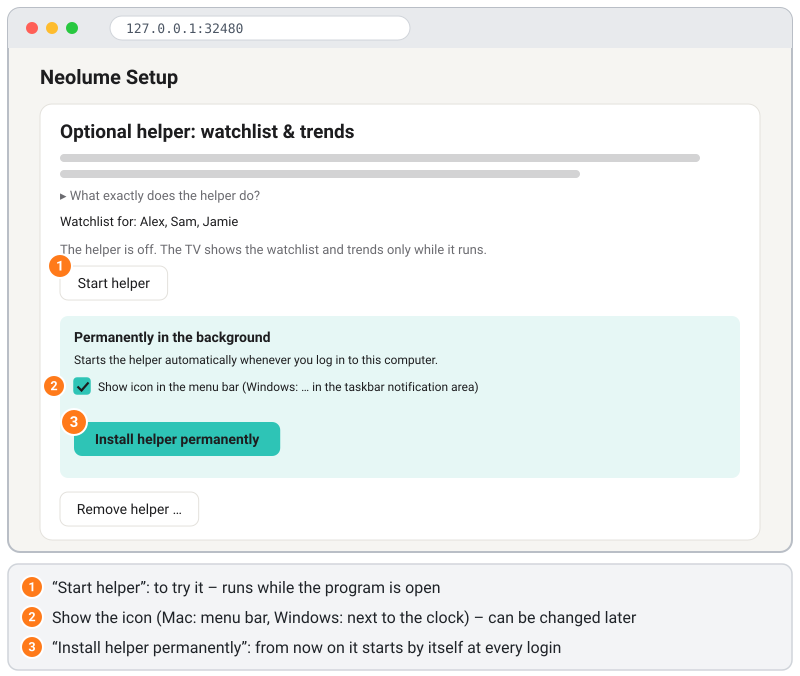

### 13.3 Install it permanently (starts automatically with your computer)

So that the helper keeps running after the setup program is closed and after a restart:

1. In the helper card on the setup page, click **Install helper permanently**. Leave the tick next to **Show icon in the
   menu bar** (Mac) or **Show icon in the taskbar notification area** (Windows) if you want to see that it is running.
2. The page shows a **Result** list, for example *Program copy created*, *Autostart set up* and *The helper is now running
   in the background*, and the card says **Running in the background (port 32499, home network only).**
3. Windows may ask about the firewall once more – for the installed copy (see the picture in [4.2](#42-start-it)): click
   **Allow**. On a Mac a notice **Background Items Added** appears (picture below) – that is expected.
4. You can now quit the setup program with **Quit program**. The helper keeps running and starts by itself whenever you log in.

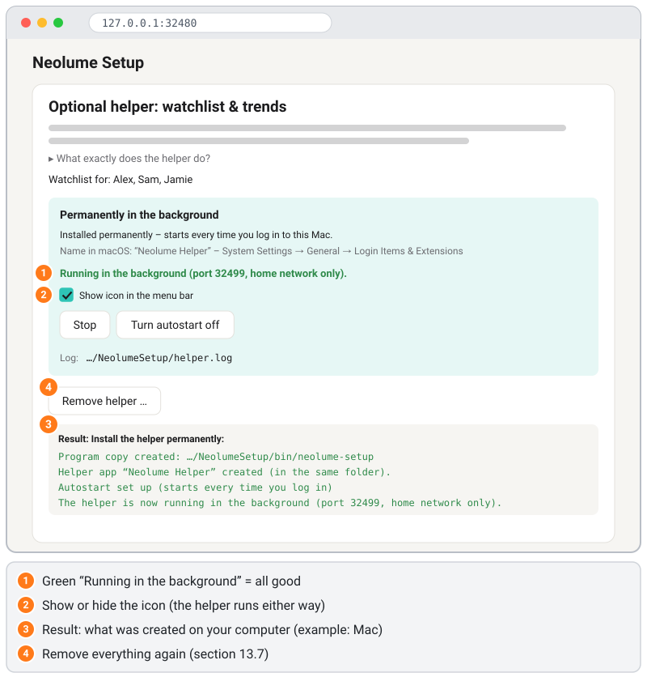

What happens on your computer:

| | Program copy | Autostart |
|---|---|---|
| Mac | `~/Library/Application Support/NeolumeSetup/bin/` (plus the small app "Neolume Helper.app" next to it) | starts when you log in (a "LaunchAgent" in `~/Library/LaunchAgents`) |
| Windows | `%LOCALAPPDATA%\NeolumeSetup\bin\` (`.exe`: two files, see below) | starts when you log in (a shortcut "Neolume Helper" in your **Startup** folder) |
| Linux | `~/.local/share/NeolumeSetup/bin/` | systemd user service `neolume-helper.service` |

The copy is made because the file you downloaded may be in your Downloads folder, which people tend to clean up. No
administrator rights are needed for any of this.

**What the helper is called on your computer – and where you see it.** The helper always appears under the name of the app
plus "Helper" – here **"Neolume Helper"** – with its own small TV icon in the app's colour. It is in German ("Neolume
Helfer") if the setup page or your computer is set to German.
- **Mac:** right after installing, macOS shows a notice **"Background Items Added"** – *"Neolume Helper" is an item that can
  run in the background*. That is expected and means the autostart works. You find it under **System Settings → General →
  Login Items & Extensions** (in the list of items allowed in the background; on newer macOS versions under **Background
  App Activity**), where you can also switch it off. Below the name macOS may write *"Item from unidentified developer"*,
  because the helper is not signed with a paid Apple certificate. To make macOS show this name (and not, say, "python3"),
  the helper is started through a tiny app, `Neolume Helper.app`, in the program folder above.
- **Windows:** Task Manager → **Startup apps** (and **Settings → Apps → Startup**) do not show the shortcut's name but the
  description of the program behind it: **"Neolume Setup & Helper"** with the publisher **"Neolume"** for the downloaded
  `.exe` (if you use the `.pyz` file with your own Python, it says **"Python"** instead). The same name appears in Task
  Manager's process list and in the firewall question. You can disable the autostart there. In your Startup folder
  (`Win + R` → `shell:startup`) it is a normal shortcut called **"Neolume Helper"**.
- **Windows, no window at login:** the helper starts silently in the background – no window and no taskbar button, only
  its icon next to the clock. For this the `.exe` is installed twice in the program folder: `neolume-helper.exe` is the
  helper that the autostart and the icon start; Windows treats it as a windowed program, so it never opens a console
  window. `neolume-setup.exe` is the normal setup program for the Command Prompt (and for **Open setup program …** in the icon
  menu). Both are the same program; that is why both carry the name "Neolume Setup & Helper". The `.pyz` file uses
  `pythonw.exe` (Python without a window) for the same reason.
- **Linux:** `systemctl --user status neolume-helper` shows it. There is no icon.
- `--helper-status` ([13.10](#1310-advanced-command-line-always-on-mac-linux)) prints the name too.

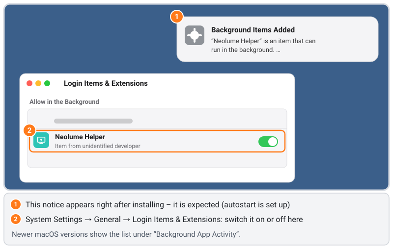

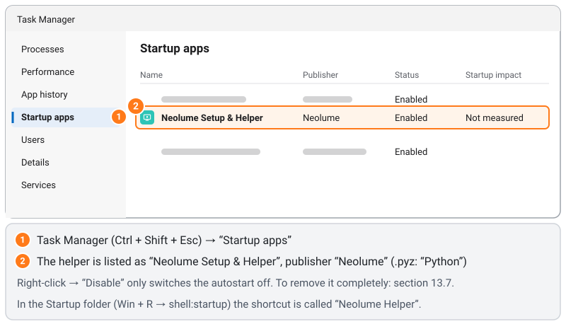

### 13.4 The icon: show or hide

On a Mac the helper shows a small TV icon in the **menu bar** (top right); on Windows in the **notification area** of the
taskbar (next to the clock – Windows may first put it under the small arrow **^**; drag it next to the clock so it stays
visible). Click it to see:

- three status lines (grey, not clickable) – what they mean is explained in [13.5](#135-check-that-it-works),
- **Pause** / **Resume** – the TV gets no watchlist and trends while paused; the helper keeps running,
- **Open setup program …** – opens the setup page at the helper card,
- **What does the helper do?** – a short explanation and where its access file is stored,
- **Quit helper** – stops it until your next login (or until **Start now** in the helper card),
- **Remove helper …** – removes it completely ([13.7](#137-remove-it-completely)).

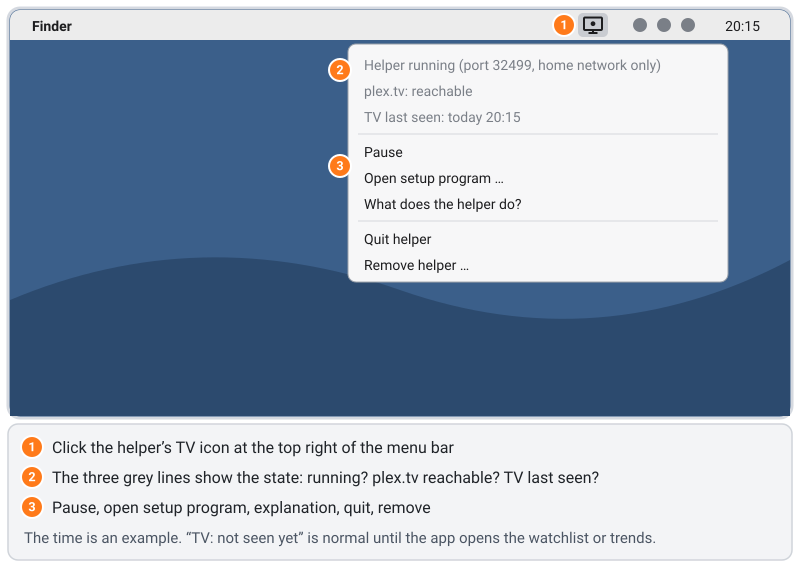

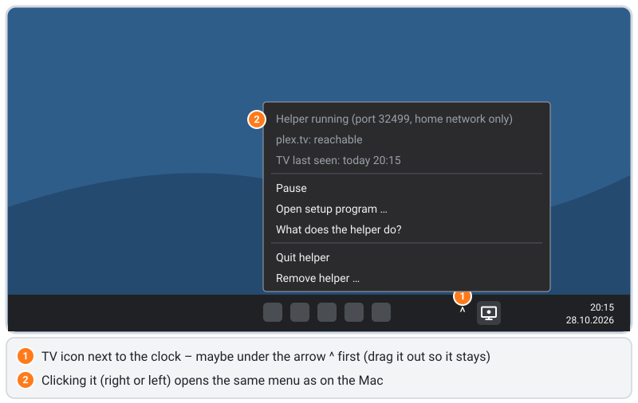

To hide the icon: start the setup program, and in the helper card untick **Show icon in the menu bar** / **Show icon in the
taskbar notification area**. The helper keeps running invisibly. Tick it again to bring the icon back. On Linux there is no
icon.

### 13.5 Check that it works

**On the TV:**
1. Open Neolume → **Settings** → **Display** → **Watchlist**. It should be switchable and on.
   - It says **Not set up**: the app package on the TV has no helper yet – tick **Set up the helper**, create the package
     and sync again (13.2).
   - It is grey with *"The Neolume helper is not answering"*: the TV knows the helper but cannot reach it – see
     [13.9](#139-helper-troubleshooting). Neolume tries again after a minute.
2. Open **Discover** in the sidebar: it shows **Your watchlist** and, before you type, the rows Trending now / Just released /
   Coming soon (which rows: **Settings** → **Display** → **Customize inspiration**). By default they only suggest titles
   that are not on your server yet (**Settings** → **Display** → **Only titles you don't have yet**).

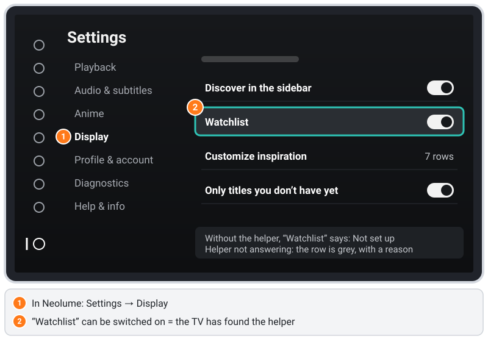

**On the computer** – the icon menu's three status lines:

| Line | Meaning |
|---|---|
| *Helper running (port 32499, home network only)* | It is running. *Helper paused – …* means you clicked **Pause**. |
| *plex.tv: reachable* | It can reach plex.tv. *checking …* right after the start; *not reachable – check the internet connection* see 13.9. |
| *TV last seen: today 20:15* | The TV last asked for something at that time. *TV: not seen yet* is normal until Neolume opens the watchlist or Discover for the first time. |

Without the icon: the helper card shows **Running in the background**, or `--helper-status` says *Running: yes (port 32499)*.

### 13.6 Update

- **A new version of the setup program:** download it, start it, and click **Update helper** in the helper card (it appears
  when the installed copy is a different version). Without a browser: run the new file with `--install-helper`.
- **New profiles or a new setup:** just run the setup again (**Set up the helper** stays ticked → **Create app package**).
  The installed helper picks up the new access file by itself within a few seconds.

### 13.7 Remove it completely

Any one of these removes everything the helper installed:

- setup page → helper card → **Remove helper …** → confirm,
- icon menu → **Remove helper …** → **Remove**,
- in a new setup, untick **Set up the helper** and click **Create app package**,
- command line: `./neolume-setup --uninstall-helper` (with `sudo` if you used `--at-boot`).

It stops the helper and deletes the autostart entry, the program copy (on a Mac also the helper app
`Neolume Helper.app`), the helper's settings and log, the access file `helper.json` and the folders that are empty
afterwards. When you remove it from the icon menu on Windows, the program copy and the log are still in use for a moment:
they are deleted as soon as the helper has quit (right after you click **OK**). If the helper has its own device entry at
plex.tv, that entry is removed too – except when it shares its access with the TV (removing it would sign the TV out).
A **Result** list shows what was removed and what is left. The app on the TV still knows the helper's address until you
create the app package again without **Set up the helper** and sync it; until then it briefly shows "Neolume helper not
reachable" when it looks for the helper. Everything else keeps working.

**What may be left – and why:**
- **The settings folder** with the setup program's own `settings.json`, if you ticked *Remember settings* – it belongs to the
  setup program, not to the helper. Delete the folder yourself if you no longer need it (paths in [13.1](#131-what-the-helper-is--and-why-the-tv-needs-it)).
- **A device entry at plex.tv**, if the result says so: remove it under **plex.tv → Account → Authorized Devices**.
- **Your downloaded file** stays where it is – delete it yourself if you no longer need it.
- **Firewall permission** (Windows/Mac): the system keeps the "allowed" entry for the program file. It is harmless (the file
  is gone). To tidy up: Windows **Allow an app through firewall** → **Change settings** → select **Neolume Setup & Helper** →
  **Remove**; Mac **Firewall → Options** → select it → **–**.
- **The TV still knows the helper's address** from its app package. Neolume then shows the watchlist as *not answering*
  – harmless. To make the TV forget it: run the setup again without **Set up the helper** and sync.
- If the same `helper.json` is also used on another device (NAS, an always-on Mac), remove the helper there too, or run the
  setup again for it.

**Turn autostart off** (in the helper card) is the gentle variant: it stops the helper and removes autostart and the
program copy, but keeps the access file, so **Start helper** in the setup program still works and you can install it
permanently again later without a new setup.

### 13.8 NAS / Docker

**NAS / Docker (for example Synology Container Manager):** the Docker image runs only the helper; the setup itself always
runs on a computer with a browser.
1. Set the helper up once on a computer: tick **Set up the helper**, keep **Remember access on this computer** and enter the
   NAS's IP address under **Advanced** → **The helper runs on another device**. Create the package and sync it to the TV.
   The helper card then says that the helper belongs on the other device – do not start or install it on the computer.
2. Copy the file `helper.json` from the settings folder (13.1) to a folder on the NAS, for example `/volume1/docker/neolume/`.
3. Start the container (`--net=host` lets the helper see the TV's real address; `--user` must be a user that can read
   `helper.json` – on a Synology run `id` over SSH, e.g. `1026:100`):
   ```sh
   docker run -d --name neolume-helper --restart unless-stopped --net=host \
     --user 1026:100 -v /volume1/docker/neolume:/data:ro ghcr.io/itsab1989/neolume-setup:latest
   ```
   Synology Container Manager: **Project → Create**, paste the
   [`docker-compose.yml`](https://github.com/itsab1989/neolume/blob/main/installer/docker-compose.yml) and adjust `user:`.
4. After a new setup, copy the new `helper.json` to the NAS and restart the container.

The Docker helper has no icon; to remove it, delete the container and the `helper.json` on the NAS (keep the copy on the
computer if you want to set it up again with the same key).

### 13.9 Helper troubleshooting

**"Neolume helper not reachable" on the TV** – Is the computer on and logged in (Mac/Windows) or the always-on Mac set to log in
automatically? Run `--helper-status` or look at the icon. Is the TV in the same home network (no guest Wi-Fi)? Did your
computer get a new IP address? Then run the setup again and sync – the TV stores the helper's address in its app package.

**Port 32499 is in use** – Only one program can use the helper's port. Usually it is the setup program itself with
**Start helper** or the **update server** running, or a second helper (for example in Docker). Stop the other one; the
installed helper tries again every 30 seconds by itself. The log file (`helper.log` in the settings folder) says
"Port 32499 in use".

**plex.tv not reachable** (icon menu or log) – Is the computer online? A firewall, proxy or ad blocker on the network must
allow `plex.tv` and `discover.provider.plex.tv`.

**Always-on Mac without a logged-in user** – A normally installed helper only starts after a login. Turn on automatic login
(13.10) or install with `sudo … --install-helper --at-boot`.

**Firewall question on the Mac** ("Do you want the application … to accept incoming network connections?") – click
**Allow**. If you missed it: **System Settings → Network → Firewall → Options…**, find `neolume-setup` or **Neolume Helper**
and set it to **Allow incoming connections**.

**Firewall question on Windows** – the first time the helper starts, Windows asks *"Do you want to allow public and private
networks to access this app?"* (older Windows: *"Windows Defender Firewall has blocked some features of this app"*). What it
means: the helper waits for the TV to ask it for the watchlist – that is an *incoming* connection, and Windows asks you
before it lets any program receive those. Click **Allow** (older Windows: tick **Private networks**, then **Allow
access**); without it the TV cannot reach the helper. This does not open anything to the internet: your router keeps the
internet out, and the helper itself only answers devices in your home network. The question names the program that
runs: **"Neolume Setup & Helper"** for the `.exe`, **"Python"** if you use the `.pyz` file (Python runs it). Windows
asks once per program file, and the installed helper (`neolume-helper.exe`) is a new file for Windows – so the question
usually comes once more right after installing (and once after updating from a version before 1.0.5). If you missed it:
**Control Panel → Windows Defender Firewall → Allow an app through Windows Defender Firewall** → **Change settings** →
**Allow another app…** → choose `%LOCALAPPDATA%\NeolumeSetup\bin\neolume-helper.exe` (`.pyz` variant: `pythonw.exe` of
your Python) → tick **Private**.

**Mac says the program "cannot be opened" / "developer cannot be verified"** – The program is not signed by a paid Apple
certificate. Open it once as described in [step 4.2](#42-start-it) (**System Settings → Privacy & Security → Open
Anyway**). Over SSH, run `xattr -d com.apple.quarantine ./neolume-setup` once before starting it. The installed copy does not
need this again.

**Windows "Windows protected your PC"** – SmartScreen warns about the downloaded, unsigned file: **More info → Run anyway**.
The installed copy starts at login without this question.

**No icon** – Is **Show icon …** ticked in the helper card? On Windows, look under the arrow **^** next to the clock and drag
the icon onto the taskbar. Installed over SSH while nobody was logged in at the screen? Then it runs without an icon until
your next login (`--helper-status` shows this). A helper installed with `--at-boot` or on Linux never has an icon.

**"Install helper permanently" says the helper is not set up** – the access file is missing: tick **Set up the helper**
(with **Remember access on this computer**) in the Summary and click **Create app package** first.

**Never forward port 32499 in your router.** The helper is meant for your home network only.

### 13.10 Advanced: command line, always-on Mac, Linux

**Without the browser (for example over SSH on an always-on Mac):** after the helper is set up (13.2, or see "Always-on Mac"
below), run the program with `--install-helper`:
```sh
./neolume-setup --install-helper            # Mac / Linux
neolume-setup-windows-x64.exe --install-helper
```
It prints the same result list, in German if your computer is set to German. Add `--no-tray` to hide the icon.

| Command | What it does |
|---|---|
| `--install-helper` | install permanently (or update the installed copy) |
| `--install-helper --no-tray` | the same, without the icon |
| `--helper-status` | set up? installed? running? its name in the system, icon state, log file |
| `--uninstall-helper` | remove completely (13.7) |
| `--uninstall-helper --keep-access` | only turn autostart off, keep the access file |
| `sudo … --install-helper --at-boot` | Mac only: start at boot without a login (see below) |

Installing over SSH on a computer where you are also logged in at the screen: the helper is started in your desktop
session, so its icon appears right away. If nobody is logged in at the screen, it runs without an icon for now; at your next
login the autostart replaces it with one that has the icon (`--helper-status` says "on, but not visible right now").

**Always-on Mac (for example one without a screen):**
- The helper starts when **your user logs in**. For a Mac without a screen, turn on **System Settings → Users & Groups →
  Automatically log in as** → your user (not available with FileVault turned on), so it comes back by itself after a power
  cut.
- Doing everything over SSH: on that Mac turn on **System Settings → General → Sharing → Remote Login**. Run the setup on
  your laptop; under **Advanced** enter that Mac's IP address in **The helper runs on another device**, create the
  package and send it to the TV. Then copy the access file and the program to that Mac and install it there (`192.168.1.20` stands for its IP address):
  ```sh
  scp ~/Downloads/neolume-setup "$HOME/Library/Application Support/NeolumeSetup/helper.json" you@192.168.1.20:
  ssh you@192.168.1.20
  mkdir -p "$HOME/Library/Application Support/NeolumeSetup" && mv helper.json "$HOME/Library/Application Support/NeolumeSetup/"
  chmod 600 "$HOME/Library/Application Support/NeolumeSetup/helper.json"
  xattr -d com.apple.quarantine ./neolume-setup 2>/dev/null; ./neolume-setup --install-helper
  ```
  Use the file for that Mac's chip (section 4.1). Do not start the helper on the laptop as well – keep its
  `helper.json` there, though: the next setup on the laptop reuses its key, so the TV and that Mac stay matched (after a
  new setup, copy `helper.json` to that Mac again).
- If nobody is logged in on that Mac right now, the result says so: the helper is started directly for now (without
  an icon), and at the next login the autostart takes over – then with its icon.
- Must it run **without any login**? `sudo ./neolume-setup --install-helper --at-boot` installs it as a system service
  ("LaunchDaemon") that starts when the Mac boots and runs as your user. Trade-off: it needs your administrator password
  once, it has no menu bar icon, and removing it also needs `sudo` (`sudo ./neolume-setup --uninstall-helper`). With
  FileVault the Mac waits for the password at boot anyway, so automatic login (above) is the simpler choice for most people.

**Linux:** a systemd user service only runs while you are logged in. To keep it running all the time, run once:
`loginctl enable-linger $USER`. If the setup ran with `sudo`, the access file is in `/root/.config/NeolumeSetup/`: copy it
to `~/.config/NeolumeSetup/`, make it yours (`sudo chown $USER: ~/.config/NeolumeSetup/helper.json`, `chmod 600`) and run
`--install-helper` **without** `sudo`.

## 14. Optional: other servers (shared with you)

Has someone shared their Plex server with you, for example a friend? Neolume can show that server's libraries **in addition to
your own server** – off by default.

1. On the setup page, in the **Summary**, click **Search shared servers**. The program looks at the servers that were shared
   with each chosen profile (only your own access – it never asks for anyone else's password or token) and checks each one
   from your computer.
2. Tick the servers you want and click **Create app package**, then install as usual. Each profile only gets the servers
   that were shared with **that** profile.
3. On the TV the libraries appear in the sidebar with a small "from <server>" line. You can hide or move them under
   **Settings → Display → Customize sidebar**. Search and Home stay with your own server.

What the status next to a server means:
- **reachable** – fine, the TV can use it.
- **secure connections only** – the server requires encrypted connections, which the 2014 TV cannot do. The owner can set
  **Settings → Network → Secure connections** to **Preferred** in Plex; then search again.
- **not reachable right now** – the server may be off, or it is only reachable through the Plex relay (an encrypted detour
  via Plex, so the TV cannot use it). You can still tick it; the app tries again later.
- **no address** – Plex knows no address for this server. Ask the owner whether it is running and linked to their Plex
  account; then search again.

Once set up, **Settings → Profile & account → Other servers** on the TV shows how many of these servers are reachable
right now.

> ⚠️ The TV cannot encrypt. The connection to a shared server therefore goes **over the internet without encryption**, and
> someone on the way could read your access to that server. Your own server stays on your home network as before. Only
> tick a server if you are fine with that.

If the shared server's internet address changes, the optional [helper](#13-optional-the-helper-for-watchlist-and-discover)
finds the new one automatically; without the helper, run the setup again. If a shared server is not reachable, only its
libraries show a message – everything else keeps working.
