# Neolume auf Android TV / Google TV installieren – Schritt für Schritt

[English version](android-tv.md) · [FAQ](../FAQ.de.md) · [Anleitung Samsung 2014](../INSTALL.de.md) · [Zurück zur Übersicht](../../README.de.md)

Diese Anleitung ist für Menschen **ohne Technik-Vorwissen** geschrieben. Geh sie einfach von oben nach unten durch: Jede Taste
auf der Fernbedienung und jedes Menü am Fernseher ist genannt, und die wichtigen Bildschirme sind gezeichnet. Rechne beim
ersten Mal mit etwa **15 Minuten** – das meiste davon ist das Eintippen einer Internetadresse mit der Fernbedienung.

> 🧪 **Android TV ist neu und noch im Versuch.** Getestet wurde auf einem **TCL 32S5K** (Google TV, Android 11, 1 GB
> Arbeitsspeicher): Anmeldung, Profile, Startseite, Bibliotheken, Wiedergabe und Live-TV funktionieren. Andere Bereiche
> brauchen noch mehr Tests. Zeigt die Download-Adresse in [Schritt 4](#4-neolume-herunterladen-und-installieren) **Not
> Found**, gibt es noch keine veröffentlichte Android-TV-Fassung – den aktuellen Stand zeigt die Tabelle *Welche Fernseher
> funktionieren?* in der [Übersicht](../../README.de.md).

> **So liest du diese Anleitung**
> - `DIES` ist eine **Taste auf der Fernbedienung** (z. B. `OK`, `ZURÜCK`, `HOME`).
> - **Dies** ist ein **Wort auf dem Bildschirm**, das du auswählst.
> - › heißt „dann wählen“ (z. B. **Einstellungen › Apps**).
> - Die Menüs des Fernsehers folgen seiner Spracheinstellung. Hier stehen die deutschen Namen (so wie auf einem TCL mit
>   Google TV), in Klammern die englischen, wo es hilft. Manche Hersteller benennen einzelne Einträge etwas anders – nimm
>   dann den Eintrag, der am besten passt.
> - Die **Zeichnungen** sind vereinfachte Skizzen, keine Fotos. Orange Nummern zeigen die Reihenfolge. **Graue Balken**
>   stehen für Einträge, die du nicht brauchst – dein Fernseher zeigt dort Text.
> - Schritte mit *(noch zu prüfen)* wurden noch nicht wortgenau an einem Fernseher geprüft. Sieht es bei dir anders aus,
>   sag uns bitte in einem [Issue](https://github.com/itsab1989/neolume/issues) Bescheid, damit wir die Anleitung verbessern.

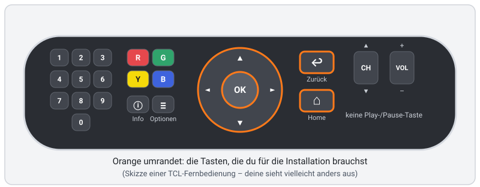

## Inhalt

1. [Was du brauchst](#1-was-du-brauchst)
2. [Wie es funktioniert (in einer Minute)](#2-wie-es-funktioniert-in-einer-minute)
3. [Fernseher vorbereiten (einmalig)](#3-fernseher-vorbereiten-einmalig)
4. [Neolume herunterladen und installieren](#4-neolume-herunterladen-und-installieren)
5. [Erster Start: anmelden und Profil wählen](#5-erster-start-anmelden-und-profil-wählen)
6. [Aufräumen (optional)](#6-aufräumen-optional)
7. [Aktualisieren](#7-aktualisieren)
8. [Deinstallieren](#8-deinstallieren)
9. [Tipps: richtige Uhrzeit, schnellerer Fernseher](#9-tipps-richtige-uhrzeit-schnellerer-fernseher)
10. [Fehlerbehebung](#10-fehlerbehebung)
11. [Für Fortgeschrittene: Installation vom Computer (adb)](#11-für-fortgeschrittene-installation-vom-computer-adb)

---

## 1. Was du brauchst

- ✅ Einen **Fernseher oder eine Streaming-Box mit Android TV oder Google TV**, Android 7.0 oder neuer. Du erkennst ihn am
  **Google Play Store** auf dem Fernseher und an der Startseite (Google TV: oben Reiter wie *Für dich*).
  - Wo steht die Android-Version? **Einstellungen › Geräteeinstellungen › Info** (Device Preferences › About) → **Android
    TV OS-Version**.
  - Getestet wird Neolume auf einem **TCL 32S5K** mit Google TV (Android 11) und nur 1 GB Arbeitsspeicher – ein kleines,
    günstiges Modell. Schnellere Geräte gehen genauso.
- ✅ Der Fernseher ist **mit dem Heimnetz verbunden** (WLAN oder Kabel) und hat Internet.
- ✅ Ein **Plex Media Server** im **selben Heimnetz** – am besten dein eigener: So wurde getestet.
- ✅ Dein **Plex-Konto** (E-Mail und Passwort oder Google-/Apple-Anmeldung).
- ✅ Ein **Handy oder Computer** mit Browser – nur um die Anmeldung einmal zu bestätigen (du tippst dort einen kurzen Code ein).
- ✅ Die **Fernbedienung**.

Einen Plex Pass brauchst du nicht, auf deinem Plex-Server muss nichts installiert werden, und **kein Computer muss
eingeschaltet bleiben**.

## 2. Wie es funktioniert (in einer Minute)

Neolume steht nicht im Google Play Store. Android erlaubt aber auch Apps aus anderen Quellen („Sideloading“) – allerdings
nur über eine App, der du das **ausdrücklich erlaubt** hast. Das schützt dich: Keine App kann heimlich etwas installieren.

1. Aus dem Play Store installierst du die kostenlose App **Downloader**. Sie kann genau eines: eine Datei von einer
   Internetadresse holen.
2. Du erlaubst **nur Downloader**, Apps zu installieren.
3. Downloader holt die App-Datei von Neolume (`android-tv.apk`) aus dem **offiziellen GitHub-Release** von Neolume und gibt
   sie an Android weiter. Android fragt dich vor dem Installieren noch einmal.
4. Beim ersten Start **meldest du dich mit einem Code** auf plex.tv/link an – dein Passwort tippst du nur bei plex.tv ein.

Danach spricht Neolume **direkt mit deinem Plex-Server** zu Hause und mit plex.tv für deine Merkliste und die Entdecken-Reihen.
Anders als die Samsung-Fernseher von 2014 erreicht ein Android-Fernseher plex.tv selbst – du brauchst also **kein
Einrichtungsprogramm und keinen Helfer**.

## 3. Fernseher vorbereiten (einmalig)

### 3.1 Downloader aus dem Play Store installieren
1. Drück `HOME`.
2. Öffne den **Google Play Store** (bei Google TV: Reiter **Apps** › **Nach Apps suchen**; bei älterem Android TV: die Kachel
   **Google Play Store** in der App-Reihe).
3. Such nach **Downloader**. Wähl die App **Downloader von AFTVnews** (orangefarbenes Symbol) – keine Nachahmung.
4. Wähl **Installieren**. Wenn sie fertig ist, öffne sie **noch nicht**.

Warum Downloader? Android TV hat keinen normalen Browser zum Herunterladen von Dateien. Downloader ist eine weit
verbreitete, kostenlose Hilfs-App genau dafür, und sie kommt aus dem offiziellen Play Store.

### 3.2 Downloader das Installieren erlauben

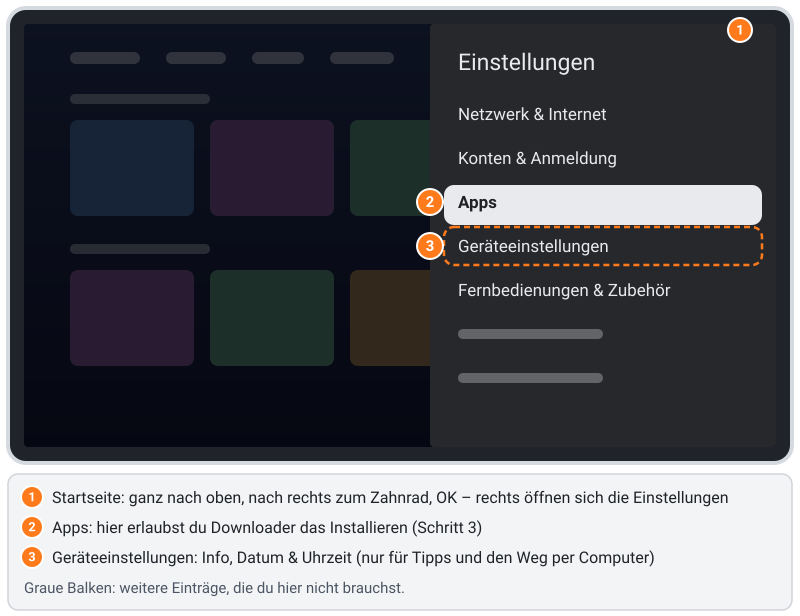

1. Drück `HOME`, geh ganz nach **oben**, dann nach **rechts** zum **Zahnrad** ⚙ oben rechts und drück `OK`. Rechts öffnen
   sich die **Einstellungen** mit den Haupteinträgen **Netzwerk & Internet**, **Konten & Anmeldung**, **Apps**,
   **Geräteeinstellungen** und **Fernbedienungen & Zubehör**.
   *Älteres Android TV:* Das Zahnrad sitzt ebenfalls oben rechts auf der Startseite.
2. Wähl **Apps** › **Sicherheit & Einschränkungen** › **Unbekannte Herkunft**. Dort steht **Installation von Apps aus
   anderen Quellen als dem Play Store zulassen**, darunter deine Apps mit je einem Schalter.
3. Markier **Downloader** und drück `OK`. Der Schalter geht an, daneben steht **Zugelassen**.
4. Alle anderen Apps lässt du, wie sie sind (**Nicht zulässig**). Mit `ZURÜCK` (mehrmals) verlässt du die Einstellungen.

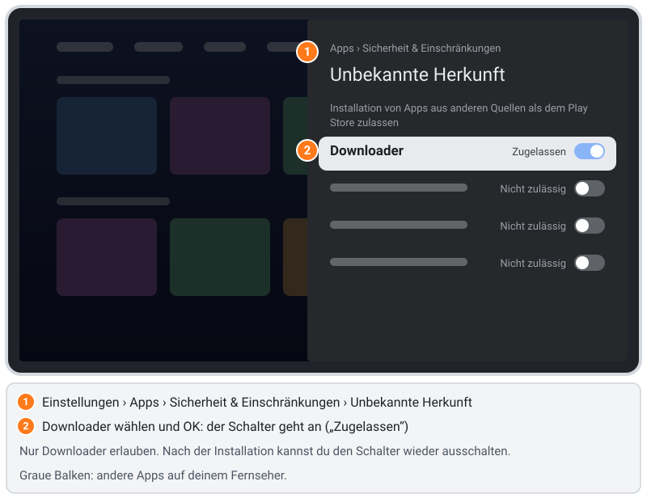

Diese Erlaubnis gilt **nur für Downloader**. Nach der Installation kannst du sie wieder ausschalten ([Abschnitt 6](#6-aufräumen-optional)).

## 4. Neolume herunterladen und installieren

1. Öffne **Downloader** (Google TV: Reiter **Apps** oder die Reihe **Deine Apps**). Beim ersten Start zeigt Downloader evtl.
   einen kurzen Hinweis oder fragt nach Zugriff auf Dateien/Medien – wähl **OK** bzw. **Zulassen**; Downloader braucht das,
   um die Datei zu speichern.
2. Geh auf der Seite **Home** in das **Adressfeld** und drück `OK`. Eine Bildschirmtastatur erscheint.
3. Tipp diese Adresse **genau so** ein (jedes Zeichen zählt, auch die Kleinbuchstaben):

   ```text
   https://github.com/itsab1989/neolume/releases/latest/download/android-tv.apk
   ```

   Tipp: Downloader bietet oft `https://` und `.com` als Abkürzung an; **/** und **.** findest du auf der Tastatur meist
   direkt oder über die Taste für Sonderzeichen.
4. Wähl **Go**. Downloader lädt die Datei (ein paar Megabyte) und öffnet danach von selbst die Installation von Android.

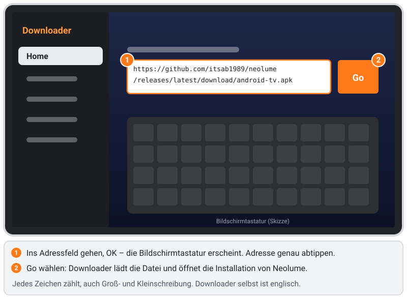

5. Android fragt **Möchtest du diese App installieren?** und zeigt den Namen **Neolume**. Wähl **Installieren** und drück
   `OK`. Steht die Markierung auf **Abbrechen**, drück vorher `►`.
6. Nach ein paar Sekunden meldet Android **App installiert**. Mit **Öffnen** startest du Neolume gleich – oder mit
   **Fertig** später über **Deine Apps**.
7. Downloader bietet danach evtl. an, die heruntergeladene Datei zu **löschen**. Das darfst du: Die installierte App braucht
   sie nicht mehr.

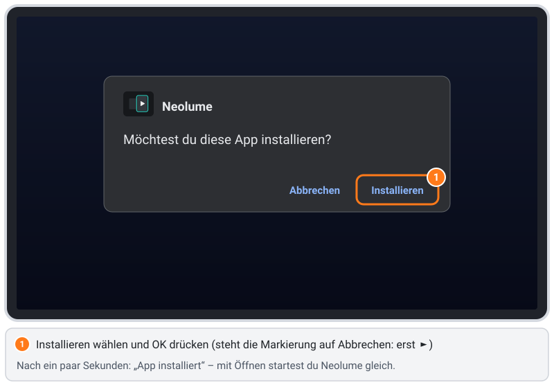

**Warum ist das sicher?** Die Adresse führt zum offiziellen GitHub-Release von Neolume. Android installiert die Datei erst
nach deiner Bestätigung, und jedes spätere Update muss dieselbe **digitale Signatur** tragen – niemand sonst kann Neolume
durch eine veränderte Fassung ersetzen.

## 5. Erster Start: anmelden und Profil wählen

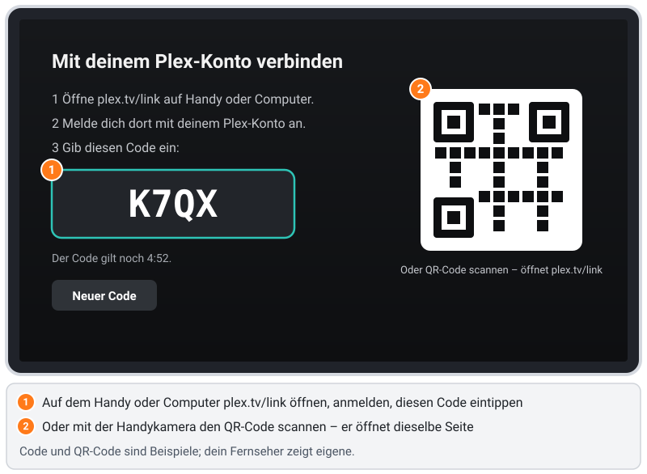

1. Starte **Neolume** (über **Deine Apps** oder mit **Öffnen** nach der Installation). Es erscheint **Mit deinem
   Plex-Konto verbinden** mit einem **Code aus 4 Zeichen**.
2. Öffne auf Handy oder Computer **plex.tv/link** – oder scanne einfach den **QR-Code** mit der Handykamera, er öffnet
   dieselbe Seite. Melde dich mit deinem Plex-Konto an und tipp den Code ein. Neolume macht nach wenigen Sekunden von
   selbst weiter.
   - Der Code gilt ein paar Minuten; danach erscheint automatisch ein neuer (oder wähl **Neuer Code**).
   - Dein Plex-Passwort tippst du **nur bei plex.tv** ein – nie am Fernseher.
3. Siehst du mit deinem Konto mehr als einen Server, wähl **deinen Server**.
4. **Wer schaut gerade?** – wähl dein Profil und drück `OK`. Profile mit Schloss fragen nach ihrer App-PIN.
5. Die Startseite lädt Weiterschauen, Nächste Folgen und das Neueste aus deinen Bibliotheken. Nach einem Moment erklärt eine
   Karte **So bedienst du Neolume** die Tasten; du findest sie wieder unter **Einstellungen › Hilfe & Diagnose**.

Die Anmeldung bleibt auf diesem Fernseher gespeichert, verschlüsselt mit einem Schlüssel aus dem geschützten Schlüsselspeicher
von Android. Nach dem Ausschalten musst du dich nicht neu anmelden.

**Spickzettel Fernbedienung** (die Hinweisleiste unten auf jedem Bildschirm zeigt die Tasten so beschriftet wie deine Fernbedienung)
| Taste | Was sie tut |
|---|---|
| Pfeiltasten, `OK` | Bewegen, auswählen |
| `ZURÜCK` (↩) | Zurück. In einer Bibliothek, der Suche, Entdecken oder den Einstellungen erst nach oben, dann zur Startseite. Auf der Startseite: zur ersten Karte, dann *Beenden* |
| `HOME` (⌂) | Verlässt Neolume und geht zur Startseite des Fernsehers |
| `≡` (Menütaste) | Optionen für das markierte Element („Mehr“-Menü im Player) – in der Hinweisleiste als ≡ |
| `ⓘ` Info | Informationen / Hilfe zum aktuellen Bildschirm |
| Farbtasten `R` `G` `Y` `B` | Stehen unten auf jedem Bildschirm (z. B. Y = als gesehen markieren, B = Suche) |
| Zahlentasten | In einer Bibliothek zu einem Buchstaben springen (wie beim Handy-Tippen) |
| `CH ▲` / `CH ▼` | In einer Bibliothek: mehrere Reihen springen. Im Player: vorheriger / nächster Titel |
| Keine Play-/Pause-Taste? | Im Player zeigt `OK` die Bedienleiste mit markiertem **Pause** – noch einmal `OK` pausiert bzw. spielt weiter |

## 6. Aufräumen (optional)

Neolume braucht Downloader nicht mehr – es aktualisiert sich selbst ([Abschnitt 7](#7-aktualisieren)). Wenn du es
aufgeräumt magst:
- Downloaders Erlaubnis wieder ausschalten: **Einstellungen › Apps › Sicherheit & Einschränkungen › Unbekannte Herkunft** ›
  **Downloader** → **Nicht zulässig**. (Für eine spätere Neuinstallation schaltest du sie wieder ein.)
- Oder Downloader ganz deinstallieren: **Einstellungen › Apps** › **Alle Apps anzeigen** › **Downloader** › **Deinstallieren**
  *(noch zu prüfen)*.

Neolume bleibt in beiden Fällen installiert und funktioniert weiter.

## 7. Aktualisieren

Neolume schaut **bei jedem Start einmal** nach einer neueren Version (kurz nachdem die Startseite erscheint). Es fragt das
offizielle GitHub-Release – ohne Computer, ohne Helfer.

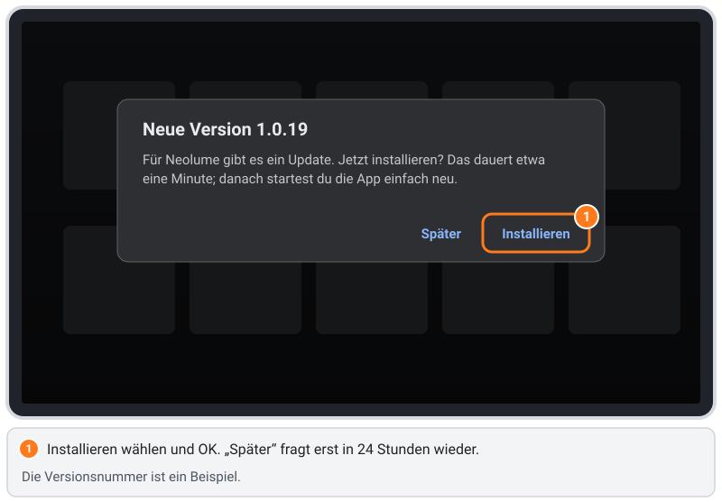

1. Ein Hinweis erscheint: **Neue Version x.y.z** – *Für Neolume gibt es ein Update. Jetzt installieren? Das dauert etwa eine
   Minute; danach startest du die App einfach neu.* Wähl **Installieren** und drück `OK`.
   (**Später** blendet den Hinweis für 24 Stunden aus.)
2. **Nur beim allerersten Mal:** Android öffnet die Seite **Installieren unbekannter Apps** mit einem Schalter für
   **Neolume**. Markier ihn, drück `OK`, damit der Schalter angeht, und dann `ZURÜCK`. Warum: Genau wie Downloader in
   Schritt 3.2 braucht Neolume einmal deine Erlaubnis, um seine eigenen Updates zu installieren. Es kann dabei nur eine
   Datei installieren, die mit dem Schlüssel von Neolume signiert ist.

   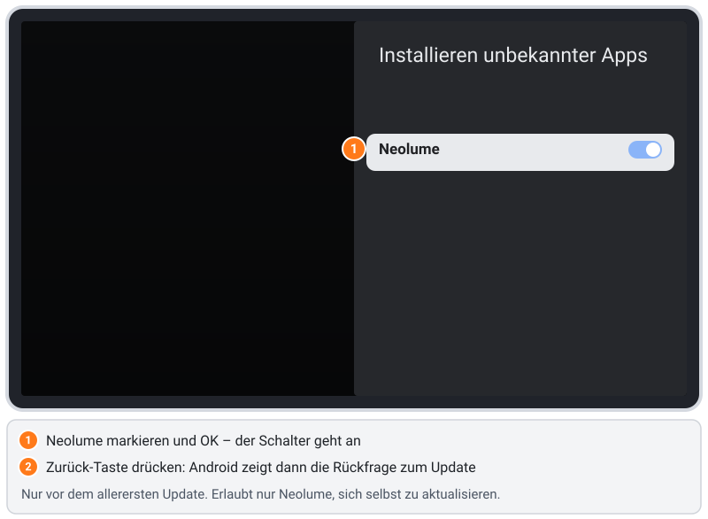

3. Android fragt **Möchtest du ein Update dieser vorhandenen App installieren? Deine bisherigen Daten gehen dabei nicht
   verloren.**
   ⚠️ **Achtung:** Die Markierung steht zuerst auf **Abbrechen**. Drück einmal `►`, damit **Installieren** markiert ist,
   und dann `OK`.

   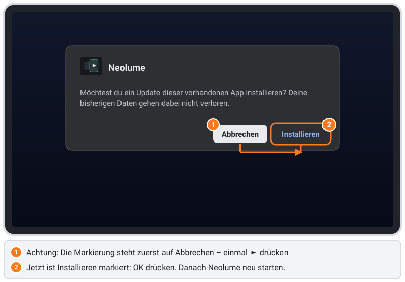

4. Die Installation dauert etwa eine Minute; Neolume wird dafür geschlossen. **Starte es danach wieder** über **Deine
   Apps** – Anmeldung, Profile, PINs und Einstellungen bleiben erhalten.

Vor dem Installieren prüft Neolume Größe und Prüfsumme der heruntergeladenen Datei, und Android prüft, dass sie mit
demselben Schlüssel signiert ist wie die installierte App. Eine veränderte oder beschädigte Datei wird abgelehnt.

## 8. Deinstallieren

1. **Einstellungen › Apps › Alle Apps anzeigen** › **Neolume** › **Deinstallieren** → **OK** *(noch zu prüfen)*. Damit
   werden auch die gespeicherte Anmeldung und die Einstellungen von Neolume auf diesem Fernseher gelöscht.
2. Öffne auf plex.tv **Konto › Autorisierte Geräte** (Account › Authorized Devices) und entferne den Eintrag **Neolume**.
   Damit ist der Zugang aufgehoben.
3. Optional: Downloader und seine Erlaubnis entfernen ([Abschnitt 6](#6-aufräumen-optional)).

Neolume verändert nichts am System des Fernsehers.

## 9. Tipps: richtige Uhrzeit, schnellerer Fernseher

### Die Uhr in Neolume geht eine Stunde falsch
Manche Fernseher kommen ab Werk mit einer Zeitzone wie **GMT+01:00** statt einer Stadt. Die Uhr des Fernsehers sieht dann
richtig aus, aber die Web-Engine, in der Neolume läuft, liest das als UTC – Uhrzeiten in Neolume liegen eine Stunde daneben
(im Sommer zwei).
Abhilfe: **Einstellungen › Geräteeinstellungen › Datum & Uhrzeit › Zeitzone** (Device Preferences › Date & time › Set time
zone) → **deine Stadt** wählen (z. B. *Berlin*). Danach Neolume neu starten.

### Den Fernseher schneller machen (sicher und jederzeit umkehrbar)
Kleine Android-Fernseher mit 1 GB Arbeitsspeicher werden mit ein paar Einstellungen spürbar flotter. Jede davon kannst du
jederzeit zurückstellen.
- **Schnellstart:** Bietet dein Fernseher in den Energie-Einstellungen **Schnellstart** (Quick start) an (oft unter
  **Einstellungen › Geräteeinstellungen › Energie** o. ä. – der Name hängt vom Hersteller ab), schalt ihn ein. Der
  Fernseher ist dann in Sekunden da, statt jedes Mal ganz hochzufahren. Im Standby braucht er etwas mehr Strom.
- **Einfacher Bildschirmschoner / Ambient-Modus:** Eine Fotoschau aus dem Internet beschäftigt den Fernseher im
  Hintergrund. Wähl in den Einstellungen für Bildschirmschoner bzw. Ambient-Modus etwas Einfaches (z. B. Farben).
- **Unbenutzte Apps deinstallieren:** **Einstellungen › Apps › Alle Apps anzeigen** › App › **Deinstallieren**.
  Vorinstallierte Apps, die sich nicht deinstallieren lassen, kann man oft **deaktivieren**. Weniger Apps = mehr freier
  Speicher für Neolume.
- **Fernseher aktuell halten:** **Einstellungen › Geräteeinstellungen › Info › Softwareaktualisierung** – Updates bringen
  oft eine schnellere Web-Engine (Android System WebView, wird über den Play Store aktualisiert).
- **Nur für Fortgeschrittene:** In den **Entwickleroptionen** ([Abschnitt 11.1](#111-entwickleroptionen-einschalten))
  **Fensteranimationsfaktor**, **Übergangsanimationsfaktor** und **Animatordauerfaktor** auf **0,5x** stellen. Menüs
  wirken dann flinker. Alle anderen Entwickleroptionen bitte nicht anfassen. Rückgängig: wieder auf **1x**.

## 10. Fehlerbehebung

### „Aus Sicherheitsgründen ist es deinem Fernseher nicht erlaubt, unbekannte Apps aus dieser Quelle zu installieren“
Downloader ist noch nicht erlaubt. Wähl in der Meldung **Einstellungen** (oder geh wie in [Schritt 3.2](#32-downloader-das-installieren-erlauben)
vor), schalte **Downloader** ein, drück `ZURÜCK` und wähl noch einmal **Go**.

### Downloader meldet „Not Found“, „404“ oder es passiert nichts
- Prüf die Adresse Zeichen für Zeichen – besonders `/`, `.` und die Kleinbuchstaben. Der Dateiname ist `android-tv.apk`.
- Ist der Fernseher online? Öffne eine beliebige App, die Internet braucht, oder **Einstellungen › Netzwerk & Internet**.
- Stimmt die Adresse und es kommt trotzdem *Not Found*, gibt es noch keine veröffentlichte Android-TV-Fassung (siehe den
  Hinweis ganz oben).

### „App nicht installiert“ oder „Das Paket steht in Konflikt mit einem vorhandenen Paket“
Es ist schon ein älteres Neolume mit anderer Signatur installiert (z. B. eine Testfassung). Deinstallier es zuerst
([Abschnitt 8](#8-deinstallieren)) und installier dann neu. Danach meldest du dich neu an.

### Der Update-Hinweis erscheint nicht
Neolume schaut einmal pro Start nach, kurz nachdem die Startseite erscheint. Hast du **Später** gewählt? Dann fragt es erst
nach 24 Stunden wieder. Beende Neolume ganz (`ZURÜCK` auf der Startseite → **Beenden**) und starte es neu. Ohne Internet
gibt es keine Prüfung.

### Ich habe OK gedrückt und das Update wurde abgebrochen
Bei der Update-Rückfrage von Android steht die Markierung zuerst auf **Abbrechen** ([Abschnitt 7](#7-aktualisieren), Punkt 3).
Starte Neolume einfach neu; der Hinweis kommt wieder – drück diesmal erst `►`, dann `OK`.

### Der Anmeldecode funktioniert nicht
- Tipp ihn auf **plex.tv/link** ein, während du mit dem Plex-Konto angemeldet bist, das Zugriff auf deinen Server hat.
- Code abgelaufen? Wähl am Fernseher **Neuer Code**.
- Das Handy hat die Plex-App statt der Webseite geöffnet? Nimm den Browser und tipp `plex.tv/link` von Hand ein.

### Server nicht gefunden / keine Bibliotheken
- Läuft dein Plex Media Server, und ist er im **selben Heimnetz** wie der Fernseher (kein Gast-WLAN, kein eigenes
  „IoT“-Netz)? Manche Router trennen WLAN-Geräte voneinander („Client-Isolation“ / „AP-Isolation“).
- Ist der Server für dein Plex-Konto bzw. dein Profil freigegeben (Plex-Web-App: **Einstellungen › Benutzer & Freigabe**)?

### Die Uhrzeit stimmt nicht
Siehe [Abschnitt 9](#die-uhr-in-neolume-geht-eine-stunde-falsch).

Kommst du nicht weiter? [Eröffne ein Issue](https://github.com/itsab1989/neolume/issues) mit deinem Fernsehermodell, der
Android-Version und dem, was du am Fernseher siehst.

## 11. Für Fortgeschrittene: Installation vom Computer (adb)

Für die normale Installation brauchst du das **nicht**. Es ist der Weg für Entwickler: Ein Computer mit dem
Android-Befehlszeilenwerkzeug **adb** installiert die App über dein Heimnetz. Nimm ihn, wenn es Downloader auf deinem
Fernseher nicht gibt oder wenn du Neolume selbst baust.

### 11.1 Entwickleroptionen einschalten

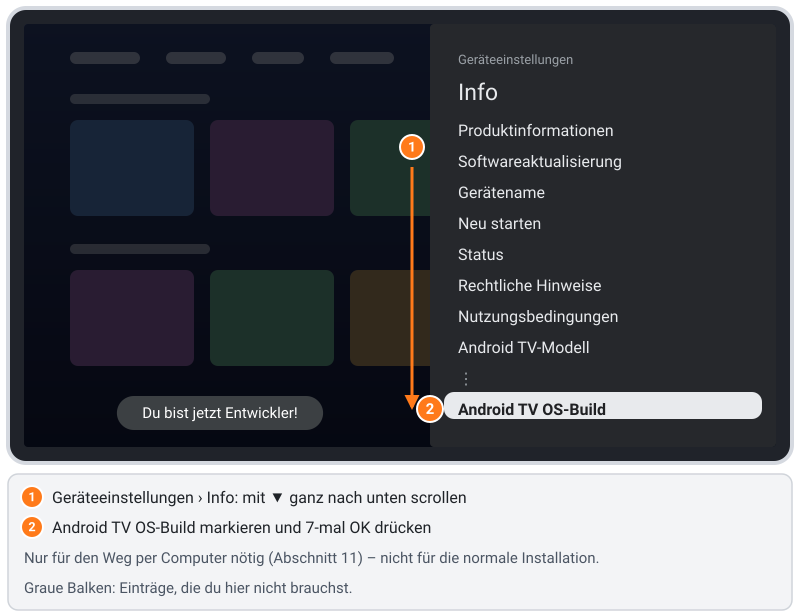

1. **Einstellungen › Geräteeinstellungen › Info**.
2. Scroll mit `▼` **ganz nach unten** – an **Produktinformationen**, **Softwareaktualisierung**, **Gerätename**, **Neu
   starten**, **Status**, **Rechtliche Hinweise**, **Nutzungsbedingungen** und **Android TV-Modell** vorbei – bis zu
   **Android TV OS-Build**, dem letzten Eintrag.
3. Drück dort **7-mal** `OK`. Die Meldung **Du bist jetzt Entwickler!** erscheint.
4. Drück `ZURÜCK`. In den **Geräteeinstellungen** gibt es jetzt den neuen Eintrag **Entwickleroptionen**.

### 11.2 USB-Debugging einschalten

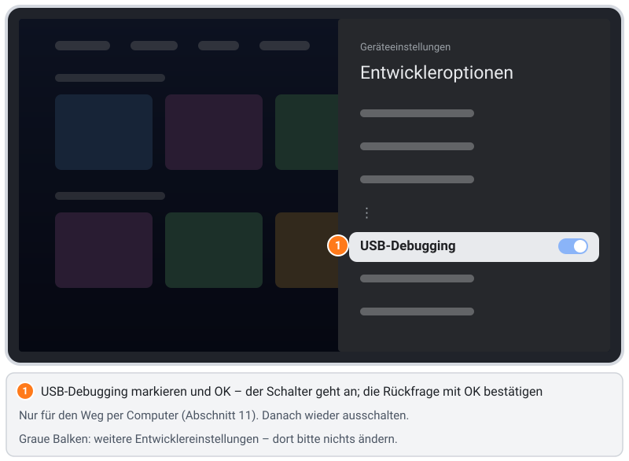

1. **Einstellungen › Geräteeinstellungen › Entwickleroptionen** › **USB-Debugging** → einschalten und die Rückfrage mit
   **OK** bestätigen. Trotz des Namens erlaubt das bei den meisten Android-Fernsehern auch adb über das Heimnetz.
2. Alle anderen Entwickleroptionen lässt du, wie sie sind.
3. Adresse des Fernsehers herausfinden: **Einstellungen › Netzwerk & Internet** › dein Netzwerk – dort steht die
   **IP-Adresse** (z. B. `192.0.2.30`).

### 11.3 Installieren
1. Installier auf dem Computer die **Android SDK Platform-Tools** (enthalten `adb`): Download unter
   [developer.android.com/tools/releases/platform-tools](https://developer.android.com/tools/releases/platform-tools), am Mac
   mit Homebrew `brew install android-platform-tools`.
2. Lade `android-tv.apk` aus dem [neuesten Release](https://github.com/itsab1989/neolume/releases/latest) auf den Computer.
3. Im Terminal (statt `<TV-IP>` die Adresse deines Fernsehers):
   ```sh
   adb connect <TV-IP>:5555
   adb install -r android-tv.apk
   ```
4. Beim ersten Mal fragt der Fernseher **USB-Debugging zulassen?** und zeigt den Schlüssel deines Computers. Setz den Haken
   bei **Von diesem Computer immer zulassen** und wähl **OK** bzw. **Zulassen**. Meldete `adb connect` *unauthorized*, führ
   es danach noch einmal aus.
5. `adb install` endet mit **Success**. Starte Neolume am Fernseher und mach mit [Abschnitt 5](#5-erster-start-anmelden-und-profil-wählen) weiter.

`adb connect` klappt nicht? Manche Hersteller haben in den Entwickleroptionen einen eigenen Schalter wie
**Netzwerk-Debugging** oder **ADB über Netzwerk** – schalt ihn ein. Computer und Fernseher müssen im selben Heimnetz sein.

**Danach:** Schalte **USB-Debugging** wieder aus. Solange es an ist, kann jedes Gerät im Heimnetz um Zugriff bitten (du
müsstest das zwar am Fernseher bestätigen, aber es gibt keinen Grund, die Tür offen zu lassen). Die Entwickleroptionen selbst
dürfen bleiben; sie ändern nichts, solange du sie nicht anfasst.
