# Installing Neolume on Android TV / Google TV – step by step

[Deutsche Fassung](android-tv.de.md) · [FAQ](../FAQ.md) · [Samsung 2014 guide](../INSTALL.md) · [Back to the overview](../../README.md)

This guide is written for people **without any technical background**. Follow it from top to bottom; every button on the
remote and every menu on the TV is named, and the important screens are shown as drawings. Plan about **15 minutes** the
first time – most of it is typing one web address with the remote.

> 🧪 **Android TV support is new and experimental.** It was tested on a **TCL 32S5K** (Google TV, Android 11, 1 GB RAM):
> sign-in, profiles, Home, libraries, playback and Live TV work. Other areas still need more testing. If the download
> address in [step 4](#4-download-and-install-neolume) shows **Not Found**, no Android TV version has been published yet –
> the table *Which TVs work?* in the [overview](../../README.md) shows the current state.

> **How to read this guide**
> - `THIS` means a **button on the remote** (for example `OK`, `BACK`, `HOME`).
> - **This** means a **word on the screen** that you select.
> - › means "then choose" (for example **Settings › Apps**).
> - The TV's menus follow the TV's language. The English names are given here, with the German name in brackets where it
>   helps. Makers name a few entries differently; if your TV says something slightly different, pick the closest match.
> - The **drawings** are simplified sketches, not photos. Orange numbers show the order of the steps. **Grey bars** stand
>   for entries you do not need – your TV shows text there.
> - A step marked *(to be verified)* has not yet been checked word for word on a real TV in English. If what you see
>   differs, please tell us in an [issue](https://github.com/itsab1989/neolume/issues) so we can fix the guide.

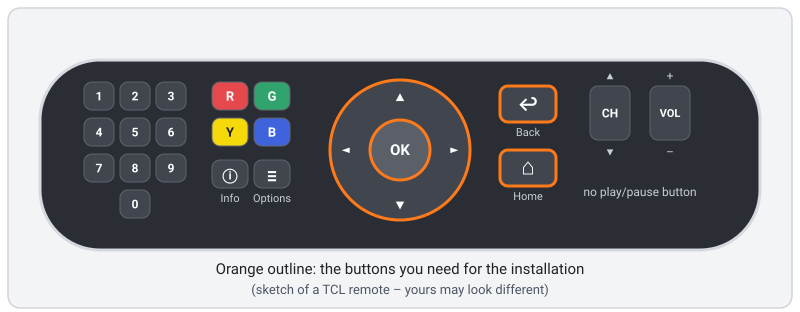

## Contents

1. [What you need](#1-what-you-need)
2. [How it works (in one minute)](#2-how-it-works-in-one-minute)
3. [Prepare the TV (once)](#3-prepare-the-tv-once)
4. [Download and install Neolume](#4-download-and-install-neolume)
5. [First start: sign in and choose your profile](#5-first-start-sign-in-and-choose-your-profile)
6. [Tidy up (optional)](#6-tidy-up-optional)
7. [Updating](#7-updating)
8. [Uninstalling](#8-uninstalling)
9. [Tips: correct clock, faster TV](#9-tips-correct-clock-faster-tv)
10. [Troubleshooting](#10-troubleshooting)
11. [Advanced: install from a computer (adb)](#11-advanced-install-from-a-computer-adb)

---

## 1. What you need

- ✅ A **TV or streaming box with Android TV or Google TV**, Android 7.0 or newer. You recognise it by the **Google Play
  Store** on the TV and by the TV's home screen (Google TV: tabs such as *For you* at the top).
  - Where is the Android version? **Settings › Device Preferences › About** (Geräteeinstellungen › Info) → **Android TV OS
    version**.
  - Neolume is tested on a **TCL 32S5K** with Google TV (Android 11) and only 1 GB of memory – a small, inexpensive model.
    Faster devices are fine too.
- ✅ The TV is **connected to your home network** (Wi-Fi or cable) and to the internet.
- ✅ A **Plex Media Server** in the **same home network** – ideally your own: that is what was tested.
- ✅ Your **Plex account** (e-mail and password, or Google/Apple sign-in).
- ✅ A **phone or computer** with a web browser – only to confirm the sign-in once (you type a short code there).
- ✅ The TV **remote**.

No Plex Pass is needed, nothing is installed on your Plex server, and **no computer has to stay switched on**.

## 2. How it works (in one minute)

Neolume is not in the Google Play Store. Android lets you install apps from other sources too ("sideloading") – but only
through an app that you have **explicitly allowed** to do so. That protects you: no app can install something behind your
back.

1. From the Play Store you install the free app **Downloader**. It does one thing: fetch a file from a web address.
2. You allow **only Downloader** to install apps.
3. Downloader fetches Neolume's app file (`android-tv.apk`) from Neolume's **official GitHub release** and hands it to
   Android, which asks you once more before installing.
4. On first start you **sign in with a code** on plex.tv/link – your password is only ever typed on plex.tv.

Afterwards Neolume talks **directly to your Plex server** at home, and to plex.tv for your watchlist and the Discover rows.
Unlike the 2014 Samsung TVs, an Android TV can reach plex.tv itself, so you need **no setup program and no helper**.

## 3. Prepare the TV (once)

### 3.1 Install Downloader from the Play Store
1. Press `HOME`.
2. Open the **Google Play Store** (on Google TV: the **Apps** tab › **Search for apps**; on older Android TV: the **Google
   Play Store** tile in the apps row).
3. Search for **Downloader**. Choose the app **Downloader by AFTVnews** (orange icon) – not a look-alike.
4. Choose **Install**. When it is done, do **not** open it yet.

Why Downloader? Android TV has no normal web browser for downloading files. Downloader is a widely used, free helper app for
exactly this, and it comes from the official Play Store.

### 3.2 Allow Downloader to install apps

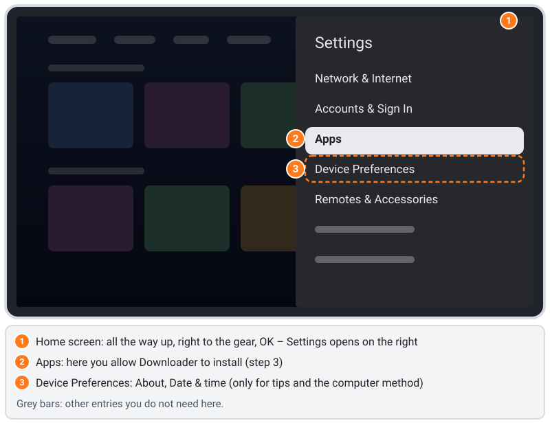

1. Press `HOME`, go all the way **up**, then **right** to the **gear** ⚙ at the top right and press `OK`. The **Settings**
   (Einstellungen) panel opens on the right. Its main entries are **Network & Internet**, **Accounts & Sign In**,
   **Apps**, **Device Preferences** and **Remotes & Accessories**.
   *Older Android TV:* the gear is also at the top right of the home screen.
2. Choose **Apps** › **Security & restrictions** (Sicherheit & Einschränkungen) › **Unknown sources** (Unbekannte
   Herkunft). The page says **Allow installation of apps from sources other than the Play Store** and lists your apps with
   a switch each.
3. Select **Downloader** and press `OK`. The switch turns on and the entry says **Allowed** (Zugelassen) *(English wording
   to be verified)*.
4. Leave all other apps as they are (**Not allowed**). Press `BACK` a few times to leave the settings.

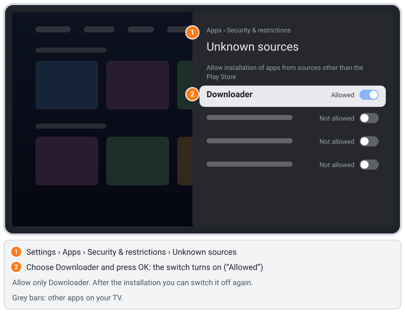

This permission applies **only to Downloader**. You can switch it off again after the installation ([section 6](#6-tidy-up-optional)).

## 4. Download and install Neolume

1. Open **Downloader** (Google TV: **Apps** tab or the row **Your apps**). On the first start Downloader may show a short
   note or ask for access to files/media – choose **OK** / **Allow**; it needs this to save the downloaded file.
2. On the **Home** page, move to the **address box** and press `OK`. An on-screen keyboard appears.
3. Type this address **exactly** (every character counts, including the small letters):

   ```text
   https://github.com/itsab1989/neolume/releases/latest/download/android-tv.apk
   ```

   Tip: on many keyboards a long press on `OK` or a separate key gives you **/** and **.**; Downloader often offers
   `https://` and `.com` as shortcuts.
4. Choose **Go**. Downloader fetches the file (a few megabytes) and then opens Android's installer by itself.

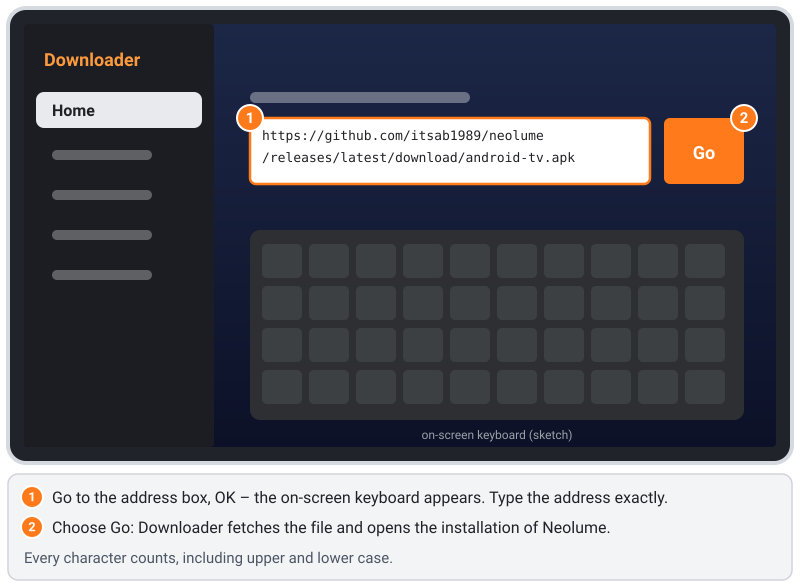

5. Android asks **Do you want to install this app?** (Möchtest du diese App installieren?) and shows the name **Neolume**.
   Choose **Install** (Installieren) and press `OK`. If the highlight is on **Cancel**, press `►` first.
6. After a few seconds Android reports **App installed**. Choose **Open** to start Neolume right away – or **Done** and
   start it later from **Your apps**.
7. Downloader may then offer to **delete** the downloaded file. You can: the installed app does not need it any more.

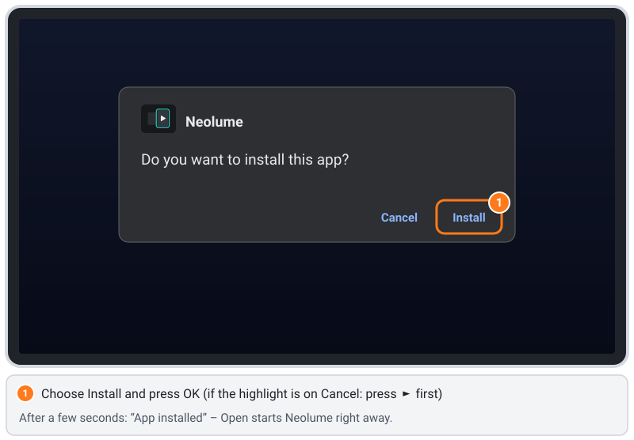

**Why is this safe?** The address points to Neolume's official GitHub release. Android only installs the file after you
confirm it, and every later update must carry the **same digital signature** – nobody else can replace Neolume with a
modified version.

## 5. First start: sign in and choose your profile

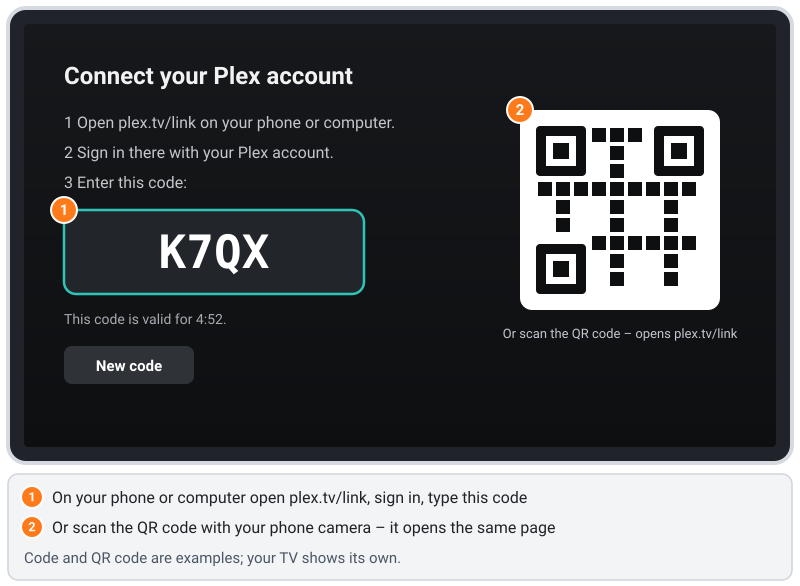

1. Start **Neolume** (from **Your apps**, or **Open** after the installation). The screen **Connect your Plex account**
   appears with a **4-character code**.
2. On your phone or computer open **plex.tv/link** – or simply scan the **QR code** with your phone camera, it opens the
   same page. Sign in with your Plex account and type the code. Neolume continues by itself within a few seconds.
   - The code is valid for a few minutes; afterwards a new one appears automatically (or choose **New code**).
   - You type your Plex password **only on plex.tv** – never on the TV.
3. If your account can see more than one server, choose **your server**.
4. **Who's watching?** – choose your profile and press `OK`. Profiles with a lock ask for their app PIN.
5. Home loads Continue Watching, Up Next and what is new in your libraries. After a moment a card **How to use Neolume**
   explains the buttons; you can open it again under **Settings › Help & diagnostics**.

The sign-in stays on this TV, encrypted with a key from Android's protected key store, so you do not have to sign in again after switching off.

**Remote cheat sheet** (the hint bar at the bottom of each screen shows the buttons with the same labels as your remote)
| Button | What it does |
|---|---|
| Arrow buttons, `OK` | Move, select |
| `BACK` (↩) | Back. In a library, Search, Discover or Settings it first goes to the top, then to Home. On Home: to the first card, then *Exit* |
| `HOME` (⌂) | Leaves Neolume and goes to the TV's home screen |
| `≡` (menu button) | Options for the focused item ("More" menu in the player) – shown as ≡ in the hint bar |
| `ⓘ` Info | Information / help for the current screen |
| Colour buttons `R` `G` `Y` `B` | Shown at the bottom of each screen (for example Y = mark as watched, B = search) |
| Number buttons | Jump to a letter in a library (like phone typing) |
| `CH ▲` / `CH ▼` | In a library: jump several rows. In the player: previous / next item |
| No play/pause button? | In the player, `OK` shows the controls with **Pause** highlighted – press `OK` again to pause or continue |

## 6. Tidy up (optional)

Neolume does not need Downloader any more – it updates itself ([section 7](#7-updating)). If you like a tidy TV:
- Switch Downloader's permission off again: **Settings › Apps › Security & restrictions › Unknown sources** › **Downloader**
  → **Not allowed**. (For a later reinstall, switch it on again.)
- Or uninstall Downloader completely: **Settings › Apps** › **See all apps** › **Downloader** › **Uninstall** *(to be verified)*.

Neolume stays installed and keeps working either way.

## 7. Updating

Neolume checks for a newer version **once at each start** (a short moment after Home appears). It asks the official GitHub
release – no computer, no helper needed.

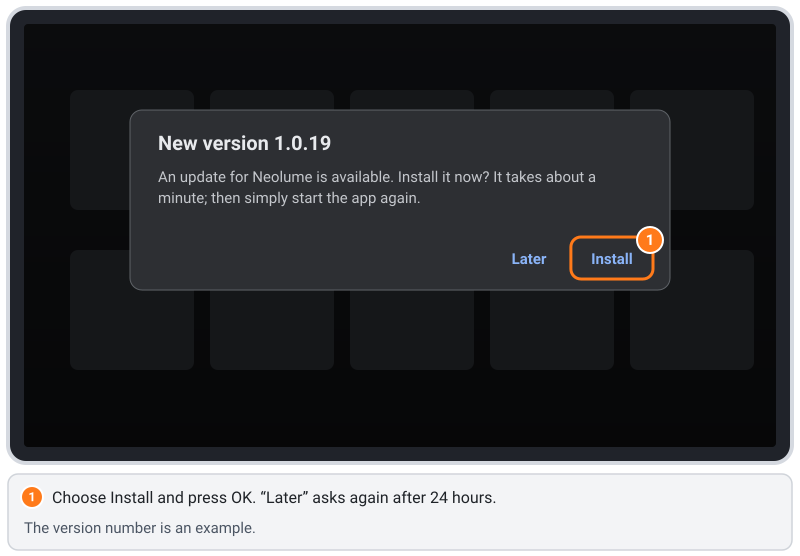

1. A notice appears: **New version x.y.z** – *An update for Neolume is available. Install it now? It takes about a minute;
   then simply start the app again.* Choose **Install** and press `OK`.
   (**Later** hides the notice for 24 hours.)
2. **Only the very first time:** Android opens the page **Install unknown apps** (Installieren unbekannter Apps) with a
   switch for **Neolume**. Select it, press `OK` so the switch turns on, then press `BACK`. Why: just like Downloader in
   step 3.2, Neolume needs your permission once to install its own updates. It can only ever install a file signed with
   Neolume's own key.

   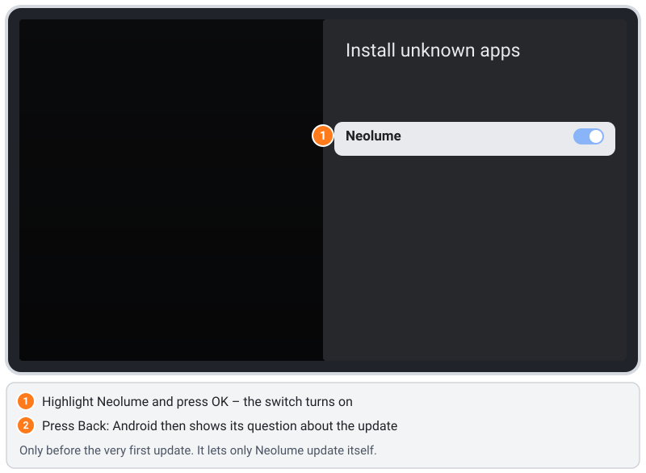

3. Android asks **Do you want to install an update to this existing app? Your existing data will not be lost.**
   ⚠️ **Careful:** the highlight starts on **Cancel**. Press `►` once so that **Install** is highlighted, then press `OK`.

   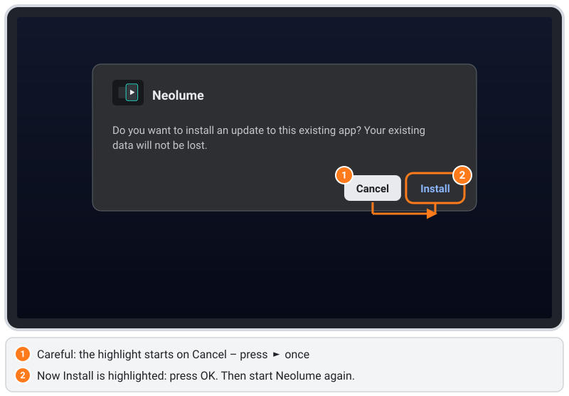

4. The installation takes about a minute; Neolume is closed for it. **Start it again** from **Your apps** – your sign-in, profiles, PINs and settings
   are kept.

Before installing, Neolume checks the size and checksum of the downloaded file, and Android checks that it is signed with
the same key as the installed app. A modified or damaged file is refused.

## 8. Uninstalling

1. **Settings › Apps › See all apps** (Alle Apps anzeigen) › **Neolume** › **Uninstall** (Deinstallieren) → **OK**
   *(English wording to be verified)*. This also deletes Neolume's stored sign-in and settings on this TV.
2. On plex.tv, open **Account › Authorized Devices** and remove the **Neolume** entry. This cancels the access.
3. Optional: remove Downloader and its permission ([section 6](#6-tidy-up-optional)).

Neolume does not change anything in the TV's system.

## 9. Tips: correct clock, faster TV

### The clock in Neolume is one hour off
Some TVs leave the factory with a time zone such as **GMT+01:00** instead of a city. The TV's own clock looks right, but the
web engine Neolume runs in reads it as UTC, so times in Neolume are off by an hour (in summer by two).
Fix: **Settings › Device Preferences › Date & time › Set time zone** (Geräteeinstellungen › Datum & Uhrzeit › Zeitzone)
→ choose **your city** (for example *Berlin* or *London*). Then start Neolume again.

### Make the TV faster (safe and reversible)
Small Android TVs with 1 GB of memory get noticeably faster with a few settings. Each of them can be undone at any time.
- **Quick start:** if your TV offers **Quick start** (Schnellstart) in its power settings (often **Settings › Device
  Preferences › Power & Energy** or similar – the name differs by maker), switch it on. The TV then wakes up in seconds
  instead of booting fully. It uses a little more power in standby.
- **Simpler screen saver / Ambient mode:** a photo slideshow from the internet keeps the TV busy in the background. Choose
  a simple screen saver (for example colours) in the screen saver / Ambient mode settings.
- **Uninstall apps you never use:** **Settings › Apps › See all apps** › app › **Uninstall**. Pre-installed apps that cannot
  be uninstalled can often be **disabled**. Fewer apps = more free memory for Neolume.
- **Keep the TV up to date:** **Settings › Device Preferences › About › System update** – updates often bring a faster web
  engine (Android System WebView, updated through the Play Store).
- **For advanced users only:** in the **Developer options** ([section 11.1](#111-switch-on-the-developer-options)) set
  **Window animation scale**, **Transition animation scale** and **Animator duration scale** (Fensteranimationsfaktor,
  Übergangsanimationsfaktor, Animatordauerfaktor) to **0.5x**. Menus then feel snappier. Leave all other developer options
  alone. To undo: set them back to **1x**.

## 10. Troubleshooting

### "For your security, your TV is not allowed to install unknown apps from this source"
Downloader has not been allowed yet. Choose **Settings** in that message (or follow [step 3.2](#32-allow-downloader-to-install-apps)),
switch **Downloader** on, press `BACK` and choose **Go** again.

### Downloader says "Not Found", "404" or nothing happens
- Check the address character by character – especially `/`, `.` and the small letters. The file name is `android-tv.apk`.
- Is the TV online? Open any app that uses the internet, or **Settings › Network & Internet**.
- If the address is correct and still shows *Not Found*, no Android TV version has been published yet (see the note at the
  top).

### "App not installed" or "The package conflicts with an existing package"
An older Neolume with a different signature is already installed (for example a test version). Uninstall it first
([section 8](#8-uninstalling)), then install again. You will have to sign in again.

### The update notice does not appear
Neolume checks once per start, a short moment after Home appears. Did you choose **Later**? Then it asks again after 24
hours. Close Neolume completely (`BACK` on Home → **Exit**) and start it again. Without internet there is no check.

### I pressed OK and the update was cancelled
On Android's update question the highlight starts on **Cancel** ([step 7.3](#7-updating)). Simply start Neolume again; the
notice appears again – this time press `►` before `OK`.

### The sign-in code does not work
- Type it on **plex.tv/link** while you are signed in with the Plex account that has access to your server.
- The code expired? Choose **New code** on the TV.
- Your phone opened the Plex app instead of the website? Use the browser and type `plex.tv/link` by hand.

### Server not found / no libraries
- Is your Plex Media Server running and in the **same home network** as the TV (no guest Wi-Fi, no separate "IoT"
  network)? Some routers isolate Wi-Fi devices from each other ("client isolation" / "AP isolation").
- Is the server shared with your Plex account or your profile (Plex web app: **Settings › Users & Sharing**)?

### The clock is wrong
See [section 9](#the-clock-in-neolume-is-one-hour-off).

Still stuck? [Open an issue](https://github.com/itsab1989/neolume/issues) with your TV model, the Android version and what you
see on the TV.

## 11. Advanced: install from a computer (adb)

You do **not** need this for the normal installation. It is the developer way: a computer with Android's command-line tool
**adb** installs the app over your home network. Use it if Downloader is not available on your TV, or if you build Neolume
yourself.

### 11.1 Switch on the developer options

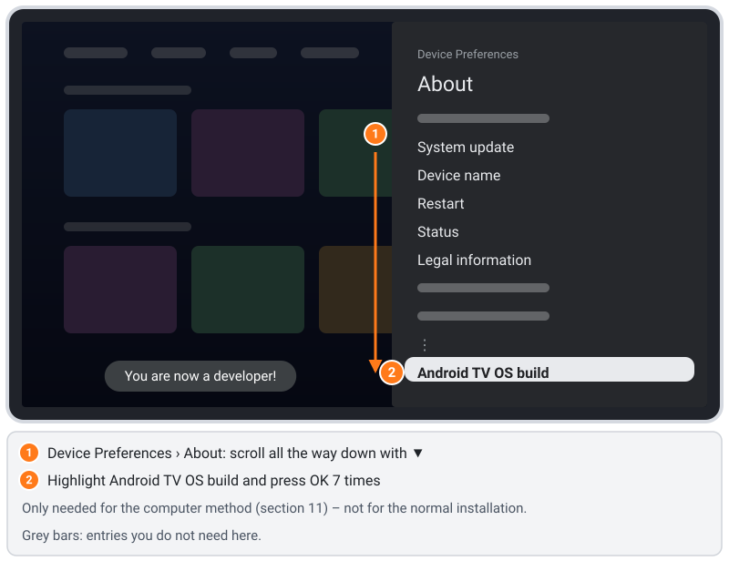

1. **Settings › Device Preferences › About** (Geräteeinstellungen › Info).
2. Scroll **all the way down** with `▼` – past **System update**, **Device name**, **Restart**, **Status**, **Legal
   information** and the model – to **Android TV OS build** (Android TV OS-Build), the last entry.
3. Press `OK` **7 times** on it. The message **You are now a developer!** (Du bist jetzt Entwickler!) appears.
4. Press `BACK`. **Device Preferences** now has a new entry **Developer options** (Entwickleroptionen).

### 11.2 Switch on USB debugging

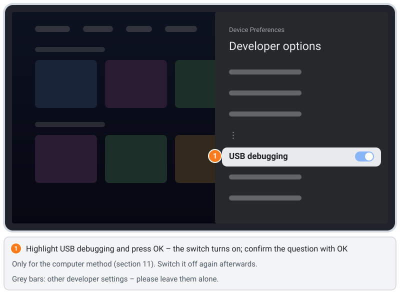

1. **Settings › Device Preferences › Developer options** › **USB debugging** (USB-Debugging) → switch it on and confirm the
   question with **OK**. Despite its name, this also allows adb over the home network on most Android TVs.
2. Leave all other developer options as they are.
3. Find the TV's address: **Settings › Network & Internet** › your network – it shows the **IP address** (for example
   `192.0.2.30`).

### 11.3 Install
1. On your computer install **Android SDK Platform-Tools** (contains `adb`): download from
   [developer.android.com/tools/releases/platform-tools](https://developer.android.com/tools/releases/platform-tools), or on a
   Mac with Homebrew `brew install android-platform-tools`.
2. Download `android-tv.apk` from the [latest release](https://github.com/itsab1989/neolume/releases/latest) to your computer.
3. In a terminal (use your TV's address instead of `<TV-IP>`):
   ```sh
   adb connect <TV-IP>:5555
   adb install -r android-tv.apk
   ```
4. The first time, the TV asks **Allow USB debugging?** with your computer's key fingerprint. Tick **Always allow from this
   computer** and choose **OK** (Zulassen). Then run `adb connect` again if it said *unauthorized*.
5. `adb install` ends with **Success**. Start Neolume on the TV and continue with [section 5](#5-first-start-sign-in-and-choose-your-profile).

`adb connect` fails? Some makers have an extra switch in the developer options such as **Network debugging** or **ADB over
network** – switch it on. Computer and TV must be in the same home network.

**Afterwards:** switch **USB debugging** off again. While it is on, any device in your home network can ask for access (you
still have to confirm it on the TV, but there is no reason to leave the door open). The developer options themselves can
stay; they change nothing as long as you do not touch them.
