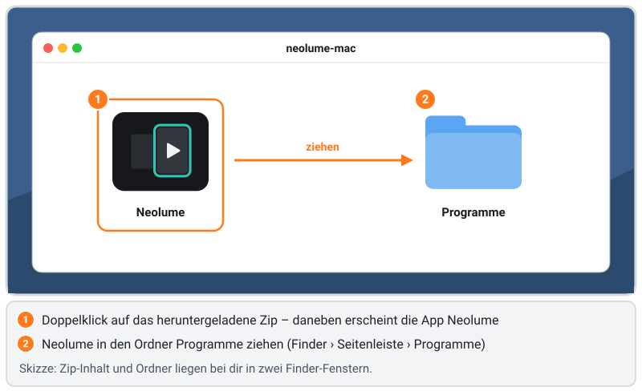
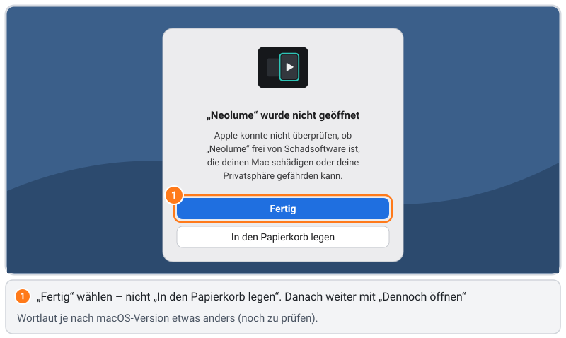
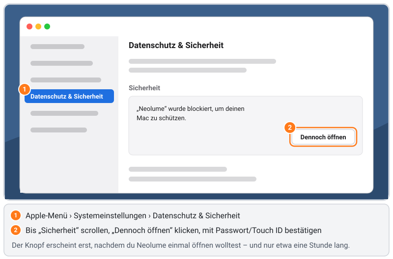

# Neolume auf dem Mac installieren – Schritt für Schritt

[English version](mac.md) · [FAQ](../FAQ.de.md) · [Anleitung Samsung 2014](../INSTALL.de.md) · [Anleitung Android TV](android-tv.de.md) · [Zurück zur Übersicht](../../README.de.md)

Diese Anleitung ist für Menschen **ohne Technik-Vorwissen** geschrieben. Geh sie einfach von oben nach unten durch: Jedes
Fenster und jeder Knopf ist genannt, und die wichtigen Bildschirme sind gezeichnet. Rechne mit etwa **5 Minuten**.

> 🧪 **Die Mac-App ist neu und noch im Versuch.** Auf dem Mac des Entwicklers funktionieren Anmeldung, Profile,
> Startseite, Bibliotheken, Suche und Wiedergabe. Andere Bereiche brauchen noch mehr Tests. Zeigt die Download-Adresse in
> [Schritt 3](#3-neolume-herunterladen) **Not Found**, gibt es noch keine veröffentlichte Mac-Fassung – den aktuellen Stand
> zeigt die Tabelle *Welche Fernseher funktionieren?* in der [Übersicht](../../README.de.md).

> **So liest du diese Anleitung**
> - **Dies** ist ein **Wort auf dem Bildschirm**, das du anklickst (ein Knopf, ein Menüeintrag, ein Ordner).
> - › heißt „dann wählen“ (z. B. ** › Systemeinstellungen › Datenschutz & Sicherheit**).
> - `Dies` ist eine **Taste auf der Tastatur** (z. B. `Esc`, `Eingabe`, `⌘ Cmd`).
> - Die **Zeichnungen** sind vereinfachte Skizzen, keine Bildschirmfotos. Orange Nummern zeigen die Reihenfolge. **Graue
>   Balken** stehen für Einträge, die du nicht brauchst – dein Mac zeigt dort Text.
> - Schritte mit *(noch zu prüfen)* wurden noch nicht wortgenau auf jeder macOS-Version geprüft. Sieht es bei dir anders
>   aus, sag uns bitte in einem [Issue](https://github.com/itsab1989/neolume/issues) Bescheid, damit wir die Anleitung
>   verbessern.

## Inhalt

1. [Was du brauchst](#1-was-du-brauchst)
2. [Wie es funktioniert (in einer Minute)](#2-wie-es-funktioniert-in-einer-minute)
3. [Neolume herunterladen](#3-neolume-herunterladen)
4. [In „Programme“ legen](#4-in-programme-legen)
5. [Erster Start: die App einmal erlauben](#5-erster-start-die-app-einmal-erlauben)
6. [Anmelden und Profil wählen](#6-anmelden-und-profil-wählen)
7. [Bedienung mit Maus, Trackpad und Tastatur](#7-bedienung-mit-maus-trackpad-und-tastatur)
8. [Aktualisieren](#8-aktualisieren)
9. [Deinstallieren](#9-deinstallieren)
10. [Wo deine Anmeldung gespeichert ist](#10-wo-deine-anmeldung-gespeichert-ist)
11. [Fehlerbehebung](#11-fehlerbehebung)

---

## 1. Was du brauchst

- ✅ Einen **Mac mit macOS 14 (Sonoma) oder neuer**, mit Apple-Chip (M1 und neuer) oder Intel-Prozessor – die App enthält
  beides.
  - Wo steht die Version? ** › Über diesen Mac** → Zeile **macOS**.
- ✅ Einen **Plex Media Server** – zu Hause im Heimnetz oder einen Server, auf den du Zugriff hast.
- ✅ Dein **Plex-Konto** (E-Mail und Passwort oder Google-/Apple-Anmeldung).

Einen Plex Pass brauchst du nicht, auf deinem Plex-Server muss nichts installiert werden, und du brauchst **kein**
Apple-Entwicklerkonto.

## 2. Wie es funktioniert (in einer Minute)

Neolume für den Mac ist **dieselbe App wie am Fernseher** – dieselben Bildschirme, dieselben Einstellungen – in einem
kleinen Mac-Fenster. Sie steht nicht im Mac App Store. Du lädst sie als Zip-Datei aus dem **offiziellen GitHub-Release** von
Neolume und legst sie wie jede andere App in deinen Ordner **Programme**.

Weil die App nicht über Apple vertrieben wird, hat sie keine „Beglaubigung“ (Notarisierung) von Apple – dafür bräuchte es
ein bezahltes Apple-Entwicklerkonto. macOS fragt dich deshalb **einmal**, beim ersten Öffnen, ob du ihr vertraust
([Schritt 5](#5-erster-start-die-app-einmal-erlauben)). Danach startet sie ganz normal.

Der Mac erreicht plex.tv selbst. Du meldest dich deshalb **direkt in der App** an – das Einrichtungsprogramm und den
Helfer der Samsung-Fernseher von 2014 brauchst du nicht.

## 3. Neolume herunterladen

1. Öffne diese Adresse im Browser (Safari, Chrome, Firefox …):

   ```text
   https://github.com/itsab1989/neolume/releases/latest/download/neolume-mac.zip
   ```

2. Die Datei `neolume-mac.zip` landet in deinem Ordner **Downloads** (Safari: der Pfeil ⬇ oben rechts im Fenster zeigt
   sie).

## 4. In „Programme“ legen



1. Öffne den Ordner **Downloads** (Finder › **Downloads** oder der Downloads-Stapel im Dock) und **doppelklicke**
   `neolume-mac.zip`. Daneben erscheint die App **Neolume** (Safari entpackt das Zip oft schon selbst – dann liegt die App
   bereits da).
2. Öffne ein zweites Finder-Fenster (`⌘ Cmd` + `N`) und klick in der Seitenleiste auf **Programme**.
3. **Zieh Neolume** in **Programme**. Die Zip-Datei kannst du danach löschen.

Warum Programme? Dort gehören Apps hin – die App bleibt dann auch bei Updates am selben Ort, und macOS behandelt sie wie
jede andere App.

## 5. Erster Start: die App einmal erlauben



1. Öffne **Programme** und **doppelklicke Neolume**.
2. macOS zeigt eine Meldung wie **„Neolume“ wurde nicht geöffnet – Apple konnte nicht überprüfen, ob „Neolume“ frei von
   Schadsoftware ist …** *(Wortlaut kann je macOS-Version abweichen)*. Klick auf **Fertig** – **nicht** auf **In den Papierkorb legen**.

   Diese Meldung heißt nicht, dass mit Neolume etwas nicht stimmt. macOS zeigt sie bei jeder App, die Apple nicht
   beglaubigt hat. Die App wird aus dem öffentlichen Quellcode in diesem Repository gebaut.



3. Öffne ** › Systemeinstellungen › Datenschutz & Sicherheit** und scroll nach unten zum Abschnitt **Sicherheit**.
   Dort steht **„Neolume“ wurde blockiert, um deinen Mac zu schützen.** *(Wortlaut kann je macOS-Version abweichen)*
4. Klick auf **Dennoch öffnen** und bestätige mit deinem **Passwort** oder **Touch ID**.
5. macOS fragt ein letztes Mal – klick auf **Öffnen**. Neolume startet.

Ab jetzt öffnet sich Neolume mit einem normalen Doppelklick. Der Knopf **Dennoch öffnen** erscheint erst, **nachdem** du die
App einmal öffnen wolltest, und nur etwa eine Stunde lang – siehst du ihn nicht, doppelklicke Neolume noch einmal und geh
dann zurück in die Systemeinstellungen.

*Älteres macOS 14 (Sonoma):* Statt der Schritte 3–5 geht auch: in Programme **Neolume** mit **Rechtsklick** (oder
`Ctrl`-Klick) › **Öffnen** › **Öffnen**. Ab macOS 15 funktioniert dieser Weg nicht mehr – dann nimm **Dennoch öffnen**.

## 6. Anmelden und Profil wählen


1. Neolume zeigt **Mit deinem Plex-Konto verbinden**. Klick auf **Mit Plex anmelden**.
2. Ein macOS-Fenster mit der **offiziellen Anmeldeseite von Plex** öffnet sich. Melde dich dort an wie gewohnt – mit
   E-Mail und Passwort, Google, Apple oder der Bestätigung in zwei Schritten. Neolume sieht dein Passwort nie; es bekommt
   von Plex nur einen Zugangsschlüssel.
3. *Klappt es nicht?* Wähl **Mit Code anmelden**. Neolume zeigt einen kurzen Code; öffne auf Handy oder Computer
   **plex.tv/link**, melde dich an und tipp den Code ein.
4. Sieht dein Konto mehr als einen Server, wähl **deinen Server**.
5. **Wer schaut gerade?** – klick dein Profil an. Profile mit Schloss fragen nach ihrer App-PIN.
6. Die Startseite lädt **Weiterschauen** und das Neueste aus deinen Bibliotheken.

Neolume bleibt angemeldet, bis du dich in den **Einstellungen** abmeldest oder das Gerät auf plex.tv entfernst.

## 7. Bedienung mit Maus, Trackpad und Tastatur

Du kannst einfach alles **anklicken**: Karten, Knöpfe, die Symbole in der Leiste links. Mit dem Trackpad oder dem Mausrad
scrollst du durch Reihen und Listen. Die Tastatur geht auch – wie die Fernbedienung am Fernseher:

| Taste | Was sie tut |
|---|---|
| Pfeiltasten, `Eingabe` | Bewegen, auswählen |
| `Esc` | Zurück (im Vollbild: zuerst Vollbild verlassen) |
| `⌘ Cmd` + `F` | Suche |
| `⌘ Cmd` + `,` | Einstellungen |
| `⌘ Cmd` + `↑` | Zurück an den Anfang einer Liste |
| `Leertaste` | Im Player: Pause / weiter |
| `J` / `L` | Im Player: zurück- / vorspringen |
| `M`, `C`, `F` | Im Player: Ton aus/an, Untertitel, Vollbild |
| `R` `G` `Y` `B`, `I` | Die Farbtasten und Info der Fernbedienung (stehen im Hinweisband) |

Vollbild: der grüne Knopf oben links im Fenster oder `Ctrl` + `⌘ Cmd` + `F`.

## 8. Aktualisieren

1. Lade das neue `neolume-mac.zip` wie in [Schritt 3](#3-neolume-herunterladen) und entpacke es.
2. Zieh das neue **Neolume** in **Programme** und wähl **Ersetzen**. Beende Neolume vorher, falls es offen ist
   (`⌘ Cmd` + `Q`).

Deine Anmeldung und deine Einstellungen bleiben erhalten. Jede Fassung ist mit demselben Neolume-Zertifikat signiert;
macOS fragt deshalb nicht noch einmal nach dem Zugriff auf die Daten der App. Nur falls macOS die Meldung aus
[Schritt 5](#5-erster-start-die-app-einmal-erlauben) wieder zeigt, erlaube sie noch einmal.

## 9. Deinstallieren

1. Beende Neolume (`⌘ Cmd` + `Q`).
2. Zieh **Neolume** aus **Programme** in den **Papierkorb**.
3. Optional – auch die gespeicherten Daten entfernen: Finder › **Gehe zu › Gehe zum Ordner …** (`⇧ Umschalt` +
   `⌘ Cmd` + `G`), `~/Library/Containers` eintippen und den Ordner, in dessen Namen **neolume** steht, in den Papierkorb
   ziehen.
4. Optional: auf plex.tv unter **Einstellungen › Geräte** den Neolume-Eintrag dieses Mac entfernen.

## 10. Wo deine Anmeldung gespeichert ist

Ganz ehrlich: Weil diese Fassung kein bezahltes Apple-Entwicklerkonto hat, darf sie den **Schlüsselbund** des Mac nicht
benutzen. Deine Anmeldung und die Schlüssel der App liegen als geschützte Dateien im eigenen Bereich der App
(`~/Library/Containers/…`). Nur dein Benutzerkonto kann sie lesen, andere Apps müssen macOS um Erlaubnis fragen. Das ist
weniger stark als der Schlüsselbund: Wer an deinem entsperrten Mac sitzt oder ein Programm mit „Festplattenvollzugriff“
hat, kommt heran. **Abmelden** in Neolume löscht die Dateien.

## 11. Fehlerbehebung

### „Neolume“ kann nicht geöffnet werden / ist beschädigt
- Nimm **Dennoch öffnen** wie in [Schritt 5](#5-erster-start-die-app-einmal-erlauben).
- Sagt macOS, die App sei **beschädigt**, war der Download vermutlich unvollständig. Lösch App und Zip, lade neu und
  entpacke noch einmal.

### Ich habe aus Versehen „In den Papierkorb legen“ geklickt
Hol Neolume aus dem Papierkorb zurück (Rechtsklick › **Zurücklegen**) oder lade es neu, dann beginn wieder mit
[Schritt 5](#5-erster-start-die-app-einmal-erlauben).

### Ich sehe „Dennoch öffnen“ nicht
Der Knopf erscheint erst, nachdem du Neolume öffnen wolltest, und nur etwa eine Stunde lang. Doppelklicke Neolume in
Programme, klick auf **Fertig** und öffne dann wieder **Systemeinstellungen › Datenschutz & Sicherheit**.

### Das Anmeldefenster öffnet sich nicht oder bleibt leer
- Ist der Mac online? Öffne irgendeine Website.
- Wähl **Mit Code anmelden** und bestätige den Code auf **plex.tv/link**.

### Server nicht gefunden / keine Bibliotheken
- Ist der Plex Media Server eingeschaltet und mit demselben Plex-Konto angemeldet?
- Zu Hause: Sind Mac und Server im selben Heimnetz? Unterwegs: Ist für den Server der Fernzugriff eingeschaltet
  (Plex: **Einstellungen › Fernzugriff**)?

### Das Fenster ist zu klein oder zu groß
Zieh am Fensterrand – Neolume passt seine Anordnung an die Fenstergröße an. Für den Fernseh-Look nimm das Vollbild.
