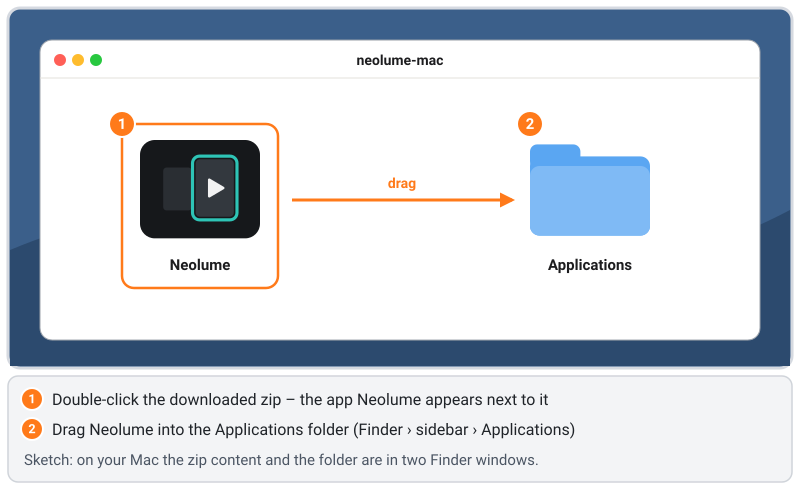
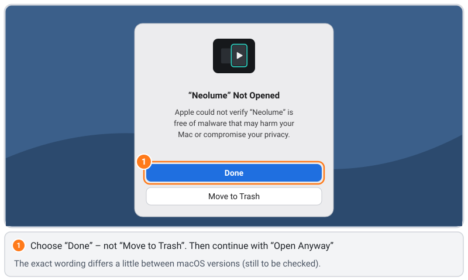
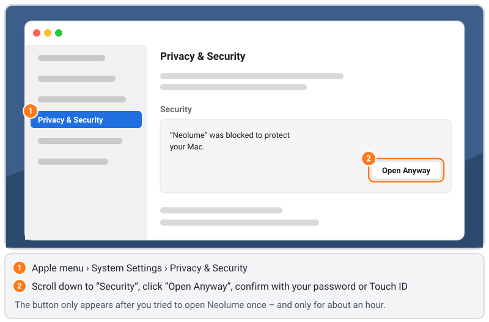
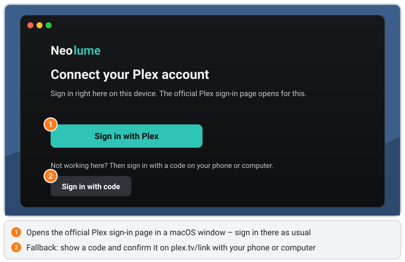

# Installing Neolume on a Mac – step by step

[Deutsche Fassung](mac.de.md) · [FAQ](../FAQ.md) · [Samsung 2014 guide](../INSTALL.md) · [Android TV guide](android-tv.md) · [Back to the overview](../../README.md)

This guide is written for people **without any technical background**. Follow it from top to bottom; every window and
button is named, and the important screens are shown as drawings. Plan about **5 minutes**.

> 🧪 **The Mac app is new and experimental.** Sign-in, profiles, Home, libraries, search and playback work on the
> maintainer’s Mac. Other areas still need more testing. If the download address in [step 3](#3-download-neolume) shows
> **Not Found**, no Mac version has been published yet – the table *Which TVs work?* in the [overview](../../README.md)
> shows the current state.

> **How to read this guide**
> - **This** is a **word on the screen** that you click (a button, a menu entry, a folder).
> - › means “then choose” (for example ** › System Settings › Privacy & Security**).
> - `This` is a **key on the keyboard** (for example `Esc`, `Enter`, `⌘ Cmd`).
> - The **drawings** are simplified sketches, not screenshots. Orange numbers show the order. **Grey bars** stand for
>   entries you do not need – your Mac shows text there.
> - Steps marked *(still to be checked)* have not been checked word for word on every macOS version. If it looks different
>   on your Mac, please tell us in an [issue](https://github.com/itsab1989/neolume/issues) so we can improve the guide.

## Contents

1. [What you need](#1-what-you-need)
2. [How it works (in one minute)](#2-how-it-works-in-one-minute)
3. [Download Neolume](#3-download-neolume)
4. [Move it to “Applications”](#4-move-it-to-applications)
5. [First start: allow the app once](#5-first-start-allow-the-app-once)
6. [Sign in and choose your profile](#6-sign-in-and-choose-your-profile)
7. [Using Neolume with mouse, trackpad and keyboard](#7-using-neolume-with-mouse-trackpad-and-keyboard)
8. [Updating](#8-updating)
9. [Uninstalling](#9-uninstalling)
10. [Where your sign-in is stored](#10-where-your-sign-in-is-stored)
11. [Troubleshooting](#11-troubleshooting)

---

## 1. What you need

- ✅ A **Mac with macOS 14 (Sonoma) or newer**, with an Apple chip (M1 and newer) or an Intel processor – the app contains
  both.
  - Where is the version? ** › About This Mac** → the line **macOS**.
- ✅ A **Plex Media Server** – at home on your network, or a server you have access to.
- ✅ Your **Plex account** (e-mail and password, or Google/Apple sign-in).

You do not need a Plex Pass, nothing has to be installed on your Plex server, and you do **not** need an Apple developer
account.

## 2. How it works (in one minute)

Neolume for the Mac is the **same app as on the TV** – the same screens, the same settings – in a small Mac window. It is
not in the Mac App Store. You download it as a zip file from Neolume’s **official GitHub release** and copy it into your
**Applications** folder like any other app.

Because the app is not sold through Apple, it has no Apple “notarisation” (that needs a paid Apple developer account).
macOS therefore asks you **once**, the first time you open it, whether you trust it ([step 5](#5-first-start-allow-the-app-once)).
After that it opens normally.

The Mac reaches plex.tv by itself, so you sign in **directly in the app** – you do not need the setup program or the helper
that the 2014 Samsung TVs use.

## 3. Download Neolume

1. Open this address in your browser (Safari, Chrome, Firefox …):

   ```text
   https://github.com/itsab1989/neolume/releases/latest/download/neolume-mac.zip
   ```

2. The file `neolume-mac.zip` lands in your **Downloads** folder (Safari: the arrow ⬇ at the top right of the window
   shows it).

## 4. Move it to “Applications”



1. Open the **Downloads** folder (Finder › **Downloads**, or the Downloads stack in the Dock) and **double-click**
   `neolume-mac.zip`. Next to it the app **Neolume** appears (Safari often unpacks the zip by itself – then the app is
   already there).
2. Open a second Finder window (`⌘ Cmd` + `N`) and click **Applications** in the sidebar.
3. **Drag Neolume** into **Applications**. Now you can delete the zip file.

Why Applications? Apps should live there – the app then stays in the same place for updates, and macOS treats it like every
other app.

## 5. First start: allow the app once



1. Open **Applications** and **double-click Neolume**.
2. macOS shows a message like **“Neolume” Not Opened – Apple could not verify “Neolume” is free of malware …**
   *(wording may differ between macOS versions)*. Click **Done** – **not** **Move to Trash**.

   This message does not mean that something is wrong with Neolume. macOS shows it for every app that is not notarised by
   Apple. The app is built from the public source code in this repository.



3. Open ** › System Settings › Privacy & Security** and scroll down to the section **Security**. There it says
   **“Neolume” was blocked to protect your Mac.** *(wording may differ between macOS versions)*
4. Click **Open Anyway** and confirm with your **password** or **Touch ID**.
5. macOS asks one last time – click **Open**. Neolume starts.

From now on Neolume opens with a normal double-click. The **Open Anyway** button only appears **after** you tried to open
the app once, and only for about an hour – if you do not see it, double-click Neolume again and go back to System Settings.

*Older macOS 14 (Sonoma):* Instead of steps 3–5 you can also **right-click** (or `Ctrl`-click) **Neolume** in
Applications › **Open** › **Open**. From macOS 15 on, this shortcut no longer works – then use **Open Anyway**.

## 6. Sign in and choose your profile



1. Neolume shows **Connect your Plex account**. Click **Sign in with Plex**.
2. A macOS window with the **official Plex sign-in page** opens. Sign in there as usual – with e-mail and password, Google,
   Apple or two-step verification. Neolume never sees your password; it only receives an access key from Plex.
3. *Does not work?* Choose **Sign in with code**. Neolume shows a short code; open **plex.tv/link** on your phone or
   computer, sign in and type the code.
4. If your account can see more than one server, choose **your server**.
5. **Who’s watching?** – click your profile. Profiles with a lock ask for their app PIN.
6. Home loads **Continue watching** and the newest items from your libraries.

Neolume stays signed in until you sign out under **Settings** or remove the device on plex.tv.

## 7. Using Neolume with mouse, trackpad and keyboard

You can simply **click** everything: cards, buttons, the icons in the bar on the left. Scrolling with the trackpad or the
mouse wheel moves rows and lists. The keyboard works too – just like the TV remote:

| Key | What it does |
|---|---|
| Arrow keys, `Enter` | Move, select |
| `Esc` | Back (in full screen: leaves full screen first) |
| `⌘ Cmd` + `F` | Search |
| `⌘ Cmd` + `,` | Settings |
| `⌘ Cmd` + `↑` | Back to the top of a list |
| `Space` | In the player: pause / continue |
| `J` / `L` | In the player: jump back / forward |
| `M`, `C`, `F` | In the player: sound off/on, subtitles, full screen |
| `R` `G` `Y` `B`, `I` | The colour buttons and Info of the remote (shown in the hint bar) |

Full screen: the green button at the top left of the window, or `Ctrl` + `⌘ Cmd` + `F`.

## 8. Updating

1. Download the new `neolume-mac.zip` as in [step 3](#3-download-neolume) and unpack it.
2. Drag the new **Neolume** into **Applications** and choose **Replace**. Quit Neolume first if it is open
   (`⌘ Cmd` + `Q`).

Your sign-in and your settings stay. Every version is signed with the same Neolume certificate, so macOS does not ask
again for access to the app’s data. Only if macOS shows the message from [step 5](#5-first-start-allow-the-app-once) again,
allow it once more.

## 9. Uninstalling

1. Quit Neolume (`⌘ Cmd` + `Q`).
2. Drag **Neolume** from **Applications** to the **Trash**.
3. Optional – also remove the stored data: Finder › **Go › Go to Folder …** (`⇧ Shift` + `⌘ Cmd` + `G`), type
   `~/Library/Containers`, and drag the folder whose name contains **neolume** to the Trash.
4. Optional: on plex.tv under **Settings › Devices** remove the Neolume entry of this Mac.

## 10. Where your sign-in is stored

To be honest: because this version has no paid Apple developer account, it may not use the Mac’s **keychain**. Your
sign-in and the app’s keys are stored as protected files in the app’s own area (`~/Library/Containers/…`). Only your user
account can read them, and other apps have to ask macOS for permission. That is less strong than the keychain: someone who
sits at your unlocked Mac, or a program with “Full Disk Access”, can get to them. **Sign out** in Neolume deletes the files.

## 11. Troubleshooting

### “Neolume” cannot be opened / is damaged
- Use **Open Anyway** as in [step 5](#5-first-start-allow-the-app-once).
- If macOS says the app is **damaged**, the download was probably incomplete. Delete the app and the zip, download again
  and unpack again.

### I clicked “Move to Trash” by mistake
Take Neolume back out of the Trash (right-click › **Put Back**) or download it again, then start again with
[step 5](#5-first-start-allow-the-app-once).

### I do not see “Open Anyway”
The button appears only after you tried to open Neolume, and only for about an hour. Double-click Neolume in Applications,
click **Done**, then open **System Settings › Privacy & Security** again.

### The sign-in window does not open or stays empty
- Is the Mac online? Open any website.
- Choose **Sign in with code** and confirm the code on **plex.tv/link**.

### Server not found / no libraries
- Is the Plex Media Server switched on and signed in with the same Plex account?
- At home: Mac and server are on the same network? Away from home: is remote access switched on for the server
  (Plex: **Settings › Remote Access**)?

### The window is too small or too big
Drag the window edge – Neolume adjusts its layout to the window size. For the TV look use full screen.
